# Ommatix

**Indexación Espacial y Percepción Incremental para Agentes de Interfaz Gráfica**

🇬🇧 [Read in English](README.md)

Ommatix es un motor de percepción local que permite a un agente basado en LLM operar un
escritorio de forma segura. Convierte los frames de pantalla en elementos de interfaz con
identificadores estables, vuelve a analizar sólo las regiones que cambiaron y entrega el
resultado mediante el [Model Context Protocol](https://modelcontextprotocol.io). El agente
elige un elemento por su identificador; Ommatix conserva la geometría, comprueba que la
observación del agente siga vigente, actúa a través del sistema operativo e informa lo que
pudo verificar. La percepción vive aquí; el razonamiento, en el agente.

> **¿Por qué "Ommatix"?** El sistema recibe el nombre de Ommatix en referencia a los
> omatidios (*ommatidia*), las unidades fotorreceptoras independientes que conforman el ojo
> compuesto de insectos de vuelo rápido. De forma análoga a cómo cada omatidio procesa
> cambios locales de luminancia en paralelo sin saturar el sistema nervioso central, Ommatix
> divide el framebuffer de la pantalla en una matriz espacial de celdas independientes,
> procesando únicamente las regiones con actividad visual y entregando al agente
> identificadores estables de elementos en lugar de coordenadas.

## La tesis

Ommatix implementa la tesis *Percepción visual incremental y grounding temporal seguro para
agentes de escritorio: fusión espacial, caché perceptual y control por identificadores
mediante MCP*. Su dossier de ingeniería e investigación es la línea base de este repositorio:
[`docs/thesis/`](docs/thesis/README.md).

| Parte | Dónde |
|---|---|
| Auditoría técnica, marco de tesis, SDD, requisitos (RF-01..18, RNF-01..10) | [capítulos 00–03](docs/thesis/README.md) |
| Algoritmos: percepción incremental, fusión espacial, caché de íconos, identidad temporal | [capítulo 04](docs/thesis/04_ALGORITMOS_CORE.md) |
| Plan TDD (76 pruebas planificadas), plan de integración S0–S4 y definición de terminado | [capítulos 05–06](docs/thesis/05_TDD_PLAN_Y_MATRIZ.md) |
| Contrato MCP, errores, schemas JSON y ejemplos | [capítulo 07](docs/thesis/07_CONTRATOS_MCP_Y_ERRORES.md), [`contratos/`](docs/thesis/contratos/README.md) |
| Seguridad, protocolo de evaluación, runbook, referencias | capítulos 08–12 |
| 32 escenarios Gherkin (BDD-01..32) y matrices de trazabilidad | [`features/`](docs/thesis/features), [`matrices/`](docs/thesis/matrices) |
| Oráculo de referencia en Python (48 pruebas) y validador del paquete | [`referencia_ejecutable/`](docs/thesis/referencia_ejecutable) |
| Decisiones de arquitectura ADR-0001..0014, en inglés con resumen en español | [`docs/adr/`](docs/adr/README.md) |

## Cómo funciona

```mermaid
flowchart LR
    CAP[Captura<br/>frame + dirty rects] --> PLAN[Algoritmo 1<br/>diff exacto por tiles,<br/>cierre halo, presupuesto]
    PLAN --> PER[Detector + OCR<br/>en las regiones planificadas]
    PER --> FUS[Algoritmo 2<br/>fusión espacial,<br/>orden de lectura, etiquetas]
    FUS --> ICO[Algoritmo 3A<br/>caché de íconos<br/>con rechazo]
    ICO --> TRK[Algoritmo 3B<br/>IDs de sesión,<br/>revisiones]
    TRK --> SNAP[Commit atómico<br/>snapshot inmutable]
    SNAP -->|observe_screen| AG[Agente LLM]
    AG -->|execute_action:<br/>target_id + revisión| GATE[Compuerta de<br/>política y acción]
    GATE --> ACT[Actuador del SO] --> VER[Verificador de efecto]
```



Un paso que falla no publica nada: el motor conserva las regiones pendientes, se declara
degradado y bloquea las acciones hasta tener una observación consistente. Las acciones son
simulaciones (dry run) salvo que el agente y una política local las permitan. Más detalle en
la [visión general de la arquitectura](docs/architecture/overview.es.md).

## Estado

**El dossier es la especificación; el código se está poniendo al día con él.**

- `docs/thesis/` contiene el dossier consolidado. Su oráculo (48/48) y su validador corren en
  la integración continua.
- `src/` contiene un prototipo escrito al arrancar el repositorio, antes de consolidar el
  dossier. Comparte la arquitectura (Rust, crates hexagonales, MCP por stdio, dry-run por
  defecto, reloj inyectado) pero no el pipeline: tiene un detector de color plano sin OCR,
  celdas con hash, una escena mutable y siete herramientas MCP que devuelven coordenadas.
  Las etapas de abajo lo reemplazan. La
  [visión general](docs/architecture/overview.es.md#dónde-está-el-código-hoy) detalla las
  diferencias.
- El núcleo de la tesis de S1 (algoritmos 1 y 2, staging y commit) está en `ommatix-domain`,
  probado con los casos del oráculo pero aún sin uso en el pipeline en ejecución.
- Primera plataforma: **Windows 11 x64**, un monitor, DPI de 100/125/150 %
  ([ADR-0008](docs/adr/0008-one-real-platform-first.md), aprobada el 14-oct-2026).

## Hoja de ruta

Según el [capítulo 06 de la tesis](docs/thesis/06_PLAN_INTEGRACION_DOD_Y_ROADMAP.md):

- [x] Dossier consolidado en el repositorio; oráculo y validador en la integración continua
- [ ] **S0, spike:** hardware, detectores y OCR candidatos, licencias y exportación ONNX,
  proveedor de ejecución, captura DXGI con stride, compatibilidad del cliente MCP
- [x] **S1, core geométrico e incremental:** diff exacto por tiles, cierre halo, agrupación
  de renglones, propiedad del texto, staging y commit (UT-01..26, BDD-01..10) en
  `ommatix-domain`; pruebas del oráculo portadas a Rust. Se conectan al pipeline en
  ejecución en S2–S3
- [ ] **S2, identidad, caché y contrato:** registro temporal con tombstones, caché de íconos,
  contrato MCP con `rmcp`, dry run honesto (UT-27..43, CT)
- [ ] **S3, adaptadores reales y bucle de acción en Windows 11:** DXGI, ONNX Runtime,
  `SendInput`, política, parada y verificación del efecto; se retiran los adaptadores de
  macOS y X11 del arranque
- [ ] **S4, aceptación:** 450 corridas de extremo a extremo en aplicaciones controladas,
  benchmarks, soak e informe de aceptación

## Inicio rápido

Requiere Rust estable (fijado en `rust-toolchain.toml`) y Python 3.11 o posterior para las
comprobaciones de la tesis.

```bash
# Comprobaciones de la tesis (desde docs/thesis/; el validador necesita jsonschema)
pip install -r docs/thesis/requirements-validacion.txt
cd docs/thesis && python referencia_ejecutable/run_tests.py && python validar_paquete.py && cd -

# Prototipo del arranque
cargo run -- demo                       # sesión de escritorio con guion, una línea por frame
cargo run -- serve --source sim         # servidor MCP sobre un escritorio simulado interactivo
cargo run --features screen -- serve --source screen   # pantalla real, entrada en dry-run
```

La entrada del prototipo es dry-run salvo que se compile con `native-input` y se arranque con
`--source screen --input native`. Sus herramientas MCP (`perceive`, `list_elements`,
`element_at`, `elements_in_rect`, `click`, `type_text`, `press_key`) son el contrato del
arranque; S2 las reemplaza por el contrato de la tesis: `observe_screen`, `execute_action` y
`get_engine_metrics`.

## Estructura del repositorio

```text
src/                       workspace de Cargo (monolito modular, ADR-0014)
├── domain/                ommatix-domain        núcleo puro, sin I/O
├── application/           ommatix-application   casos de uso y traits de los puertos
├── adapters/
│   ├── capture/           ommatix-adapter-capture  captura de frames
│   ├── vision/            ommatix-adapter-vision   detección (y OCR, desde S3)
│   ├── input/             ommatix-adapter-input    entrada del SO
│   ├── sim/               ommatix-adapter-sim      escritorio simulado para fixtures deterministas
│   └── mcp/               ommatix-adapter-mcp      servidor MCP por stdio (adaptador conductor)
├── app/                   ommatix               raíz de composición y binario CLI
└── acceptance/            ommatix-acceptance    escenarios Gherkin ejecutables
docs/
├── thesis/                el dossier de la tesis: capítulos, contratos, matrices, oráculo
├── adr/                   registros de decisiones (los del arranque en adr/bootstrap/)
├── architecture/          visión general (EN/ES)
├── diagrams/              diagramas Mermaid
└── reviews/               revisiones de código: hallazgo, corrección, prueba de regresión
```

## Desarrollo

```bash
git config core.hooksPath .githooks     # una vez: fmt + clippy + tests antes de commit/push
cargo fmt --all
cargo clippy --workspace --all-targets -- -D warnings
cargo test --workspace                  # tests unitarios, de integración y Gherkin
```

Las reglas de contribución, para personas y agentes de IA, están en [AGENTS.md](AGENTS.md).

## Documentación

- [Dossier de la tesis](docs/thesis/README.md)
- [Visión general de la arquitectura](docs/architecture/overview.es.md) · [Architecture overview](docs/architecture/overview.md)
- [Registros de decisiones (ADR)](docs/adr/README.md)
- [Diagramas](docs/diagrams/README.md)
- [Glosario / Glossary](docs/glossary.md)
- [Revisión de código del MVP del arranque](docs/reviews/2026-10-14-mvp-review.md)
