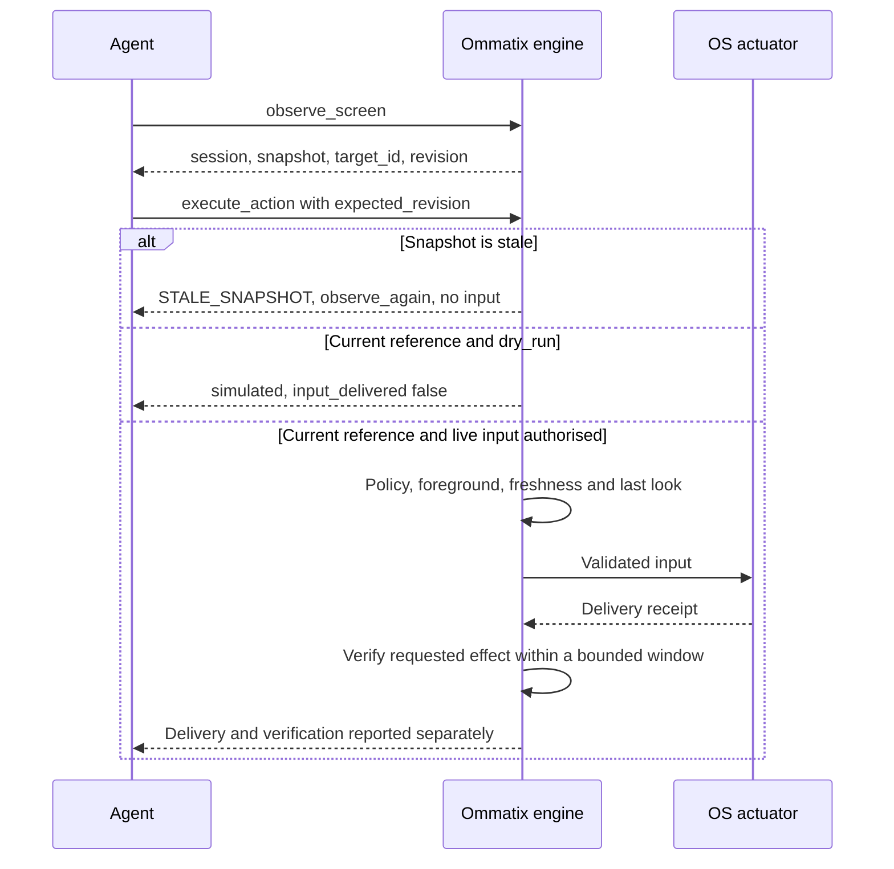

# Ommatix

**Spatial Indexing and Incremental Perception for GUI Agents**

[](https://github.com/Yosoyepa/Ommatix/actions/workflows/ci.yml)
[](#licencia)
[](LICENSE-DOCS)
[](rust-toolchain.toml)
[](docs/thesis/07_CONTRATOS_MCP_Y_ERRORES.md)
[](#estado-del-proyecto)
[](docs/adr/0008-one-real-platform-first.md)

🇬🇧 [Read in English](README.md)

<picture>
  <source media="(max-width: 640px) and (prefers-color-scheme: dark)" srcset="docs/assets/readme/hero-mobile-dark.svg">
  <source media="(max-width: 640px)" srcset="docs/assets/readme/hero-mobile-light.svg">
  <source media="(prefers-color-scheme: dark)" srcset="docs/assets/readme/hero-dark.svg">
  
</picture>

Ommatix es un prototipo de investigación de tesis que permite a un agente LLM dirigirse a
elementos del escritorio por **IDs de sesión y revisiones en lugar de coordenadas**. Su motor
local en Rust analiza las regiones que cambiaron frente al último frame confirmado, con un
refresco completo explícito cuando corresponde. La actuación falla de forma segura: las
acciones son dry run por defecto; la entrada real requiere la política del operador y una
observación vigente. [Diseño y límites de confianza →](docs/architecture/overview.es.md)

<p align="center">
  <a href="docs/assets/readme/protocol-demo.mp4"></a>
</p>

<p align="center"><sub>Ilustración sobre un escritorio simulado, generada a partir de los <a href="docs/thesis/contratos/ejemplos">ejemplos del contrato</a>; no es una grabación de pantalla.
<a href="docs/assets/readme/protocol-demo.mp4">Ver el vídeo de 44 segundos</a> (MP4 sin audio, subtítulos en inglés) ·
<a href="tools/readme-media/README.md">cómo se hace</a></sub></p>

## Por qué Ommatix

Una coordenada identifica una posición en una imagen; no establece qué control estará allí
cuando llegue la entrada. Ommatix hace explícito el vínculo entre observación y acción,
y mantiene la percepción separada del razonamiento del agente.
[Problema de investigación →](docs/thesis/01_TESIS_Y_MARCO_TEORICO.md)

| Idea | Qué hace el motor |
|---|---|
| **Percepción incremental** | Planifica regiones cambiadas, conserva cambios pendientes tras un fallo y recurre al refresco completo por geometría o presupuesto. [Algoritmo 1](docs/thesis/04_ALGORITMOS_CORE.md) |
| **Identidad estable** | Sigue elementos dentro de una sesión, aumenta la revisión cuando cambian propiedades relevantes para actuar y se abstiene ante continuidad ambigua. [Algoritmos 3A–3B](docs/thesis/04_ALGORITMOS_CORE.md) |
| **Actuación con denegación por defecto** | Comprueba snapshot, objetivo, revisión, permisos y primer plano antes de entregar. [ADR-0007](docs/adr/0007-fail-closed-actuation-and-honest-simulation.md) |
| **Contrato MCP** | Ofrece observaciones estructuradas, acciones y métricas por stdio; la geometría queda dentro del motor. [Contrato](docs/thesis/07_CONTRATOS_MCP_Y_ERRORES.md) |

## Cómo funciona

<picture>
  <source media="(max-width: 640px) and (prefers-color-scheme: dark)" srcset="docs/assets/readme/pipeline-mobile-dark.svg">
  <source media="(max-width: 640px)" srcset="docs/assets/readme/pipeline-mobile-light.svg">
  <source media="(prefers-color-scheme: dark)" srcset="docs/assets/readme/pipeline-dark.svg">
  
</picture>

Cada observación publica juntos el frame base, el registro de identidad y el snapshot. Si
una etapa falla no publica nada, conserva las regiones pendientes y bloquea las acciones
mientras está degradado. La evidencia opcional de UI Automation se fusiona con la visión y
nunca lee el valor de un campo. [Arquitectura](docs/architecture/overview.es.md) ·
[Evidencia de accesibilidad](docs/adr/0017-ui-automation-evidence-fused-with-vision.md)

<details>
<summary>Un ciclo observar → actuar, incluido el rechazo de un snapshot obsoleto</summary>



Fuentes: [contrato MCP](docs/thesis/07_CONTRATOS_MCP_Y_ERRORES.md) y
[secuencia de acción](docs/diagrams/action-sequence.md). Toda entrega agota el snapshot;
la acción siguiente necesita una nueva observación.

</details>

## El contrato MCP

| Herramienta | Propósito |
|---|---|
| `observe_screen` | Una página de elementos con `target_id`, `revision`, rol, etiqueta y accionabilidad; consulta y paginación ligada al snapshot. |
| `execute_action` | `click`, `type` o `scroll` sobre un elemento en una revisión esperada; dry run por defecto. |
| `get_engine_metrics` | Modo, recuentos de observaciones y acciones, regiones pendientes y estado de carga de modelos. |

[Esquemas y ejemplos](docs/thesis/contratos/README.md) ·
[Errores y perfiles del protocolo](docs/thesis/07_CONTRATOS_MCP_Y_ERRORES.md) ·
[Configuración y metadatos de tiempos](docs/guide/configuration.es.md#contrato-y-diagnósticos)

<details>
<summary>Una solicitud y respuesta reales de dry run del dossier</summary>

Argumentos de la herramienta de [click_input.json](docs/thesis/contratos/ejemplos/click_input.json),
JSON literal (sólo se reformatean espacios):

```json
{
  "request_id": "demo-click-001",
  "session_id": "demo-session",
  "snapshot_id": "s17",
  "geometry_epoch": 1,
  "target_id": "e7",
  "expected_revision": 3,
  "action": "click",
  "dry_run": true
}
```

Respuesta estructurada de [simulated_output.json](docs/thesis/contratos/ejemplos/simulated_output.json):

```json
{
  "schema_version": "1.0",
  "request_id": "demo-click-001",
  "status": "simulated",
  "target_id": "e7",
  "snapshot_id": "s17",
  "input_delivered": false,
  "verified": false
}
```

</details>

## Modelo de seguridad

> [!CAUTION]
> La entrada real está **apagada por defecto**. Requiere un binario Windows con `sendinput`,
> `--source dxgi`, `--input sendinput`, `actuation_enabled = true` y una lista
> `allowed_applications` no vacía del operador, y `dry_run: false` del agente. El operador
> controla la parada y cualquier ventana fijada. [Lea la guía antes de habilitarla.](docs/guide/live-input.es.md)

<picture>
  <source media="(max-width: 640px) and (prefers-color-scheme: dark)" srcset="docs/assets/readme/gate-mobile-dark.svg">
  <source media="(max-width: 640px)" srcset="docs/assets/readme/gate-mobile-light.svg">
  <source media="(prefers-color-scheme: dark)" srcset="docs/assets/readme/gate-dark.svg">
  
</picture>

`simulated` no afirma entrega; `input_delivered` no afirma efecto; `indeterminate` nunca
provoca un reintento automático. Con UI Automation, la escritura espera el foco de teclado
en el elemento objetivo entre su clic de enfoque y sus teclas.
[Semántica de acción](docs/adr/0007-fail-closed-actuation-and-honest-simulation.md) ·
[Escritura en dos fases](docs/adr/0018-two-phase-type-with-element-level-focus-confirmation.md)

> [!IMPORTANT]
> El texto de pantalla, OCR y accesibilidad es dato no confiable y no concede permisos.
> El motor no entrega capturas al cliente ni registra valores de pantalla por defecto.
> El envío de observaciones a un modelo externo es el límite de datos del cliente; AG-02
> autorizó explícitamente observaciones sintéticas de las aplicaciones de prueba para sus
> proveedores. [Privacidad](docs/thesis/08_SEGURIDAD_Y_PRIVACIDAD.md) · [Protocolo AG-02](docs/thesis/09_EVALUACION_EXPERIMENTAL.md#911-ag-02-un-agente-sólo-llm-con-ommatix-por-mcp)

## Resultados de un vistazo

<picture>
  <source media="(max-width: 640px) and (prefers-color-scheme: dark)" srcset="docs/assets/readme/results-mobile-dark.svg">
  <source media="(max-width: 640px)" srcset="docs/assets/readme/results-mobile-light.svg">
  <source media="(prefers-color-scheme: dark)" srcset="docs/assets/readme/results-dark.svg">
  
</picture>

*Fuente: [capítulo 09 §9.11.1–3](docs/thesis/09_EVALUACION_EXPERIMENTAL.md#911-ag-02-un-agente-sólo-llm-con-ommatix-por-mcp),
18–19 de octubre de 2026. La fase 1 puntúa elecciones en dry run; la fase 2 combina el
veredicto del agente con un oráculo del SO. Ambas incluyen las abstenciones correctas.*

La fase 2 registró **0 falsos éxitos y 0 eventos de seguridad definidos por el protocolo**
en cada modelo. La fase 1 también informa cero con su puntuación implementada, que exime el
veredicto del señuelo: con la regla estricta serían 9/11, 10/11 y 9/11, y un falso éxito
por modelo. Estas definiciones importan al interpretar la figura.

| Latencia de percepción medida | p95 en caliente | Contexto |
|---|---:|---|
| Escenario de cambio en una región (`incr1`, AD) | 136,3 ms | UI Automation + DirectML; planes mayormente regionales. |
| Escenario de cambio en dos regiones (`incr2`, AD) | 137,6 ms | La regla adaptativa selecciona un **refresco completo**. |

Fuente: [S0 §16](docs/thesis/S0_RESULTADOS.md#16-inc-07-política-adaptativa-entre-refresco-completo-y-regional-en-vivo-con-uia-1065),
15 de octubre de 2026; Ryzen 7 5700X, RX 6700 XT, una aplicación sintética y un detector fijado.
RNF-05 está **aceptado por alcance**, con «incremental» entendido como escenario de cambio.
[Decisión de alcance](docs/thesis/06_PLAN_INTEGRACION_DOD_Y_ROADMAP.md#67-definition-of-done-del-producto)

> [!WARNING]
> Evidencia preliminar: una serie por modelo y fase, dos aplicaciones sintéticas, once metas
> fijas y una máquina. Difieren los presupuestos y puntos de acceso. No hay línea base VLM;
> AG-03 está planificado, sin ejecutar. No se han medido precisión ni cobertura de percepción,
> y la latencia citada no mide el bucle del agente AG-02. Los resultados no establecen una
> clasificación de modelos, una tasa general de éxito ni una ventaja frente a agentes VLM.

[Leer el protocolo experimental, resultados y límites →](docs/thesis/09_EVALUACION_EXPERIMENTAL.md)

## Inicio rápido

Use [Rust 1.99.0 fijado](rust-toolchain.toml). Las comprobaciones de la tesis necesitan Python 3.11+.

```bash
cargo run -- demo   # simulated observations and a dry-run click
cargo run -- serve  # MCP over stdio on the simulated desktop
```

Para un cliente MCP, compile con `cargo build --locked`, ponga el binario en `PATH` (o use su ruta absoluta) y configure:

```json
{"mcpServers":{"ommatix":{"command":"ommatix","args":["serve"]}}}
```

> [!TIP]
> El escritorio simulado no necesita modelos ni acceso a pantalla. [Primeros pasos](docs/guide/getting-started.es.md) · [Configuración](docs/guide/configuration.es.md) · [Instalación y reversión](docs/thesis/S4_INSTALACION_Y_REVERSION.md).

## Estado del proyecto

A **19 de octubre de 2026**, evidencia comprobada contra el commit **`875495f`**.
El [dossier](docs/thesis/README.md) es la especificación; la tabla describe el alcance actual.

| Área | Estado actual |
|---|---|
| S0 · viabilidad | Detector candidato y OCR medidos; faltan validar un detector de producto e instalar en una máquina limpia. |
| S1 · núcleo geométrico | Implementados el diff por tiles, plan de regiones, fusión espacial y snapshots transaccionales. |
| S2 · identidad y contrato | Implementados el registro temporal, caché de íconos curados y las tres herramientas MCP. |
| S3 · integración Windows | DXGI, SendInput, ONNX, OCR de Windows y UI Automation opcionales; evidencia supervisada en el perfil acordado. IT-01–04 siguen parciales. |
| S4 · aceptación | Protocolo reducido: cinco flujos, cada uno 10/10 sin falsos éxitos. El corpus y la evaluación más amplios siguen diferidos. |
| Definition of Done | **6/10 casillas marcadas: 1, 4, 5, 6, 8, 9.** La 2 y 3 tienen aceptaciones por alcance, no cumplimiento; a la 7 le faltan memoria viva de caché de íconos activa y variación entre corridas; la 10 conserva integración parcial e instalación limpia. |

Fuente: [capítulo 06 §6.7](docs/thesis/06_PLAN_INTEGRACION_DOD_Y_ROADMAP.md#67-definition-of-done-del-producto).
Primera plataforma real: Windows 11 x64, un monitor, DPI 100 % y un tema para el MVP reducido.
[Límites de plataforma](docs/thesis/S4_INSTALACION_Y_REVERSION.md) · [Qué cambió → CHANGELOG](docs/thesis/CHANGELOG.md)

## Documentación

| Para leer sobre… | Empiece aquí |
|---|---|
| Ejecutar y configurar el motor | [Primeros pasos](docs/guide/getting-started.es.md) · [Configuración](docs/guide/configuration.es.md) · [Entrada real](docs/guide/live-input.es.md) |
| Especificación y evidencia de investigación | [Dossier de tesis](docs/thesis/README.md) · [Evaluación](docs/thesis/09_EVALUACION_EXPERIMENTAL.md) |
| Crates, puertos y límites de confianza | [Arquitectura](docs/architecture/overview.es.md) · [Estructura y desarrollo](docs/guide/development.es.md) |
| Decisiones y diagramas | [ADRs](docs/adr/README.md) · [Diagramas](docs/diagrams/README.md) |
| Revisiones, terminología e índice completo | [Revisiones](docs/reviews) · [Glosario](docs/glossary.md) · [Mapa documental](docs/README.md) |

## Investigación y cita

El repositorio acompaña la tesis de percepción visual incremental y grounding temporal seguro
para agentes de escritorio. Cite el software con [CITATION.cff](CITATION.cff); el
[dossier](docs/thesis/README.md) es la especificación pública de investigación. No se afirma una publicación ni un DOI.

```bibtex
@software{ommatix,
  author = {Andrade Unigarro, Juan Carlos},
  title = {Ommatix: Spatial Indexing and Incremental Perception for GUI Agents},
  url = {https://github.com/Yosoyepa/Ommatix}
}
```

## Contribuir

Lea [CONTRIBUTING.md](.github/CONTRIBUTING.md) y las reglas canónicas de [AGENTS.md](AGENTS.md).
Personas y agentes de programación siguen las mismas reglas. Use los
[formularios](https://github.com/Yosoyepa/Ommatix/issues/new/choose) para fallos, propuestas y
documentación; comunique vulnerabilidades por [el canal privado](.github/SECURITY.md).
[Conducta de la comunidad](.github/CODE_OF_CONDUCT.md) · [Soporte](.github/SUPPORT.md)

## Licencia

Código, herramientas y aplicaciones de prueba: [MIT](LICENSE-MIT) OR [Apache-2.0](LICENSE-APACHE).
Documentación, dossier y medios del README: [CC BY 4.0](LICENSE-DOCS).
La [adaptación del Contributor Covenant](.github/CODE_OF_CONDUCT.md) es CC BY-SA 4.0.
Copyright 2026 Juan Carlos Andrade Unigarro. [Decisión de licencia](docs/adr/0023-licence-and-reduced-mvp-scope.md)

No se redistribuyen pesos, ONNX Runtime ni `DirectML.dll`. Conservan sus licencias y requieren
descargas gestionadas por el operador y fijadas por SHA-256; no se usan los pesos AGPL-3.0.
Las dependencias de medios, sólo de desarrollo, conservan sus términos.
[Artefactos de terceros](docs/thesis/S4_REPRODUCIBILIDAD.md#3-licencias-del-grafo-de-dependencias) · [Herramientas de medios](tools/readme-media/README.md)
