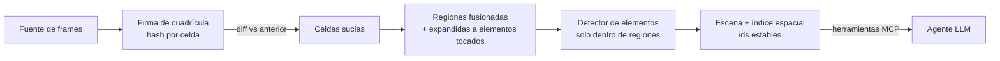

# Ommatix

**Indexación Espacial y Percepción Incremental para Agentes de Interfaz Gráfica**

🇬🇧 [Read in English](README.md)

Ommatix es un motor de percepción determinista y de baja latencia que permite a agentes
basados en LLM operar un escritorio gráfico. En lugar de enviar cada captura de pantalla a
un modelo de visión lento, Ommatix divide el framebuffer en una cuadrícula de celdas
independientes, vuelve a analizar **solo las celdas que cambiaron**, mantiene cada elemento
detectado en un índice espacial y responde al agente con **coordenadas exactas en píxeles**
a través del [Model Context Protocol](https://modelcontextprotocol.io).

> **¿Por qué "Ommatix"?** El sistema recibe el nombre de Ommatix en referencia a los
> omatidios (*ommatidia*), las unidades fotorreceptoras independientes que conforman el ojo
> compuesto de insectos de vuelo rápido. De forma análoga a cómo cada omatidio procesa
> cambios locales de luminancia en paralelo sin saturar el sistema nervioso central, Ommatix
> divide el framebuffer de la pantalla en una matriz espacial de celdas independientes,
> procesando únicamente las regiones con actividad visual y entregando coordenadas
> deterministas al agente.

## Estado

`v0.1.0`: **MVP en construcción.** El agente puede percibir y actuar (clic, escribir,
teclas) de extremo a extremo sobre un escritorio simulado, frames grabados o, con feature
flags, la pantalla real. Los criterios de aceptación del MVP son features Gherkin
ejecutables. Ver la [hoja de ruta](#hoja-de-ruta).

## Cómo funciona



Una pantalla estática cuesta una pasada de hashing y nada más; escribir en un campo de
texto vuelve a analizar 3 de 260 celdas en la sesión de demo. Más detalle en
[docs/architecture](docs/architecture/overview.es.md).

## Inicio rápido

Requiere Rust estable (fijado en `rust-toolchain.toml`).

```bash
cargo run -- demo                       # sesión de escritorio guionada, una línea por frame
cargo run -- demo --theme dark          # la misma sesión con tema oscuro (o contrasting-wallpaper)
cargo run -- serve --source sim         # servidor MCP sobre un escritorio simulado interactivo
cargo run -- serve --source images --images ./captures/sesion-01    # reproducir PNGs
cargo run --features screen -- serve --source screen                # pantalla real, entrada dry-run
cargo run --features screen,native-input -- serve --source screen --input native  # entrada real
```

La entrada es **dry-run por defecto**: las acciones se validan y registran pero no llegan al
sistema operativo salvo que compiles con `native-input` y pases `--input native` (ADR-0008).
La entrada nativa exige `--source screen`, para que los clics caigan en el monitor que ve el
agente, con el escalado HiDPI aplicado (ADR-0012). La captura en vivo en Linux necesita las
librerías de sistema listadas en [AGENTS.md](AGENTS.md#toolchain).

### Uso desde un cliente MCP

```json
{
  "mcpServers": {
    "ommatix": { "command": "/ruta/a/ommatix", "args": ["serve", "--source", "screen"] }
  }
}
```

| Herramienta | Propósito |
|---|---|
| `perceive` | Captura un frame, re-analiza regiones cambiadas y devuelve elementos añadidos / actualizados / eliminados |
| `list_elements` | Todos los elementos en orden de lectura, con punto de clic |
| `element_at` | Elementos bajo `(x, y)`, el más específico primero |
| `elements_in_rect` | Elementos que intersectan un rectángulo |
| `click` | Clic en un elemento por id (preferido) o en una coordenada |
| `type_text` | Escribe texto imprimible en el control enfocado |
| `press_key` | Pulsa Enter, Tab, Escape, Retroceso, flechas… |

Cada acción espera a que la pantalla se estabilice (sin cambios durante 2 frames, como
máximo 1 s) y devuelve el cambio neto. Una acción realizada nunca se informa como fallida:
si observar la pantalla después falla, el resultado trae `performed` y un `observe_error`,
para que el agente no la repita. Las medidas de tiempo viajan en `_meta`, así
`structuredContent` es reproducible (ADR-0012).

## Estructura del repositorio

```text
src/                       Miembros del workspace de Cargo (monolito modular)
├── domain/                ommatix-domain        núcleo puro: frame, cuadrícula, regiones, escena, índice
├── application/           ommatix-application   puertos (traits) + casos de uso: percibir, observar, actuar
├── adapters/
│   ├── capture/           ommatix-adapter-capture  FrameSource: guion, secuencia PNG, pantalla
│   ├── vision/            ommatix-adapter-vision   ElementDetector: detector por regiones planas
│   ├── input/             ommatix-adapter-input    InputController: dry-run, nativo (enigo)
│   ├── sim/               ommatix-adapter-sim      escritorio simulado con temas (FrameSource + InputController)
│   └── mcp/               ommatix-adapter-mcp      servidor MCP stdio (adaptador conductor)
├── app/                   ommatix               raíz de composición + binario CLI
└── acceptance/            ommatix-acceptance    features Gherkin (features/*.feature) + pasos cucumber
docs/
├── adr/                   registros de decisiones de arquitectura
├── architecture/          visión general (EN/ES)
├── diagrams/              diagramas Mermaid (contexto, hexágono, pipeline)
└── reviews/               revisiones de código: hallazgo → corrección → prueba de regresión
```

## Desarrollo

```bash
git config core.hooksPath .githooks     # una vez: fmt + clippy + tests antes de commit/push
cargo fmt --all
cargo clippy --workspace --all-targets -- -D warnings
cargo test --workspace                  # tests unitarios, de integración y Gherkin
cargo test -p ommatix-acceptance        # solo la especificación Gherkin
cargo test -p ommatix-adapter-vision --release -- --ignored --nocapture   # benchmark del detector
```

Las reglas de contribución (para personas y agentes de IA) están en [AGENTS.md](AGENTS.md).

## Hoja de ruta

- [x] Diff por cuadrícula, fusión de regiones, índice espacial, identidad estable de elementos
- [x] Detector determinista por regiones planas, con el mismo resultado en temas claro, oscuro y contrastado
- [x] Servidor MCP (stdio) con herramientas de percepción
- [x] Fuentes sintética, secuencia PNG y pantalla en vivo
- [x] Herramientas de actuación (clic, texto, teclas) detrás de un puerto `InputController`, dry-run por defecto
- [x] Las acciones esperan a que la pantalla se estabilice; mapeo de coordenadas HiDPI y multi-monitor
- [x] Especificación Gherkin ejecutable sobre un escritorio simulado
- [ ] Validación en un escritorio real (Linux X11/Wayland, Windows, macOS)
- [ ] Benchmarks (criterion) y presupuesto de latencia por etapa
- [ ] Adaptador de detección de texto / OCR, clasificación de elementos (botón, texto, icono)
- [ ] Detección paralela por región y hashing SIMD
- [ ] Banco de evaluación con sesiones GUI grabadas

## Documentación

- [Visión general de la arquitectura](docs/architecture/overview.es.md) · [Architecture overview](docs/architecture/overview.md)
- [Registros de decisiones (ADR)](docs/adr/README.md)
- [Features de aceptación (Gherkin)](src/acceptance/features)
- [Diagramas](docs/diagrams/README.md)
- [Revisión de código del MVP](docs/reviews/2026-10-14-mvp-review.md)
- [Glosario / Glossary](docs/glossary.md)
