# Ommatix

**Indexación Espacial y Percepción Incremental para Agentes de Interfaz Gráfica**

🇬🇧 [Read in English](README.md)

Ommatix es un motor de percepción local que permite a un agente basado en LLM operar un
escritorio de forma segura. Convierte los frames de pantalla en elementos de interfaz con
identificadores estables, vuelve a analizar sólo las regiones que cambiaron y entrega el
resultado mediante el [Model Context Protocol](https://modelcontextprotocol.io). El agente
elige un elemento por su identificador; Ommatix conserva la geometría, comprueba que la
observación del agente siga vigente, actúa a través del sistema operativo e informa lo que
pudo verificar. La percepción vive aquí; el razonamiento, en el agente.

> **¿Por qué "Ommatix"?** El sistema recibe el nombre de Ommatix en referencia a los
> omatidios (*ommatidia*), las unidades fotorreceptoras independientes que conforman el ojo
> compuesto de insectos de vuelo rápido. De forma análoga a cómo cada omatidio procesa
> cambios locales de luminancia en paralelo sin saturar el sistema nervioso central, Ommatix
> divide el framebuffer de la pantalla en una matriz espacial de celdas independientes,
> procesando únicamente las regiones con actividad visual y entregando al agente
> identificadores estables de elementos en lugar de coordenadas.

## La tesis

Ommatix implementa la tesis *Percepción visual incremental y grounding temporal seguro para
agentes de escritorio: fusión espacial, caché perceptual y control por identificadores
mediante MCP*. Su dossier de ingeniería e investigación es la línea base de este repositorio:
[`docs/thesis/`](docs/thesis/README.md).

| Parte | Dónde |
|---|---|
| Auditoría técnica, marco de tesis, SDD, requisitos (RF-01..18, RNF-01..10) | [capítulos 00–03](docs/thesis/README.md) |
| Algoritmos: percepción incremental, fusión espacial, caché de íconos, identidad temporal | [capítulo 04](docs/thesis/04_ALGORITMOS_CORE.md) |
| Plan TDD (77 pruebas planificadas), plan de integración S0–S4 y definición de terminado | [capítulos 05–06](docs/thesis/05_TDD_PLAN_Y_MATRIZ.md) |
| Contrato MCP, errores, schemas JSON y ejemplos | [capítulo 07](docs/thesis/07_CONTRATOS_MCP_Y_ERRORES.md), [`contratos/`](docs/thesis/contratos/README.md) |
| Seguridad, protocolo de evaluación, runbook, referencias | capítulos 08–12 |
| 33 escenarios Gherkin (BDD-01..33) y matrices de trazabilidad | [`features/`](docs/thesis/features), [`matrices/`](docs/thesis/matrices) |
| Oráculo de referencia en Python (48 pruebas) y validador del paquete | [`referencia_ejecutable/`](docs/thesis/referencia_ejecutable) |
| Decisiones de arquitectura ADR-0001..0016, en inglés con resumen en español | [`docs/adr/`](docs/adr/README.md) |

## Cómo funciona

```mermaid
flowchart LR
    CAP[Captura<br/>frame + dirty rects] --> PLAN[Algoritmo 1<br/>diff exacto por tiles,<br/>cierre halo, presupuesto]
    PLAN --> PER[Detector + OCR<br/>en las regiones planificadas]
    PER --> FUS[Algoritmo 2<br/>fusión espacial,<br/>orden de lectura, etiquetas]
    FUS --> ICO[Algoritmo 3A<br/>caché de íconos<br/>con rechazo]
    ICO --> TRK[Algoritmo 3B<br/>IDs de sesión,<br/>revisiones]
    TRK --> SNAP[Commit atómico<br/>snapshot inmutable]
    SNAP -->|observe_screen| AG[Agente LLM]
    AG -->|execute_action:<br/>target_id + revisión| GATE[Compuerta de<br/>política y acción]
    GATE --> ACT[Actuador del SO] --> VER[Verificador de efecto]
```



Un paso que falla no publica nada: el motor conserva las regiones pendientes, se declara
degradado y bloquea las acciones hasta tener una observación consistente. Las acciones son
simulaciones (dry run) salvo que el agente y una política local las permitan. Más detalle en
la [visión general de la arquitectura](docs/architecture/overview.es.md).

## Estado

**El dossier es la especificación; el código se está poniendo al día con él.**

- `docs/thesis/` contiene el dossier consolidado. Su oráculo (48/48) y su validador corren en
  la integración continua.
- `ommatix-domain` contiene el núcleo de la tesis: algoritmo 1 (diff exacto por tiles, plan
  de regiones, cierre halo), algoritmo 2 (fusión espacial), algoritmo 3A (caché de íconos con
  rechazo), algoritmo 3B (registro de identidad, comprobaciones de vigencia) y snapshots
  transaccionales, probado con los casos del oráculo (UT-01..43).
- `ommatix-application` lo ejecuta como un único motor detrás de los puertos del SDD, y
  `ommatix-adapter-mcp` sirve el contrato de la tesis (`observe_screen`, `execute_action`,
  `get_engine_metrics`) por MCP 2026-07-28
  ([ADR-0015](docs/adr/0015-mcp-transport-on-rmcp-wire-types.md)). Las pruebas de contrato
  CT-01..10 y los escenarios BDD-01..33 corren en la integración continua
  (BDD-28..32 sobre un doble de prueba del actuador real). `serve` y `demo` usan este motor.
  Cada observación resuelve además los íconos sin texto con prototipos curados (algoritmo 3A)
  cuando el operador los configura; si no, sus etiquetas quedan `unknown`.
- **S3, primera parte (adaptadores de Windows):** captura con DXGI Desktop Duplication
  (`--source dxgi`, `--output N`), entrada con `SendInput` de Win32 que atestigua la
  aplicación en primer plano (`--input sendinput`), un detector ONNX que falla de forma
  segura guiado por un manifiesto de modelo fijado por SHA-256 y el OCR de Windows, todos
  tras features de compilación opcionales. El `unsafe` que necesitan los adaptadores de
  captura y entrada lo acota la
  [ADR-0016](docs/adr/0016-bounded-unsafe-for-windows-capture-and-input.md) (aprobada el 14 de octubre de 2026). La integración continua los compila, revisa y
  prueba en Windows. El operador puede detener localmente la entrada real con un archivo de
  parada (`[safety] stop_file`), y `type` sólo envía sus teclas tras verificar que el foco
  de teclado está en el campo objetivo.
- **S3, corridas supervisadas** ([informe](docs/thesis/S3_CORRIDAS_SUPERVISADAS.md)): captura
  DXGI y `SendInput` reales sobre `notepad.exe` con datos desechables, guiadas por MCP con
  `tools/s3/mcp_driver.py`. Cuatro clics reales sobre el menú Archivo llegaron al SO; la
  parada del operador, la comprobación de vigencia y la política rechazaron el resto sin
  enviar nada. SEC-01 queda ejecutada; IT-01, IT-03, IT-05, SEC-02 y SEC-05, en parte. Un
  resultado `indeterminate` dice ahora si el actuador entregó la entrada. Desde entonces se
  corrigieron dos hallazgos, y una segunda corrida supervisada (con el detector en DirectML)
  confirmó los dos en vivo: la comprobación del efecto espera el redibujado dentro de un
  plazo acotado (`[engine] verify_timeout_ms`, 500 ms, con capturas cada `verify_poll_ms`,
  50 ms; nunca reenvía la entrada), así que 2 de 2 clics entregados dieron `effect_observed`,
  y el primer frame DXGI de cada sesión ya muestra el escritorio. IT-04 se ejecutó en parte:
  con un plazo de 0 ms, un clic entregado es `indeterminate` y nunca se reintenta.
- **S4, protocolo de aceptación reducido** ([informe](docs/thesis/S4_ACEPTACION_REDUCIDA.md)):
  20 corridas de extremo a extremo puntuadas, sólo con clics, por MCP
  (`tools/s4/e2e_driver.py`) y con captura y entrada reales. La aplicación de prueba propia
  (`tools/s4/testapp`, `egui`, estado sólo en memoria) pasó 9 de 10 corridas y el Bloc de
  notas (abrir y cerrar el menú Editar), 10 de 10. Ningún falso éxito en 92 clics con
  `effect_observed`, comprobados con el título de la ventana y con UI Automation (a qué
  control llegó el clic). El actuador `SendInput` atestigua ahora la aplicación UWP
  hospedada (`calculatorapp.exe`) y no `ApplicationFrameHost.exe`. La Calculadora no
  puntuó: el OCR de Windows no lee sus botones de un glifo, y su única etiqueta utilizable
  pertenecía a una caja centrada en otro botón. Ningún flujo escribe: `type` necesita un
  rol de entrada confirmado, que el detector de una clase nunca da. E2E-01 y PERF-02 se
  ejecutaron en parte; queda el protocolo de 450 corridas.
- Lo que **todavía no** está: no hay detector aceptado para el producto (el spike S0
  seleccionó OmniParser `icon_detect_v3` para integrar y medir: una clase y precisión sin
  medir; una inferencia cuesta unos 7,5 s con un hilo de CPU, 2,6 s con ocho y 0,12 s con
  DirectML, donde se cumplen las metas iniciales de RNF-05 para el refresco completo y para
  una región, pero no para dos o más), así que por defecto el detector es el buscador de regiones de color
  plano del arranque (roles `unknown`) y no hay OCR; no se ha probado un cliente MCP de
  terceros; IT-02 sólo se ejecutó en parte (S0); e IT-06, IT-07, SEC-03,
  SEC-04 y SEC-06 no se han ejecutado de forma supervisada. La
  entrada real sigue **apagada** salvo que el operador la habilite (abajo). La
  [visión general](docs/architecture/overview.es.md#dónde-está-el-código-hoy) detalla lo que
  falta.
- Primera plataforma: **Windows 11 x64**, un monitor, DPI de 100/125/150 %
  ([ADR-0008](docs/adr/0008-one-real-platform-first.md), aprobada el 14-oct-2026).

## Hoja de ruta

Según el [capítulo 06 de la tesis](docs/thesis/06_PLAN_INTEGRACION_DOD_Y_ROADMAP.md):

- [x] Dossier consolidado en el repositorio; oráculo y validador en la integración continua
- [ ] **S0, spike:** hardware, detectores y OCR candidatos, licencias y exportación ONNX,
  proveedor de ejecución, captura DXGI con stride, compatibilidad del cliente MCP
- [x] **S1, core geométrico e incremental:** diff exacto por tiles, cierre halo, agrupación
  de renglones, propiedad del texto, staging y commit (UT-01..26, BDD-01..10) en
  `ommatix-domain`; pruebas del oráculo portadas a Rust
- [x] **S2, identidad, caché y contrato:** registro temporal con tombstones, caché de íconos
  (UT-27..43, S2a); el motor, los puertos del SDD y el contrato MCP con `rmcp` con dry run
  honesto (CT-01..10, BDD-11..27, S2b)
- [ ] **S3, adaptadores reales y bucle de acción en Windows 11:** DXGI, ONNX Runtime,
  `SendInput`, política, parada y verificación del efecto; se retiran los adaptadores de
  macOS y X11 del arranque. Primera parte hecha: los adaptadores DXGI, `SendInput`, ONNX y
  OCR de Windows tras features de compilación, el archivo de parada del operador y la
  comprobación del foco antes de escribir; primeras corridas supervisadas con entrada real
  sobre `notepad.exe`; falta: un detector para el producto, comprobar efectos más allá del cambio visual, un cliente MCP de terceros y el resto de
  corridas supervisadas
- [ ] **S4, aceptación:** 450 corridas de extremo a extremo en aplicaciones controladas,
  benchmarks, soak e informe de aceptación. Se ejecutó un protocolo reducido sólo con clics
  (20 corridas puntuadas en dos aplicaciones; E2E-01 y PERF-02 en parte)

## Inicio rápido

Requiere Rust estable (fijado en `rust-toolchain.toml`) y Python 3.11 o posterior para las
comprobaciones de la tesis.

```bash
# Comprobaciones de la tesis (desde docs/thesis/; el validador necesita jsonschema)
pip install -r docs/thesis/requirements-validacion.txt
cd docs/thesis && python referencia_ejecutable/run_tests.py && python validar_paquete.py && cd -

# El motor
cargo run -- demo                                   # observaciones y un clic en dry run sobre el escritorio simulado, impresos
cargo run -- demo --observations 5 --theme dark     # más observaciones, otro tema
cargo run -- serve                                  # servidor MCP por stdio sobre el escritorio simulado
cargo run -- serve --config ommatix.toml            # lo mismo, con un archivo de configuración
cargo run -- serve --source images --images frames/ # un directorio de frames PNG
cargo run --features screen -- serve --source screen   # el monitor principal (provisional, xcap)
cargo run --features dxgi -- serve --source dxgi        # Windows: captura DXGI de la salida 0, entrada en dry run
```

Features de compilación, todas apagadas por defecto:

| Feature | Añade | Plataforma |
|---|---|---|
| `screen` | `--source screen`: el monitor principal con `xcap` (provisional) | Windows, macOS, Linux |
| `native-input` | `--input native`: entrada con `enigo` (provisional; implica `screen`; nunca actúa de verdad, ver abajo) | Windows, macOS, Linux |
| `dxgi` | `--source dxgi`: DXGI Desktop Duplication de una salida | Windows |
| `sendinput` | `--input sendinput`: `SendInput` de Win32 (implica `dxgi`) | Windows |
| `onnx` | el detector ONNX de `[models]`; ONNX Runtime se carga al ejecutar desde la biblioteca que fija el operador, nada se descarga al compilar | cualquiera |
| `directml` | `[models] detector_execution_provider = "directml"`: el detector sobre DirectML (implica `onnx`); necesita una compilación de ONNX Runtime con DirectML y una `DirectML.dll` fijada | Windows |
| `winrt-ocr` | `[models] ocr = "winrt"`: el OCR incluido en Windows | Windows |
| `uia` | `[models] accessibility = "uia"`: el árbol de UI Automation de la ventana en primer plano, como evidencia fusionada con la visual ([ADR-0017](docs/adr/0017-ui-automation-evidence-fused-with-vision.md)); exige `--source dxgi` o `screen` | Windows |

`serve` y `demo` aceptan las mismas opciones:

| Opción | Valores | Por defecto |
|---|---|---|
| `--config RUTA` | un archivo de configuración (abajo) | los valores de la plantilla del dossier |
| `--source` | `sim` (escritorio simulado, con su propio detector y reconocedor), `images` (frames PNG), `screen` (monitor principal; feature `screen`) o `dxgi` (un monitor con DXGI Desktop Duplication, en píxeles físicos, frames sólo en memoria; feature `dxgi`, Windows). Las fuentes reales usan el detector y el OCR de `[models]` | `sim` |
| `--images DIR` | el directorio de PNG para `--source images` | ninguno (`images` lo exige) |
| `--output N` | la salida que duplica `--source dxgi`, en el orden de DXGI (la 0 suele ser el monitor principal); se rechaza una salida rotada | `0` |
| `--input` | `dry-run` (registra, nunca toca el SO), `native` (`enigo`; feature `native-input`, fuente `screen`) o `sendinput` (`SendInput` de Win32; feature `sendinput`, fuente `dxgi`) | `[engine] mode` (`dry_run`) |
| `--theme` | `light`, `dark`, `contrasting-wallpaper` (sólo el escritorio simulado) | `light` |
| `--session-id ID` | de 1 a 64 caracteres ASCII visibles, para una salida reproducible | derivado de la hora de inicio y del ID del proceso |
| `--legacy` | sirve además el perfil MCP legacy 2025-11-25 (como `[mcp] legacy_enabled = true`) | apagado |
| `--observations N` (sólo `demo`) | 1–20 | 3 |

Todo falla de forma segura por defecto: sin archivo de configuración, la plantilla niega la
actuación, oculta los valores y no carga ningún modelo; cada acción es un dry run salvo que
el agente envíe `dry_run: false`; y ninguna opción de la línea de órdenes relaja `[safety]`.
La entrada real exige **todo** lo siguiente:

1. `--input sendinput` con `--source dxgi`, en un binario de Windows con `sendinput`;
2. `[safety] actuation_enabled = true` y una lista `[safety] allowed_applications` no vacía
   de nombres de ejecutable en minúsculas (`"notepad.exe"`), ambas en la configuración del
   operador;
3. `dry_run: false` del agente, sobre un objetivo del snapshot vigente.

La línea de órdenes rechaza un adaptador de entrada real antes de abrir ningún adaptador si
no se cumplen 1 o 2. En cada acción, el motor comprueba después la aplicación en primer plano
que atestigua el actuador contra `allowed_applications`, vuelve a capturar la pantalla y
rechaza (`STALE_SNAPSHOT`) si ya no coincide con el snapshot, lee la parada del operador y
vuelve a atestiguar la aplicación en primer plano (rechaza con `POLICY_DENIED` si la parada
está activa o la aplicación cambió), y sólo entonces entrega. El actuador `SendInput`
rechaza además un proceso en primer plano con un nivel de integridad mayor (UIPI
descartaría la entrada en silencio), un punto fuera de las ventanas de ese proceso y teclas
modificadoras o botones del ratón pulsados; en `type`, tras el clic que enfoca el campo,
comprueba que el foco de teclado está en la ventana bajo el punto objetivo (o en una que la
contiene) del mismo proceso en primer plano y, si no, no envía ninguna tecla. Ese rechazo se
informa como `indeterminate` y nunca se reintenta: en `type` el clic puede haberse
entregado ya. `--input native` (o `[engine] mode = "native"`) se
sigue aceptando con `--source screen` y `actuation_enabled = true`, pero `enigo` no puede
atestiguar la aplicación en primer plano, así que sus acciones reales son siempre
`POLICY_DENIED`.

**Parada del operador.** Mientras la entrada real es posible, `serve` escribe en stderr una
línea `ACTIVE CONTROL` con las aplicaciones permitidas y cómo detenerla. Con `[safety]
stop_file = "STOP"` (relativo al archivo de configuración), crear ese archivo detiene la
entrada real: el motor lo lee antes de cada acción y otra vez justo antes de entregar,
rechaza las acciones nuevas con `POLICY_DENIED` (`next_step: operator_review`) sin enviar
ningún evento y escribe una línea en stderr al activarse o retirarse la parada; borrar el
archivo la retira. Las acciones ya entregadas conservan el estado informado (repetir su
`request_id` sigue diciendo `input_delivered`); no se deshace nada. Ninguna herramienta MCP
puede activar ni retirar la parada. Terminar el proceso (Ctrl+C) también detiene; sin
`stop_file`, es la única parada local.

El archivo de configuración tiene la forma de
[`docs/thesis/plantillas/configuracion_mvp.toml`](docs/thesis/plantillas/configuracion_mvp.toml)
(`[engine]`, `[mcp]`, `[safety]`, `[models]`, `[cache]`; 64 KiB como máximo); sin él se
aplican los valores de la plantilla, que niegan la actuación y ocultan los valores. Ninguna
opción de la línea de órdenes relaja `[safety]`. El archivo se comprueba de forma estricta:

- **Se rechaza** (el servidor no arranca): secciones o claves desconocidas; valores fuera de
  rango (`tile_size` 8–1024, `halo_px` ≤ 1024, `max_regions` 1–1024,
  `full_refresh_area_ratio` en (0, 1], `max_snapshot_age_ms` ≥ 1, `verify_timeout_ms` 0–5000, `verify_poll_ms` 1–1000, `max_message_bytes`
  4096–65536, `max_entries` ≥ 1, entradas vacías en `allowed_applications`, un `stop_file`
  en blanco); y valores que este binario no puede cumplir: un `platform` distinto de
  `windows`, un `snapshot_policy`
  distinto de `strict`, un `profile` distinto de `2026-07-28` (el perfil legacy se habilita
  con `legacy_enabled`), un `transport` distinto de `stdio`, `allow_destructive = true`,
  `allow_screenshots_to_client = true`, `[models] detector_path`, `detector_sha256`,
  `ocr_path` u `ocr_sha256` (los pesos se declaran en el manifiesto del modelo), un detector
  configurado a medias o con hashes mal formados (abajo) y `[cache] persist = true`.
- **Se acepta pero no se aplica** (una nota en stderr al arrancar): `max_snapshot_age_ms`
  (cada página informa su `age_ms`) y `actuation_enabled = true` con un adaptador de entrada
  que no es real.

`[cache]` puede además encender el resolvedor de íconos (algoritmo 3A) con cinco claves que
van juntas: `prototypes` (un archivo JSON lines, relativo al archivo de configuración, con un
`{"label", "context", "grid"}` por línea, donde `grid` es el recorte 9×8 en escala de grises
como 72 valores), `context` (la aplicación a la que valen los prototipos; hasta que S3
identifique la aplicación en primer plano, la nombra el operador), `gradient_tau` (1–255),
`max_distance` y `min_margin` (0–1). Ninguna tiene valor por defecto, porque la tesis los
calibra en su corpus (H4); cualquiera de ellas sin las demás se rechaza, y también el archivo
entero ante una línea inválida o más de `max_entries` prototipos. Sin ellas, la nota de
arranque dice que las etiquetas de los íconos quedan desconocidas.

`[models]` está vacío por defecto: no se carga ningún modelo (`models_loaded: false`), el
detector es el de regiones de color plano y no hay OCR. Con la fuente `images`, `screen` o
`dxgi` puede elegir:

| Clave | Significado |
|---|---|
| `detector_manifest`, `detector_manifest_sha256` | un manifiesto con la forma de [`model_manifest.json`](docs/thesis/plantillas/model_manifest.json), con estado `SELECCIONADO`, cuya entrada de detector nombra los pesos, su SHA-256 y los roles y affordances de cada clase; y el SHA-256 del propio manifiesto (64 caracteres hexadecimales) |
| `onnxruntime_path`, `onnxruntime_sha256` | la biblioteca de ONNX Runtime (`onnxruntime.dll`) y su SHA-256; debe estar en un directorio que sólo el operador pueda escribir |
| `detector_execution_provider` | `"cpu"` (por defecto) o `"directml"` (feature de compilación `directml`); el `execution_provider` del manifiesto debe incluirlo. DirectML nunca recurre a la CPU: si no puede crearse, o algún nodo se ejecutaría en la CPU, el detector se rechaza |
| `directml_path`, `directml_sha256` | sólo con `directml`: la `DirectML.dll` que se carga por ruta absoluta antes de ONNX Runtime (nunca la copia de System32), y su SHA-256 |
| `detector_threads` | hilos intra-op, de `1` a `64`; `0` (por defecto) deja que ONNX Runtime use el número de núcleos físicos |
| `ocr` | `"none"` (por defecto) o `"winrt"`, el OCR incluido en Windows |
| `ocr_language` | la etiqueta BCP-47 del idioma del OCR, por defecto `es-ES`; nunca se sustituye por otro |

Las cuatro claves del detector van juntas (feature de compilación `onnx`); las rutas
relativas lo son al archivo de configuración. El manifiesto, la biblioteca y los pesos se
comprueban cada uno contra su SHA-256 antes de cargar nada, y una discrepancia, una feature
ausente o un idioma de OCR no instalado detienen el motor antes de abrir ninguna captura: no
se recurre a otro modelo ni a otro idioma. Con `--source sim` las claves se ignoran, con una
nota en stderr. Todavía no se ha seleccionado ningún modelo (S0,
[ADR-0009](docs/adr/0009-models-and-licences-decided-in-the-spike.md)).

El servidor MCP expone tres herramientas, con los schemas JSON del dossier:

| Herramienta | Hace |
|---|---|
| `observe_screen` | Observa la pantalla y devuelve una página del snapshot nuevo: `session_id`, `snapshot_id`, `geometry_epoch`, elementos con `target_id`, `revision`, rol, etiqueta y accionabilidad, nunca coordenadas; `query`, `limit` y un `cursor` atado al snapshot |
| `execute_action` | `click`, `type` o `scroll` sobre un `target_id` en una revisión esperada; dry run por defecto; devuelve `simulated`, `rejected`, `input_delivered`, `effect_observed` o `indeterminate` |
| `get_engine_metrics` | Modo, observaciones, acciones rechazadas y entregadas, regiones pendientes, si hay modelos cargados |

Los errores del dominio vuelven como resultados de herramienta con `isError: true`, un
`code`, `retryable` y un `next_step`; los tiempos por etapa viajan en el `_meta` del resultado,
bajo `io.ommatix/timings`.

## Estructura del repositorio

```text
src/                       workspace de Cargo (monolito modular, ADR-0014)
├── domain/                ommatix-domain        núcleo de la tesis, sin I/O: incremental,
│                                                fusion, appearance, identity, snapshot
├── application/           ommatix-application   puertos del SDD, caso de uso Engine, tipos del contrato
├── adapters/
│   ├── accessibility/     ommatix-adapter-accessibility  AccessibilityProvider: UI Automation (feature `uia`)
│   ├── capture/           ommatix-adapter-capture  FrameCapturer: guion, frames PNG, pantalla, DXGI
│   ├── vision/            ommatix-adapter-vision   VisionDetector, TextRecognizer (color plano, ONNX, OCR de Windows)
│   ├── input/             ommatix-adapter-input    OsActuator: dry run, entrada nativa, SendInput
│   ├── sim/               ommatix-adapter-sim      escritorios simulado y de fixtures (los cuatro
│   │                                               puertos de píxeles y entrada) para pruebas deterministas
│   └── mcp/               ommatix-adapter-mcp      servidor MCP por stdio (adaptador conductor),
│                                                   CT-01..10 en tests/
├── app/                   ommatix               raíz de composición y binario CLI (serve, demo)
└── acceptance/            ommatix-acceptance    ejecuta los escenarios de la tesis (tests/thesis.rs)
docs/
├── thesis/                el dossier: capítulos 00–12 en su raíz, contratos/, features/,
│                          matrices/, plantillas/, diagramas/, fuentes/, oráculo
├── adr/                   registros de decisiones (los del arranque en adr/bootstrap/)
├── architecture/          visión general (EN/ES)
├── diagrams/              diagramas Mermaid, etiquetas en inglés
└── reviews/               revisiones de código: hallazgo, corrección, prueba de regresión
```

Cómo se reparten los componentes del SDD del dossier
([capítulo 02 §2.3](docs/thesis/02_SDD_ARQUITECTURA_MVP.md)) entre los crates:

| Componente del SDD | Dónde |
|---|---|
| MCP Adapter | `ommatix-adapter-mcp` |
| Observation Coordinator, Policy & Action Gate | `Engine` en `ommatix-application` |
| Spatial Fusion, Temporal Registry | `ommatix-domain` (`fusion`, `identity`), dirigidos por el `Engine` |
| Icon Resolver | `ommatix-domain` (`appearance`), ejecutado por el `Engine` sobre los controles sin texto de las regiones planificadas con los prototipos curados del operador |
| Capture Provider | `ommatix-adapter-capture` (`FrameCapturer`) |
| Perception Provider | `ommatix-adapter-vision` (`VisionDetector`, `TextRecognizer`) |
| Accessibility Provider | `ommatix-adapter-accessibility` (`AccessibilityProvider`; opcional, apagado por defecto) |
| OS Actuator | `ommatix-adapter-input` (`OsActuator`) |
| Effect Verifier | la nueva captura del `Engine` tras la entrega (sólo el cambio visual); parcial, se completa en S3 |
| Telemetry | tiempos por etapa en el `_meta` de MCP; parcial, se completa en S3 |

Y cómo se reparte el paquete del dossier en el repositorio: capítulos, contratos, matrices,
plantillas (`plantillas/`: configuración y puertos), features, diagramas y oráculo están en
`docs/thesis/`; sus ADR, en `docs/adr/` en inglés; la edición de lectura (PDF y Word), el
manifiesto y la conversación original [F0] se conservan fuera del repositorio
([CHANGELOG 1.0.1](docs/thesis/CHANGELOG.md)).

## Desarrollo

```bash
git config core.hooksPath .githooks     # una vez: fmt + clippy + tests antes de commit/push
cargo fmt --all
cargo clippy --workspace --all-targets -- -D warnings
cargo test --workspace                  # tests unitarios, de integración y Gherkin
cargo clippy -p ommatix --features dxgi,sendinput,onnx,winrt-ocr,uia --all-targets -- -D warnings   # en Windows
cargo test -p ommatix --features dxgi,sendinput,onnx,winrt-ocr,uia                              # en Windows
```

Ninguna prueba envía entrada real: el actuador `SendInput` sólo se prueba con sus funciones
puras.

Las reglas de contribución, para personas y agentes de IA, están en [AGENTS.md](AGENTS.md).

## Documentación

- [Dossier de la tesis](docs/thesis/README.md)
- [Visión general de la arquitectura](docs/architecture/overview.es.md) · [Architecture overview](docs/architecture/overview.md)
- [Registros de decisiones (ADR)](docs/adr/README.md)
- [Diagramas](docs/diagrams/README.md)
- [Glosario / Glossary](docs/glossary.md)
- Revisiones de código: [MVP del arranque](docs/reviews/2026-10-14-mvp-review.md),
  [motor y adaptador MCP de S2b](docs/reviews/2026-10-14-s2b-engine-and-mcp.md)
