# Ommatix

**Indexación Espacial y Percepción Incremental para Agentes de Interfaz Gráfica**

🇬🇧 [Read in English](README.md)

Ommatix es un motor de percepción local que permite a un agente basado en LLM operar un
escritorio de forma segura. Convierte los frames de pantalla en elementos de interfaz con
identificadores estables, vuelve a analizar sólo las regiones que cambiaron y entrega el
resultado mediante el [Model Context Protocol](https://modelcontextprotocol.io). El agente
elige un elemento por su identificador; Ommatix conserva la geometría, comprueba que la
observación del agente siga vigente, actúa a través del sistema operativo e informa lo que
pudo verificar. La percepción vive aquí; el razonamiento, en el agente.

> **¿Por qué "Ommatix"?** El sistema recibe el nombre de Ommatix en referencia a los
> omatidios (*ommatidia*), las unidades fotorreceptoras independientes que conforman el ojo
> compuesto de insectos de vuelo rápido. De forma análoga a cómo cada omatidio procesa
> cambios locales de luminancia en paralelo sin saturar el sistema nervioso central, Ommatix
> divide el framebuffer de la pantalla en una matriz espacial de celdas independientes,
> procesando únicamente las regiones con actividad visual y entregando al agente
> identificadores estables de elementos en lugar de coordenadas.

## La tesis

Ommatix implementa la tesis *Percepción visual incremental y grounding temporal seguro para
agentes de escritorio: fusión espacial, caché perceptual y control por identificadores
mediante MCP*. Su dossier de ingeniería e investigación es la línea base de este repositorio:
[`docs/thesis/`](docs/thesis/README.md).

| Parte | Dónde |
|---|---|
| Auditoría técnica, marco de tesis, SDD, requisitos (RF-01..18, RNF-01..10) | [capítulos 00–03](docs/thesis/README.md) |
| Algoritmos: percepción incremental, fusión espacial, caché de íconos, identidad temporal | [capítulo 04](docs/thesis/04_ALGORITMOS_CORE.md) |
| Plan TDD (77 pruebas planificadas), plan de integración S0–S4 y definición de terminado | [capítulos 05–06](docs/thesis/05_TDD_PLAN_Y_MATRIZ.md) |
| Contrato MCP, errores, schemas JSON y ejemplos | [capítulo 07](docs/thesis/07_CONTRATOS_MCP_Y_ERRORES.md), [`contratos/`](docs/thesis/contratos/README.md) |
| Seguridad, protocolo de evaluación, runbook, referencias | capítulos 08–12 |
| 33 escenarios Gherkin (BDD-01..33) y matrices de trazabilidad | [`features/`](docs/thesis/features), [`matrices/`](docs/thesis/matrices) |
| Oráculo de referencia en Python (48 pruebas) y validador del paquete | [`referencia_ejecutable/`](docs/thesis/referencia_ejecutable) |
| Decisiones de arquitectura ADR-0001..0016, en inglés con resumen en español | [`docs/adr/`](docs/adr/README.md) |

## Cómo funciona

```mermaid
flowchart LR
    CAP[Captura<br/>frame + dirty rects] --> PLAN[Algoritmo 1<br/>diff exacto por tiles,<br/>cierre halo, presupuesto]
    PLAN --> PER[Detector + OCR<br/>en las regiones planificadas]
    PER --> FUS[Algoritmo 2<br/>fusión espacial,<br/>orden de lectura, etiquetas]
    FUS --> ICO[Algoritmo 3A<br/>caché de íconos<br/>con rechazo]
    ICO --> TRK[Algoritmo 3B<br/>IDs de sesión,<br/>revisiones]
    TRK --> SNAP[Commit atómico<br/>snapshot inmutable]
    SNAP -->|observe_screen| AG[Agente LLM]
    AG -->|execute_action:<br/>target_id + revisión| GATE[Compuerta de<br/>política y acción]
    GATE --> ACT[Actuador del SO] --> VER[Verificador de efecto]
```



Un paso que falla no publica nada: el motor conserva las regiones pendientes, se declara
degradado y bloquea las acciones hasta tener una observación consistente. Las acciones son
simulaciones (dry run) salvo que el agente y una política local las permitan. Más detalle en
la [visión general de la arquitectura](docs/architecture/overview.es.md).

## Estado

**El dossier es la especificación; el código se está poniendo al día con él.**

- **Alcance del MVP, decidido por el responsable el 15 de octubre de 2026** ([CHANGELOG 1.0.52](docs/thesis/CHANGELOG.md), [ADR-0023](docs/adr/0023-licence-and-reduced-mvp-scope.md)): el MVP se cierra con un alcance reducido y explícito. [RNF-05](docs/thesis/03_ESPECIFICACION_REQUISITOS.md) se acepta como incumplimiento documentado y **no se cumple**: con dos regiones su p95 es de 153 ms frente a 150 ms, mientras que una región y el refresco completo cumplen sus metas. Para este MVP, el protocolo reducido de S4 (E2E-01, E2E-02, E2E-03, S4R-02 y S4R-03, diez de diez y cero falsos éxitos cada uno) sustituye a las 450 corridas de EV-02. En `main`, las cinco series tienen diez de diez (E2E-03 desde la 1.0.46). EV-01, EV-02, IT-07 y el corpus de REL-01 pasan al próximo corte, que sigue el plan del paquete de artículo (INC-00 a INC-09, fuera de este repositorio). Tres de las diez [casillas de la Definition of Done](docs/thesis/06_PLAN_INTEGRACION_DOD_Y_ROADMAP.md) están marcadas, cada una con su evidencia; las otras siete dicen qué falta. Reevaluadas contra `main` en la 1.0.58, las casillas mantienen las mismas tres marcas, y ocho decisiones esperan al responsable al final del §6.7 de ese capítulo ([CHANGELOG 1.0.58](docs/thesis/CHANGELOG.md)). Desde la 1.0.53, el motor borra su estado y su caché al terminar la sesión MCP, y la comparación de tiles optimizada se comprueba contra una referencia escalar en fotogramas generados ([CHANGELOG 1.0.53](docs/thesis/CHANGELOG.md); SEC-07, BDD-39, UT-08). Falta el borrado bajo demanda, sin terminar la sesión.
- `docs/thesis/` contiene el dossier consolidado. Su oráculo (48/48) y su validador corren en
  la integración continua.
- `ommatix-domain` contiene el núcleo de la tesis: algoritmo 1 (diff exacto por tiles, plan
  de regiones, cierre halo), algoritmo 2 (fusión espacial), algoritmo 3A (caché de íconos con
  rechazo), algoritmo 3B (registro de identidad, comprobaciones de vigencia) y snapshots
  transaccionales, probado con los casos del oráculo (UT-01..43).
- `ommatix-application` lo ejecuta como un único motor detrás de los puertos del SDD, y
  `ommatix-adapter-mcp` sirve el contrato de la tesis (`observe_screen`, `execute_action`,
  `get_engine_metrics`) por MCP 2026-07-28
  ([ADR-0015](docs/adr/0015-mcp-transport-on-rmcp-wire-types.md)). Las pruebas de contrato
  CT-01..10 y los escenarios BDD-01..33 corren en la integración continua
  (BDD-28..32 sobre un doble de prueba del actuador real). `serve` y `demo` usan este motor.
  Cada observación resuelve además los íconos sin texto con prototipos curados (algoritmo 3A)
  cuando el operador los configura; si no, sus etiquetas quedan `unknown`.
- **S3, primera parte (adaptadores de Windows):** captura con DXGI Desktop Duplication
  (`--source dxgi`, `--output N`), entrada con `SendInput` de Win32 que atestigua la
  aplicación en primer plano (`--input sendinput`), un detector ONNX que falla de forma
  segura guiado por un manifiesto de modelo fijado por SHA-256 y el OCR de Windows, todos
  tras features de compilación opcionales. El `unsafe` que necesitan los adaptadores de
  captura y entrada lo acota la
  [ADR-0016](docs/adr/0016-bounded-unsafe-for-windows-capture-and-input.md) (aprobada el 14 de octubre de 2026). La integración continua los compila, revisa y
  prueba en Windows. El operador puede detener localmente la entrada real con un archivo de
  parada (`[safety] stop_file`), y `type` sólo envía sus teclas tras verificar que el foco
  de teclado está en el campo objetivo: con evidencia de UI Automation el motor confirma el
  foco en el elemento objetivo entre el clic de enfoque y las teclas
  ([ADR-0018](docs/adr/0018-two-phase-type-with-element-level-focus-confirmation.md)).
- **S3, corridas supervisadas** ([informe](docs/thesis/S3_CORRIDAS_SUPERVISADAS.md)): captura
  DXGI y `SendInput` reales sobre `notepad.exe` con datos desechables, guiadas por MCP con
  `tools/s3/mcp_driver.py`. Cuatro clics reales sobre el menú Archivo llegaron al SO; la
  parada del operador, la comprobación de vigencia y la política rechazaron el resto sin
  enviar nada. SEC-01 queda ejecutada; IT-01, IT-03, IT-05, SEC-02 y SEC-05, en parte. Un
  resultado `indeterminate` dice ahora si el actuador entregó la entrada. Desde entonces se
  corrigieron dos hallazgos, y una segunda corrida supervisada (con el detector en DirectML)
  confirmó los dos en vivo: la comprobación del efecto espera el redibujado dentro de un
  plazo acotado (`[engine] verify_timeout_ms`, 500 ms, con capturas cada `verify_poll_ms`,
  50 ms; nunca reenvía la entrada), así que 2 de 2 clics entregados dieron `effect_observed`,
  y el primer frame DXGI de cada sesión ya muestra el escritorio. IT-04 se ejecutó en parte:
  con un plazo de 0 ms, un clic entregado es `indeterminate` y nunca se reintenta.
- **S4, protocolo de aceptación reducido** ([informe](docs/thesis/S4_ACEPTACION_REDUCIDA.md)):
  20 corridas de extremo a extremo puntuadas, sólo con clics, por MCP
  (`tools/s4/e2e_driver.py`) y con captura y entrada reales. La aplicación de prueba propia
  (`tools/s4/testapp`, `egui`, estado sólo en memoria) pasó 9 de 10 corridas y el Bloc de
  notas (abrir y cerrar el menú Editar), 10 de 10. Ningún falso éxito en 92 clics con
  `effect_observed`, comprobados con el título de la ventana y con UI Automation (a qué
  control llegó el clic). El actuador `SendInput` atestigua ahora la aplicación UWP
  hospedada (`calculatorapp.exe`) y no `ApplicationFrameHost.exe`. La Calculadora no
  puntuó: el OCR de Windows no lee sus botones de un glifo, y su única etiqueta utilizable
  pertenecía a una caja centrada en otro botón. Ningún flujo escribe: `type` necesita un
  rol de entrada confirmado, que el detector de una clase nunca da. E2E-01 y PERF-02 se
  ejecutaron en parte; queda el protocolo de 450 corridas. Una segunda ronda con evidencia
  de UI Automation ([ADR-0017](docs/adr/0017-ui-automation-evidence-fused-with-vision.md),
  [CHANGELOG 1.0.15](docs/thesis/CHANGELOG.md)) confirmó por nombre de accesibilidad las
  teclas de la aplicación de prueba y de la Calculadora en sondeos sin entrada, con 36
  entregas reales, todas sobre el control pedido. Sus corridas puntuadas de escritura
  fallaron: `type` perdía las teclas que llegaban en el fotograma de su clic de enfoque,
  porque la comprobación de foco era a nivel de ventana. La ADR-0018 lo corrige en código
  (`type` en dos fases, probado con dobles). La serie puntuada de la segunda ronda se detuvo
  por la regla de tres fallos seguidos, así que los flujos de la Calculadora y del Bloc de
  notas no se ejecutaron en vivo. Una tercera ronda ([CHANGELOG 1.0.17](docs/thesis/CHANGELOG.md))
  ejecutó `type` en dos fases en vivo: la aplicación de prueba pasó 10 de 10 corridas
  puntuadas, con el texto confirmado por el título de la ventana en todas, sin falsos éxitos
  ni teclas perdidas. El flujo puntuado de la Calculadora se detuvo en 0 de 3, porque su tecla
  final «Borrar» no aparece tras «=» en su modo científico; los pilotos del Bloc de notas no
  mostraron el menú «Editar» de forma fiable y no se puntuaron. Quedan dos hallazgos abiertos:
  una lectura parcial de accesibilidad que no se vuelve a leer en observaciones incrementales,
  y el paso del menú del Bloc de notas en el cliente, que no se verifica ni se limpia tras un
  fallo. Una cuarta ronda ([CHANGELOG 1.0.19](docs/thesis/CHANGELOG.md)) repitió la aplicación de
  prueba con las correcciones de 1.0.18: de nuevo 10 de 10 corridas puntuadas, con los tiempos de
  las etapas de acción registrados en `_meta`. La Calculadora estaba en modo científico, sin tecla
  de borrado tras «=», y su cambio a modo estándar no se completó de forma segura: su primer clic de
  navegación no quedó confirmado sobre el control pedido, así que la serie se abandonó. La serie del
  Bloc de notas no se ejecutó, a la espera de la decisión del responsable.
  Una quinta ronda ([CHANGELOG 1.0.21](docs/thesis/CHANGELOG.md)) no puntuó corridas. Su cambio de la Calculadora a modo Estándar se detuvo antes del segundo clic, así que E2E-02 no se ejecutó, y el piloto del Bloc de notas tuvo un clic en «Editar» sin anclaje confirmado tras el clic, así que la serie puntuada de E2E-03 no se ejecutó.
  Después se corrigió el cliente sin ejecutar nada en vivo ([CHANGELOG 1.0.23](docs/thesis/CHANGELOG.md)): el clic que cierra el menú se ancla por identidad, un paso registra por qué no halló objetivo y el paso del menú del Bloc de notas registra un diagnóstico de sólo lectura. El responsable decidió que las corridas de S4 usen desde ahora el manifiesto del detector en float16 y que no se cambie la enumeración de ventanas de ADR-0017 para llegar a la meta de dos regiones de RNF-05, así que RNF-05 sigue sin cumplirse por unos 3 ms.
Una séptima ronda ([CHANGELOG 1.0.26](docs/thesis/CHANGELOG.md)) pasó el piloto del Bloc de notas, en el que el descenso por la isla ancló los dos clics de «Editar», y puntuó nueve de las diez corridas del Bloc de notas, todas exitosas y sin falsos éxitos. La décima no se envió: el cupo de la serie (20 solicitudes) no reservaba solicitudes para los reintentos tras una captura obsoleta (`STALE_SNAPSHOT`), que dos corridas usaron. Después el cliente creó el archivo de parada del operador; el responsable autorizó retirarlo para esta ronda, y así se hizo. La primera parte no ejecutó los pasos de la Calculadora. La continuación ([CHANGELOG 1.0.27](docs/thesis/CHANGELOG.md)) se ejecutó con el archivo de parada ausente: pasó la décima corrida del Bloc de notas, así que la serie del Bloc de notas tiene diez de diez corridas puntuadas, todas exitosas y sin falsos éxitos. El paso `--calc-standard` de la Calculadora no alcanzó el modo Estándar (el clic de navegación quedó anclado, pero «Estándar» no apareció en UI Automation), así que E2E-02 no se ejecutó.
El cliente se cambió de nuevo sin ejecución en vivo ([CHANGELOG 1.0.28](docs/thesis/CHANGELOG.md)): tras el clic de navegación de la Calculadora, `--calc-standard` sondea UI Automation (sólo lectura, tres segundos) por el elemento «Estándar» del panel según su `AutomationId`, acepta sólo dos nombres, y envía el segundo clic únicamente si halla exactamente uno, el elemento del motor tiene ese nombre y el clic llega a ese mismo elemento; el paso también registra el modo al detenerse y su espera de primer plano, y escribe su registro en UTF-8. Los flujos reducidos de S4 tienen ahora identificadores propios, **S4R-02** (Calculadora: 7 + 8 = 15 y borrar) y **S4R-03** (Bloc de notas: abrir y cerrar «Editar»); no son E2E-02 (editor) ni E2E-03 (explorador de archivos) del dossier, que siguen pendientes. Hay evidencia puntuada en dos aplicaciones, la aplicación de prueba (E2E-01, parcial) y el Bloc de notas (S4R-03, diez de diez); la Calculadora no tiene ninguna, y faltan los flujos de editor y explorador, otros DPI y temas y las 450 corridas, así que RF-18 y la Definition of Done siguen abiertos.
El E2E-02 del propio dossier (un editor que escribe y guarda un archivo temporal) y su E2E-03 (un explorador de archivos que se navega sin destruir nada) están preparados, no ejecutados ([CHANGELOG 1.0.29](docs/thesis/CHANGELOG.md), sin entrada en vivo): un editor propio (`tools/s4/testeditor`, `ommatix-testeditor.exe`, que guarda un solo archivo en la carpeta temporal del cliente y en ningún otro sitio), un cliente (`tools/s4/e2e_dossier.py`) que crea y borra sólo su propio árbol temporal, y un alcance del operador por ventanas ([ADR-0020](docs/adr/0020-operator-scope-on-windows.md), **propuesta**, apagada por defecto) que deja a `explorer.exe` actuar sólo en la ventana del Explorador que abrió el cliente, nunca en el escritorio ni en la barra de tareas.
Una octava ronda ([CHANGELOG 1.0.31](docs/thesis/CHANGELOG.md)) se ejecutó en vivo con una sola solicitud real y no puntuó corridas. El `--calc-standard` de la Calculadora halló el elemento Estándar por su `AutomationId`, pero el cliente no acepta su nombre, así que se detuvo sin segundo clic. El editor y el Explorador de archivos no llegaron al primer plano maximizado en su piloto y sus sondeos, así que no se les envió entrada. Decide el responsable los siguientes pasos (el nombre exacto del elemento, el diagnóstico del primer plano, la etiqueta de accesibilidad del editor y la regla del piloto); la matriz no cambia.

Los tres bloqueos de esa ronda se corrigieron después sin ejecución en vivo ni entrada ([CHANGELOG 1.0.32](docs/thesis/CHANGELOG.md)): el elemento Estándar de la Calculadora se halla sólo por su AutomationId (su nombre queda en memoria, nunca en un registro); la ventana se pide al primer plano por su identificador con tres métodos que no envían entrada, con un diagnóstico de sólo lectura y un `--operator-activation` apagado por defecto para el bloqueo de primer plano de Windows; el editor se maximiza solo, y el cliente se detiene antes de toda entrada si el motor no lee accesibilidad del editor. La causa de esto último no está verificada; todavía nada está confirmado en vivo.

Una novena ronda ([CHANGELOG 1.0.33](docs/thesis/CHANGELOG.md)) ejecutó dos solicitudes reales, ambas de `--calc-standard`. El sondeo de la Calculadora confirmó sus cinco elementos y el elemento Estándar se halló por su `AutomationId`; pero el segundo clic, sobre ese elemento, se entregó y el motor lo informó como efecto sin que quedara anclado después. Por la regla de seguridad del responsable se detuvo ahí todo el trabajo en vivo: no se puntuó ninguna corrida, y no se ejecutaron el flujo de la Calculadora, el editor ni el Explorador de archivos. La causa no está verificada; decide el responsable si la ronda continúa.

La continuación de esa ronda ([CHANGELOG 1.0.34](docs/thesis/CHANGELOG.md)) no envió ninguna solicitud real. La comprobación de modo de la Calculadora dio `other` en dos lecturas de sólo lectura, así que S4R-02 no se ejecutó. Los sondeos y el piloto del editor se detuvieron antes de toda entrada, porque UI Automation indica como propietario del foco de teclado al escritorio y no al editor. El sondeo del Explorador comprobó que sus objetivos de navegación no se encuentran como los define el flujo, así que tampoco se ejecutó. Nada está confirmado en vivo, la matriz no cambia y decide el responsable los siguientes pasos.
- Lo que **todavía no** está: no hay detector aceptado para el producto (el spike S0
  seleccionó OmniParser `icon_detect_v3` para integrar y medir: una clase y precisión sin
  medir; una inferencia cuesta unos 7,5 s con un hilo de CPU, 2,6 s con ocho y 0,12 s con
  DirectML; con las etapas de una observación en concurrencia y la red en float16
  ([ADR-0019](docs/adr/0019-concurrent-observation-stages.md), [CHANGELOG 1.0.22](docs/thesis/CHANGELOG.md))
  se cumplen en la máquina de referencia las metas iniciales de RNF-05 para el refresco
  completo (p95 98 ms) y para una región (p95 102 ms), pero no, por 3 ms, para dos regiones
  (p95 153 ms), así que RNF-05 no se cumple; para este MVP se acepta como incumplimiento documentado), así que por defecto el detector es el buscador de regiones de color
  plano del arranque (roles `unknown`) y no hay OCR salvo que el operador lo configure (el protocolo reducido corre con el detector ONNX y el OCR de Windows); no se ha probado un cliente MCP de
  terceros; IT-02 sólo se ejecutó en parte (S0); IT-07 no se ha ejecutado y pasa al próximo corte; e IT-06, SEC-03, SEC-04
  y SEC-06 se prueban en Rust sobre dobles de prueba y el escritorio simulado
  ([CHANGELOG 1.0.35](docs/thesis/CHANGELOG.md)), todavía no de forma supervisada con las etapas
  reales. La
  entrada real sigue **apagada** salvo que el operador la habilite (abajo). La
  [visión general](docs/architecture/overview.es.md#dónde-está-el-código-hoy) detalla lo que
  falta.
- Primera plataforma: **Windows 11 x64**, un monitor, DPI de 100/125/150 %
  ([ADR-0008](docs/adr/0008-one-real-platform-first.md), aprobada el 14-oct-2026). Para este MVP el perfil es DPI 100 % y un tema; 125 % y 150 % pasan al próximo corte.

Los bloqueos de esa ronda se corrigen sin conexión ([CHANGELOG 1.0.36](docs/thesis/CHANGELOG.md); sin solicitudes reales ni entrada): el modo Estándar de la Calculadora se lee de un encabezado que contenga «estándar» o «standard» (su nombre real aún no se conoce), un `--check-mode` de sólo lectura lee el modo sin crear nunca el archivo de parada, el editor de prueba obtiene ahora el foco de teclado de Win32 (verificado en lectura: UI Automation informa al editor, no al escritorio) y ninguna aplicación de prueba pide ya el primer plano al toolkit, porque esa petición enviaba una tecla Alt sintética (hallazgo de seguridad, corregido) y el flujo del Explorador empieza en `carpeta-b` y va miga de pan arriba, miga de pan arriba y «Atrás». Nada de esto está confirmado con el motor ni en una ejecución en vivo.

Una décima ronda ([CHANGELOG 1.0.38](docs/thesis/CHANGELOG.md)) envió 61 solicitudes reales, dentro del cupo de 200. La comprobación de modo de la Calculadora leyó Estándar, y S4R-02 pasó su piloto y sus diez corridas puntuadas, sin falsos éxitos; la matriz lo registra como `EJECUTADO_SUPERVISADO_PARCIAL`, como el flujo del Bloc de notas. El sondeo del editor leyó sus elementos de accesibilidad, pero el piloto no pasó: el motor rechazó cuatro veces el clic de «Guardar» por `STALE_SNAPSHOT`, así que la serie de E2E-02 no se ejecutó. El sondeo del Explorador no halló sus objetivos de navegación como los define el flujo, así que E2E-03 no se ejecutó en vivo. Decide el responsable.

Los bloqueos de la décima ronda se corrigieron después sin ejecución en vivo ni entrada ([CHANGELOG 1.0.39](docs/thesis/CHANGELOG.md)). El cursor de texto del editor de prueba ya no parpadea: el parpadeo por defecto del toolkit cambiaba la pantalla dos veces por segundo, y el motor se niega a actuar cuando un fotograma capturado justo antes de entregar difiere del snapshot, por eso el clic de guardar volvía obsoleto. La comprobación del motor no cambia, y un editor real con cursor parpadeante recibiría el mismo rechazo; cómo tolerarlo es decisión del responsable y no se implementa ninguna opción. El recorrido de accesibilidad lee ahora primero la ventana con el foco y por niveles, porque las migas de pan del Explorador estaban después de su panel de navegación y un presupuesto de 250 ms no las alcanzaba (con el escritorio en reposo salen ahora con 100 ms de presupuesto, donde antes hacían falta 200). Ninguna de las dos correcciones está confirmada en una ejecución en vivo.

La continuación de la décima ronda ([CHANGELOG 1.0.40](docs/thesis/CHANGELOG.md)) envió 4 solicitudes reales (cuaderno 490 → 494, cupo de 200). El piloto de E2E-02 no pasó: el primer `type` fue rechazado como obsoleto antes de entregar ninguna tecla; después se entregó y se verificó, pero el criterio del piloto no admite ningún rechazo de ese tipo, así que la serie no se ejecutó. La compuerta del sondeo de E2E-03 se cumplió. El primer clic del piloto se entregó y la comprobación de la carpeta pasó, pero la comprobación de anclaje posterior halló bajo el cursor un hijo de texto de la miga, no la miga, y la regla del responsable lo trata como un clic sobre un control incorrecto: ahí se detuvo todo el trabajo en vivo. No cambió ningún código; las decisiones son del responsable.

La serie puntuada de E2E-02 ([CHANGELOG 1.0.41](docs/thesis/CHANGELOG.md)) ejecutó después diez corridas puntuadas en el editor de prueba. Las diez tuvieron éxito, con 20 de 20 comprobaciones del sistema pasadas y ningún falso éxito; el cambio de la matriz que registra E2E-02 como `EJECUTADO_SUPERVISADO_PARCIAL`, el estado de los flujos reducidos de la Calculadora y del Bloc de notas, está en el PR para la aprobación del responsable. Envió 21 solicitudes reales (cuaderno 494 → 515, cupo de 200). Cada corrida tuvo su invocación, así que la regla de seguridad del responsable pudo detener la serie entre corridas: el cliente, por sí mismo, no detiene una invocación de varias corridas ante un clic sobre un control incorrecto (hallazgo para el responsable). E2E-03 no se ejecutó.

El responsable decidió después la regla para los clics que reconstruyen su propio control ([CHANGELOG 1.0.42](docs/thesis/CHANGELOG.md), [ADR-0022](docs/adr/0022-ground-the-point-before-a-click-and-verify-the-os-after-a-navigating-click.md), sin ejecución en vivo ni entrada). Antes de cada solicitud, el cliente supervisado lee ahora el elemento bajo el punto objetivo, que debe ser el identificado (o su padre) en la ventana esperada, o no envía nada. Para una lista cerrada de clics de navegación (las dos migas de pan y «Atrás» de E2E-03) la identidad posterior se registra pero no se exige: decide la comprobación del sistema, la carpeta que muestra la ventana, y un fallo lo detiene todo. Los demás pasos conservan la comprobación de identidad. No está verificado por qué el control bajo el cursor era otro (los registros no guardaban sus ancestros; ahora sí). Nada de esto está confirmado en una ejecución en vivo.

La undécima ronda ([CHANGELOG 1.0.43](docs/thesis/CHANGELOG.md)) no envió ninguna solicitud real. Su preflight de sólo lectura halló que las dos ventanas minimizadas y fuera de pantalla del Explorador del shell (PID 36160), que el responsable confirmó como suyas, ya no existen, y que el equipo recibió una entrada de teclado o ratón entre dos comprobaciones. La sonda, el piloto y la serie de E2E-03 no se ejecutaron: una sonda abre y maximiza una ventana del Explorador, y no debe correr con alguien usando el equipo. La causa no está verificada; el responsable debe confirmar el estado del equipo y de la línea base antes de cualquier entrada.

La continuación de la undécima ronda ([CHANGELOG 1.0.44](docs/thesis/CHANGELOG.md)) tampoco envió ninguna solicitud real. Con la línea base nueva que indicó el responsable (ninguna ventana del Explorador visible en el shell, y la oculta intacta), la comprobación previa cumplió todas sus condiciones, pero el contador de inactividad marcó una entrada de teclado o ratón hacia las 00:23 (hora local), después de su respuesta y sin comandos que la provocaran. Por la regla de la ronda no se ejecutó nada de E2E-03; el responsable debe confirmar si el equipo estaba en uso antes de cualquier entrada.

La segunda continuación de la undécima ronda ([CHANGELOG 1.0.45](docs/thesis/CHANGELOG.md)) ejecutó E2E-03 en vivo por primera vez. Su sonda cumplió la compuerta sin entrada, y su piloto pasó: tres de tres comprobaciones del sistema, ningún falso éxito y ningún control erróneo. Después pasaron tres de las diez corridas puntuadas (cuaderno de 515 a 530; quedan 99 de las 200 solicitudes de la ronda). Antes de la cuarta invocación puntuada (corrida 5), la regla de entrada del responsable detuvo la serie: el contador de inactividad marcó entrada de teclado o ratón que la ronda no provocó, entre una corrida y la siguiente. La matriz de E2E-03 no cambia (`PENDIENTE_PRODUCTO`; exige diez de diez). El responsable debe decir si esa entrada fue suya antes de que la serie reanude.

La tercera continuación de la undécima ronda ([CHANGELOG 1.0.46](docs/thesis/CHANGELOG.md)) completó la serie puntuada de E2E-03. Las corridas 5 a 11 pasaron todas, cada una con sus tres comprobaciones de carpetas del sistema, sin falsos éxitos ni controles erróneos; así, diez de diez corridas puntuadas pasan. El estado de E2E-03 en la matriz es ahora `EJECUTADO_SUPERVISADO_PARCIAL`. Dos corridas se retuvieron antes de cualquier solicitud por la regla de entrada: una, con una lectura anterior a la entrada del responsable; otra, con una entrada que la coordinación atribuyó después al responsable, y la serie reanudó desde una lectura nueva. El registro sólo permite fechar esa entrada, no verificar su origen.

## Hoja de ruta

Según el [capítulo 06 de la tesis](docs/thesis/06_PLAN_INTEGRACION_DOD_Y_ROADMAP.md):

- [x] Dossier consolidado en el repositorio; oráculo y validador en la integración continua
- [ ] **S0, spike:** hardware, detectores y OCR candidatos, licencias y exportación ONNX,
  proveedor de ejecución, captura DXGI con stride, compatibilidad del cliente MCP
- [x] **S1, core geométrico e incremental:** diff exacto por tiles, cierre halo, agrupación
  de renglones, propiedad del texto, staging y commit (UT-01..26, BDD-01..10) en
  `ommatix-domain`; pruebas del oráculo portadas a Rust
- [x] **S2, identidad, caché y contrato:** registro temporal con tombstones, caché de íconos
  (UT-27..43, S2a); el motor, los puertos del SDD y el contrato MCP con `rmcp` con dry run
  honesto (CT-01..10, BDD-11..27, S2b)
- [ ] **S3, adaptadores reales y bucle de acción en Windows 11:** DXGI, ONNX Runtime,
  `SendInput`, política, parada y verificación del efecto; se retiran los adaptadores de
  macOS y X11 del arranque. Primera parte hecha: los adaptadores DXGI, `SendInput`, ONNX y
  OCR de Windows tras features de compilación, el archivo de parada del operador y la
  comprobación del foco antes de escribir; primeras corridas supervisadas con entrada real
  sobre `notepad.exe`; falta: un detector para el producto, comprobar efectos más allá del cambio visual, un cliente MCP de terceros y el resto de
  corridas supervisadas
- [ ] **S4, aceptación:** 450 corridas de extremo a extremo en aplicaciones controladas,
  benchmarks, soak e informe de aceptación. Se ejecutó un protocolo reducido sólo con clics
  (20 corridas puntuadas en dos aplicaciones; E2E-01 y PERF-02 en parte; con UI Automation y
  `type` en dos fases, la aplicación de prueba pasó 10 de 10 corridas de escritura en dos rondas, y la
  Calculadora y el Bloc de notas no se completaron; en la séptima ronda y su continuación, las diez corridas puntuadas del Bloc de notas pasaron, y el flujo de la Calculadora, S4R-02, no se ejecutó porque la Calculadora no alcanzó el modo Estándar; en la octava ronda no se puntuó ninguna corrida, porque el nombre del elemento Estándar no se acepta y los flujos del editor y del Explorador no llegaron al primer plano; en la novena ronda la ejecución se detuvo tras dos solicitudes reales, cuando el segundo clic sobre Estándar no quedó anclado y la regla de seguridad del responsable detuvo todo el trabajo en vivo; su continuación no envió ninguna solicitud real, porque el modo de la Calculadora se leyó como «otro», el editor no recibió el foco de teclado y los objetivos de navegación del Explorador no se encontraron como los define el flujo)

## Inicio rápido

Requiere Rust 1.99.0 (la versión fijada en `rust-toolchain.toml`) y Python 3.11 o posterior para las
comprobaciones de la tesis.

```bash
# Comprobaciones de la tesis (desde docs/thesis/; el validador necesita jsonschema)
pip install -r docs/thesis/requirements-validacion.txt
cd docs/thesis && python referencia_ejecutable/run_tests.py && python validar_paquete.py && cd -

# El motor
cargo run -- demo                                   # observaciones y un clic en dry run sobre el escritorio simulado, impresos
cargo run -- demo --observations 5 --theme dark     # más observaciones, otro tema
cargo run -- serve                                  # servidor MCP por stdio sobre el escritorio simulado
cargo run -- serve --config ommatix.toml            # lo mismo, con un archivo de configuración
cargo run -- serve --source images --images frames/ # un directorio de frames PNG
cargo run --features screen -- serve --source screen   # el monitor principal (provisional, xcap)
cargo run --features dxgi -- serve --source dxgi        # Windows: captura DXGI de la salida 0, entrada en dry run
```

Features de compilación, todas apagadas por defecto:

| Feature | Añade | Plataforma |
|---|---|---|
| `screen` | `--source screen`: el monitor principal con `xcap` (provisional) | Windows, macOS, Linux |
| `native-input` | `--input native`: entrada con `enigo` (provisional; implica `screen`; nunca actúa de verdad, ver abajo) | Windows, macOS, Linux |
| `dxgi` | `--source dxgi`: DXGI Desktop Duplication de una salida | Windows |
| `sendinput` | `--input sendinput`: `SendInput` de Win32 (implica `dxgi`) | Windows |
| `onnx` | el detector ONNX de `[models]`; ONNX Runtime se carga al ejecutar desde la biblioteca que fija el operador, nada se descarga al compilar | cualquiera |
| `directml` | `[models] detector_execution_provider = "directml"`: el detector sobre DirectML (implica `onnx`); necesita una compilación de ONNX Runtime con DirectML y una `DirectML.dll` fijada | Windows |
| `winrt-ocr` | `[models] ocr = "winrt"`: el OCR incluido en Windows | Windows |
| `uia` | `[models] accessibility = "uia"`: el árbol de UI Automation de la ventana en primer plano, como evidencia fusionada con la visual ([ADR-0017](docs/adr/0017-ui-automation-evidence-fused-with-vision.md)); exige `--source dxgi` o `screen` | Windows |

`serve` y `demo` aceptan las mismas opciones:

| Opción | Valores | Por defecto |
|---|---|---|
| `--config RUTA` | un archivo de configuración (abajo) | los valores de la plantilla del dossier |
| `--source` | `sim` (escritorio simulado, con su propio detector y reconocedor), `images` (frames PNG), `screen` (monitor principal; feature `screen`) o `dxgi` (un monitor con DXGI Desktop Duplication, en píxeles físicos, frames sólo en memoria; feature `dxgi`, Windows). Las fuentes reales usan el detector y el OCR de `[models]` | `sim` |
| `--images DIR` | el directorio de PNG para `--source images` | ninguno (`images` lo exige) |
| `--output N` | la salida que duplica `--source dxgi`, en el orden de DXGI (la 0 suele ser el monitor principal); se rechaza una salida rotada | `0` |
| `--input` | `dry-run` (registra, nunca toca el SO), `native` (`enigo`; feature `native-input`, fuente `screen`) o `sendinput` (`SendInput` de Win32; feature `sendinput`, fuente `dxgi`) | `[engine] mode` (`dry_run`) |
| `--theme` | `light`, `dark`, `contrasting-wallpaper` (sólo el escritorio simulado) | `light` |
| `--session-id ID` | de 1 a 64 caracteres ASCII visibles, para una salida reproducible | derivado de la hora de inicio y del ID del proceso |
| `--legacy` | sirve además el perfil MCP legacy 2025-11-25 (como `[mcp] legacy_enabled = true`) | apagado |
| `--observations N` (sólo `demo`) | 1–20 | 3 |

Todo falla de forma segura por defecto: sin archivo de configuración, la plantilla niega la
actuación, oculta los valores y no carga ningún modelo; cada acción es un dry run salvo que
el agente envíe `dry_run: false`; y ninguna opción de la línea de órdenes relaja `[safety]`.
La entrada real exige **todo** lo siguiente:

1. `--input sendinput` con `--source dxgi`, en un binario de Windows con `sendinput`;
2. `[safety] actuation_enabled = true` y una lista `[safety] allowed_applications` no vacía
   de nombres de ejecutable en minúsculas (`"notepad.exe"`), ambas en la configuración del
   operador;
3. `dry_run: false` del agente, sobre un objetivo del snapshot vigente.

La línea de órdenes rechaza un adaptador de entrada real antes de abrir ningún adaptador si
no se cumplen 1 o 2. En cada acción, el motor comprueba después la aplicación en primer plano
que atestigua el actuador contra `allowed_applications`, vuelve a capturar la pantalla y
rechaza (`STALE_SNAPSHOT`) si ya no coincide con el snapshot, lee la parada del operador y
vuelve a atestiguar la aplicación en primer plano (rechaza con `POLICY_DENIED` si la parada
está activa o la aplicación cambió), y sólo entonces entrega. El actuador `SendInput`
rechaza además un proceso en primer plano con un nivel de integridad mayor (UIPI
descartaría la entrada en silencio), un punto fuera de las ventanas de ese proceso y teclas
modificadoras o botones del ratón pulsados; en `type`, tras el clic que enfoca el campo,
comprueba que el foco de teclado está en la ventana bajo el punto objetivo (o en una que la
contiene) del mismo proceso en primer plano y, si no, no envía ninguna tecla. Con
`[models] accessibility = "uia"` el motor entrega `type` en dos fases
([ADR-0018](docs/adr/0018-two-phase-type-with-element-level-focus-confirmation.md)): envía
el clic, consulta con su reloj hasta que UI Automation informa el foco de teclado en el
elemento objetivo y sólo entonces envía las teclas; sin confirmación dentro del plazo de
verificación no hay teclas. Ese rechazo se informa como `indeterminate` y nunca se
reintenta: en `type` el clic puede haberse entregado ya. `--input native` (o `[engine] mode = "native"`) se
sigue aceptando con `--source screen` y `actuation_enabled = true`, pero `enigo` no puede
atestiguar la aplicación en primer plano, así que sus acciones reales son siempre
`POLICY_DENIED`.

**Parada del operador.** Mientras la entrada real es posible, `serve` escribe en stderr una
línea `ACTIVE CONTROL` con las aplicaciones permitidas y cómo detenerla. Con `[safety]
stop_file = "STOP"` (relativo al archivo de configuración), crear ese archivo detiene la
entrada real: el motor lo lee antes de cada acción y otra vez justo antes de entregar,
rechaza las acciones nuevas con `POLICY_DENIED` (`next_step: operator_review`) sin enviar
ningún evento y escribe una línea en stderr al activarse o retirarse la parada; borrar el
archivo la retira. Las acciones ya entregadas conservan el estado informado (repetir su
`request_id` sigue diciendo `input_delivered`); no se deshace nada. Ninguna herramienta MCP
puede activar ni retirar la parada. Terminar el proceso (Ctrl+C) también detiene; sin
`stop_file`, es la única parada local.

**Purga del operador** ([ADR-0028](docs/adr/0028-operator-purge-file.md), propuesta; apagada por
defecto). Con `[safety] purge_file = "PURGE"` (relativo al archivo de configuración), crear ese
archivo hace que el motor borre su estado y su caché en su siguiente petición, sin terminar la
sesión; ningún identificador se emite otra vez después. El motor atiende cada instancia del archivo
una sola vez (una fecha de modificación o un tamaño nuevos son otra instancia), escribe una línea
en stderr y nunca borra el archivo: para volver a pedirla, el operador lo retira, deja pasar una
petición y lo vuelve a crear. Ninguna herramienta MCP puede pedir la purga, y el agente sólo ve el
`STALE_SNAPSHOT` habitual en su siguiente acción sobre el snapshot anterior.

**Alcance del operador por ventanas** ([ADR-0020](docs/adr/0020-operator-scope-on-windows.md),
aprobada; apagado por defecto). `allowed_applications` nombra un proceso, y `explorer.exe`
es también dueño del escritorio y de la barra de tareas. `[safety] allowed_window_classes =
{ "explorer.exe" = ["CabinetWClass"] }` limita una aplicación a las clases de ventana de la
lista, y `[safety] window_pin_file` nombra un archivo, que escribe el operador o el arnés que
ejecuta, con el identificador de la única ventana permitida. El motor comprueba la ventana
en primer plano y la ventana bajo el punto de la acción (clase e identificador, como los
atestigua el actuador, nunca un título) en la puerta y otra vez justo antes de entregar; lo
que no se pueda atestiguar se rechaza con `POLICY_DENIED`. `applicationframehost.exe` nunca se
permite, y `serve` avisa si `explorer.exe` está permitido sin ninguna de las dos.

El archivo de configuración tiene la forma de
[`docs/thesis/plantillas/configuracion_mvp.toml`](docs/thesis/plantillas/configuracion_mvp.toml)
(`[engine]`, `[mcp]`, `[safety]`, `[models]`, `[cache]`; 64 KiB como máximo); sin él se
aplican los valores de la plantilla, que niegan la actuación y ocultan los valores. Ninguna
opción de la línea de órdenes relaja `[safety]`. El archivo se comprueba de forma estricta:

- **Se rechaza** (el servidor no arranca): secciones o claves desconocidas; valores fuera de
  rango (`tile_size` 8–1024, `halo_px` ≤ 1024, `max_regions` 1–1024,
  `full_refresh_area_ratio` en (0, 1], `max_snapshot_age_ms` ≥ 1, `verify_timeout_ms` 0–5000, `verify_poll_ms` 1–1000, `concurrent_stages` booleano (por defecto `true`), `candidate_search` `scan` (por defecto, la referencia) o `rstar` (R*-tree experimental, [ADR-0027](docs/adr/0027-candidate-enumeration-with-an-rstar-index.md); los mismos resultados), `max_message_bytes`
  4096–65536, `max_entries` ≥ 1, entradas vacías en `allowed_applications`, un `stop_file`,
  `window_pin_file` o `purge_file` en blanco, una entrada de `allowed_window_classes` que nunca podría
  aplicarse o que nombra el escritorio, la barra de tareas o `applicationframehost.exe`); y valores que este binario no puede cumplir: un `platform` distinto de
  `windows`, un `snapshot_policy`
  distinto de `strict`, un `profile` distinto de `2026-07-28` (el perfil legacy se habilita
  con `legacy_enabled`), un `transport` distinto de `stdio`, `allow_destructive = true`,
  `allow_screenshots_to_client = true`, `[models] detector_path`, `detector_sha256`,
  `ocr_path` u `ocr_sha256` (los pesos se declaran en el manifiesto del modelo), un detector
  configurado a medias o con hashes mal formados (abajo) y `[cache] persist = true`.
- **Vigencia** (ADR-0025): `max_snapshot_age_ms` (por defecto `10000`) acota la edad, en el
  reloj del motor, de la captura del snapshot publicado y de la lectura de accesibilidad que
  confirma un objetivo al autorizar una acción. Pasada esa edad, la acción se rechaza con
  `STALE_SNAPSHOT` (observar de nuevo, sin reanclar): en la puerta, también en simulación, y
  antes de cada entrada real, incluidas las teclas de un `type` en dos fases. Una publicación
  nueva no renueva una lectura de accesibilidad antigua.
- **Se acepta sin efecto** (una nota en stderr al arrancar): `actuation_enabled = true` con un
  adaptador de entrada que no es real.

`[cache]` puede además encender el resolvedor de íconos (algoritmo 3A) con seis claves que
van juntas: `prototypes` (un archivo JSON lines, relativo al archivo de configuración, con un
`{"label", "context", "grid"}` por línea, donde `grid` es el recorte 9×8 en escala de grises
como 72 valores), `prototypes_sha256` (el SHA-256 del archivo: se comprueba antes de leerlo, así
que un prototipo añadido después de la revisión del operador detiene el servidor, SEC-06), `context` (la aplicación a la que valen los prototipos; hasta que S3
identifique la aplicación en primer plano, la nombra el operador), `gradient_tau` (1–255),
`max_distance` y `min_margin` (0–1). Ninguna tiene valor por defecto, porque la tesis los
calibra en su corpus (H4); cualquiera de ellas sin las demás se rechaza, y también el archivo
entero ante una línea inválida o más de `max_entries` prototipos. Sin ellas, la nota de
arranque dice que las etiquetas de los íconos quedan desconocidas.

`[models]` está vacío por defecto: no se carga ningún modelo (`models_loaded: false`), el
detector es el de regiones de color plano y no hay OCR. Con la fuente `images`, `screen` o
`dxgi` puede elegir:

| Clave | Significado |
|---|---|
| `detector_manifest`, `detector_manifest_sha256` | un manifiesto con la forma de [`model_manifest.json`](docs/thesis/plantillas/model_manifest.json), con estado `SELECCIONADO`, cuya entrada de detector nombra los pesos, su SHA-256 y los roles y affordances de cada clase; y el SHA-256 del propio manifiesto (64 caracteres hexadecimales) |
| `onnxruntime_path`, `onnxruntime_sha256` | la biblioteca de ONNX Runtime (`onnxruntime.dll`) y su SHA-256; debe estar en un directorio que sólo el operador pueda escribir |
| `detector_execution_provider` | `"cpu"` (por defecto) o `"directml"` (feature de compilación `directml`); el `execution_provider` del manifiesto debe incluirlo. DirectML nunca recurre a la CPU: si no puede crearse, o algún nodo se ejecutaría en la CPU, el detector se rechaza |
| `directml_path`, `directml_sha256` | sólo con `directml`: la `DirectML.dll` que se carga por ruta absoluta antes de ONNX Runtime (nunca la copia de System32), y su SHA-256 |
| `detector_threads` | hilos intra-op, de `1` a `64`; `0` (por defecto) deja que ONNX Runtime use el número de núcleos físicos |
| `ocr` | `"none"` (por defecto) o `"winrt"`, el OCR incluido en Windows |
| `ocr_language` | la etiqueta BCP-47 del idioma del OCR, por defecto `es-ES`; nunca se sustituye por otro |

Las cuatro claves del detector van juntas (feature de compilación `onnx`); las rutas
relativas lo son al archivo de configuración. El manifiesto, la biblioteca y los pesos se
comprueban cada uno contra su SHA-256 antes de cargar nada, y una discrepancia, una feature
ausente o un idioma de OCR no instalado detienen el motor antes de abrir ninguna captura: no
se recurre a otro modelo ni a otro idioma. Con `--source sim` las claves se ignoran, con una
nota en stderr. Todavía no se ha seleccionado ningún modelo (S0,
[ADR-0009](docs/adr/0009-models-and-licences-decided-in-the-spike.md)).

El servidor MCP expone tres herramientas, con los schemas JSON del dossier:

| Herramienta | Hace |
|---|---|
| `observe_screen` | Observa la pantalla y devuelve una página del snapshot nuevo: `session_id`, `snapshot_id`, `geometry_epoch`, elementos con `target_id`, `revision`, rol, etiqueta y accionabilidad, nunca coordenadas; `query`, `limit` y un `cursor` atado al snapshot |
| `execute_action` | `click`, `type` o `scroll` sobre un `target_id` en una revisión esperada; dry run por defecto; devuelve `simulated`, `rejected`, `input_delivered`, `effect_observed` o `indeterminate` |
| `get_engine_metrics` | Modo, observaciones, acciones rechazadas y entregadas, regiones pendientes, si hay modelos cargados |

Los errores del dominio vuelven como resultados de herramienta con `isError: true`, un
`code`, `retryable` y un `next_step`; los valores que dependen de la ejecución viajan en el
`_meta` del resultado: los tiempos por etapa bajo `io.ommatix/timings` y si la evidencia de
accesibilidad es completa bajo `io.ommatix/accessibility` (`observe_screen`), y los tiempos
por etapa de la acción bajo `io.ommatix/action_timings` (`execute_action`).

## Estructura del repositorio

```text
src/                       workspace de Cargo (monolito modular, ADR-0014)
├── domain/                ommatix-domain        núcleo de la tesis, sin I/O: incremental,
│                                                fusion, appearance, identity, snapshot
├── application/           ommatix-application   puertos del SDD, caso de uso Engine, tipos del contrato
├── adapters/
│   ├── accessibility/     ommatix-adapter-accessibility  AccessibilityProvider: UI Automation (feature `uia`)
│   ├── capture/           ommatix-adapter-capture  FrameCapturer: guion, frames PNG, pantalla, DXGI
│   ├── vision/            ommatix-adapter-vision   VisionDetector, TextRecognizer (color plano, ONNX, OCR de Windows)
│   ├── input/             ommatix-adapter-input    OsActuator: dry run, entrada nativa, SendInput
│   ├── sim/               ommatix-adapter-sim      escritorios simulado y de fixtures (los cuatro
│   │                                               puertos de píxeles y entrada) para pruebas deterministas
│   └── mcp/               ommatix-adapter-mcp      servidor MCP por stdio (adaptador conductor),
│                                                   CT-01..10 en tests/
├── app/                   ommatix               raíz de composición y binario CLI (serve, demo)
└── acceptance/            ommatix-acceptance    ejecuta los escenarios de la tesis (tests/thesis.rs)
docs/
├── thesis/                el dossier: capítulos 00–12 en su raíz, contratos/, features/,
│                          matrices/, plantillas/, diagramas/, fuentes/, oráculo
├── adr/                   registros de decisiones (los del arranque en adr/bootstrap/)
├── architecture/          visión general (EN/ES)
├── diagrams/              diagramas Mermaid, etiquetas en inglés
└── reviews/               revisiones de código: hallazgo, corrección, prueba de regresión
tools/                     herramientas de medición y aceptación fuera del workspace (nunca
├── s0/                    enlazadas al binario): exportación del modelo (`--fp16`, `--dynamic`),
│                          frames sintéticos, configuraciones del operador
├── repro/                 `environment.py`: commit, toolchain, lockfiles, máquina y artefactos fijados (REL-01)
├── s3/, s4/               clientes MCP, la aplicación de prueba controlada (`s4/testapp`, con
│                          las banderas ocultas `--animate` de las mediciones de RNF-05) y el
│                          editor (`s4/testeditor`) y el cliente (`s4/e2e_dossier.py`) del
│                          E2E-02 y E2E-03 del dossier
└── perf/                  `measure_latency.py`: latencia por etapa contra la aplicación de prueba;
                           `soak.py` (PERF-03: recursos y soak de 2 h) y `dpi_probe.py` (IT-07: DPI
                           100/125/150 %), de sólo lectura, sin entrada, escritas y aún sin ejecutar
```

Cómo se reparten los componentes del SDD del dossier
([capítulo 02 §2.3](docs/thesis/02_SDD_ARQUITECTURA_MVP.md)) entre los crates:

| Componente del SDD | Dónde |
|---|---|
| MCP Adapter | `ommatix-adapter-mcp` |
| Observation Coordinator, Policy & Action Gate | `Engine` en `ommatix-application` |
| Spatial Fusion, Temporal Registry | `ommatix-domain` (`fusion`, `identity`), dirigidos por el `Engine` |
| Icon Resolver | `ommatix-domain` (`appearance`), ejecutado por el `Engine` sobre los controles sin texto de las regiones planificadas con los prototipos curados del operador |
| Capture Provider | `ommatix-adapter-capture` (`FrameCapturer`) |
| Perception Provider | `ommatix-adapter-vision` (`VisionDetector`, `TextRecognizer`) |
| Accessibility Provider | `ommatix-adapter-accessibility` (`AccessibilityProvider`; opcional, apagado por defecto) |
| OS Actuator | `ommatix-adapter-input` (`OsActuator`) |
| Effect Verifier | la nueva captura del `Engine` tras la entrega (sólo el cambio visual); parcial, se completa en S3 |
| Telemetry | tiempos por etapa en el `_meta` de MCP; parcial, se completa en S3 |

Y cómo se reparte el paquete del dossier en el repositorio: capítulos, contratos, matrices,
plantillas (`plantillas/`: configuración y puertos), features, diagramas y oráculo están en
`docs/thesis/`; sus ADR, en `docs/adr/` en inglés; la edición de lectura (PDF y Word), el
manifiesto y la conversación original [F0] se conservan fuera del repositorio
([CHANGELOG 1.0.1](docs/thesis/CHANGELOG.md)).

## Desarrollo

```bash
git config core.hooksPath .githooks     # una vez: fmt + clippy + tests antes de commit/push
cargo fmt --all
cargo clippy --workspace --all-targets -- -D warnings
cargo test --workspace                  # tests unitarios, de integración y Gherkin
cargo clippy -p ommatix --features dxgi,sendinput,onnx,winrt-ocr,uia --all-targets -- -D warnings   # en Windows
cargo test -p ommatix --features dxgi,sendinput,onnx,winrt-ocr,uia                              # en Windows
```

Ninguna prueba envía entrada real: el actuador `SendInput` sólo se prueba con sus funciones
puras.

Las reglas de contribución, para personas y agentes de IA, están en [AGENTS.md](AGENTS.md).

## Documentación

- [Dossier de la tesis](docs/thesis/README.md)
- [Instalar, verificar y revertir](docs/thesis/S4_INSTALACION_Y_REVERSION.md) y [las sesiones supervisadas pendientes](docs/thesis/S4_SESIONES_PENDIENTES.md) (escritas, aún no ejecutadas en una máquina limpia)
- [Visión general de la arquitectura](docs/architecture/overview.es.md) · [Architecture overview](docs/architecture/overview.md)
- [Registros de decisiones (ADR)](docs/adr/README.md)
- [Diagramas](docs/diagrams/README.md)
- [Glosario / Glossary](docs/glossary.md)
- Revisiones de código: [MVP del arranque](docs/reviews/2026-10-14-mvp-review.md),
  [motor y adaptador MCP de S2b](docs/reviews/2026-10-14-s2b-engine-and-mcp.md)

## Licencia

- **Código** (los crates, `tools/` y las dos aplicaciones de prueba de `tools/s4`): [MIT](LICENSE-MIT) OR [Apache-2.0](LICENSE-APACHE), a elección de quien lo use. El espacio de trabajo declara `license = "MIT OR Apache-2.0"`.
- **Documentación** (el dossier de la tesis en `docs/thesis/`, el resto de `docs/`, los README y el artículo de la tesis cuando se distribuya con este repositorio): [CC BY 4.0](LICENSE-DOCS).
- Copyright 2026 Juan Carlos Andrade Unigarro. Lo decidió el responsable el 15 de octubre de 2026 ([ADR-0023](docs/adr/0023-licence-and-reduced-mvp-scope.md)).
- **No son nuestros y nunca se versionan:** los pesos del detector `icon_detect_v3` (OmniParser v3; MIT según su ficha), ONNX Runtime (MIT) y `DirectML.dll` (términos de licencia de software de Microsoft para DirectML; no es MIT, y no se incluye ni se redistribuye aquí). Se descargan fuera del repositorio y su SHA-256 está fijado. Los pesos AGPL-3.0 de la misma familia no se usan. Las dependencias de Cargo conservan sus licencias, ninguna con copyleft fuerte ([S4_REPRODUCIBILIDAD.md](docs/thesis/S4_REPRODUCIBILIDAD.md) §3).
