# Ommatix

**Indexación Espacial y Percepción Incremental para Agentes de Interfaz Gráfica**

🇬🇧 [Read in English](README.md)

Ommatix es un motor de percepción local que permite a un agente basado en LLM operar un
escritorio de forma segura. Convierte los frames de pantalla en elementos de interfaz con
identificadores estables, vuelve a analizar sólo las regiones que cambiaron y entrega el
resultado mediante el [Model Context Protocol](https://modelcontextprotocol.io). El agente
elige un elemento por su identificador; Ommatix conserva la geometría, comprueba que la
observación del agente siga vigente, actúa a través del sistema operativo e informa lo que
pudo verificar. La percepción vive aquí; el razonamiento, en el agente.

> **¿Por qué "Ommatix"?** El sistema recibe el nombre de Ommatix en referencia a los
> omatidios (*ommatidia*), las unidades fotorreceptoras independientes que conforman el ojo
> compuesto de insectos de vuelo rápido. De forma análoga a cómo cada omatidio procesa
> cambios locales de luminancia en paralelo sin saturar el sistema nervioso central, Ommatix
> divide el framebuffer de la pantalla en una matriz espacial de celdas independientes,
> procesando únicamente las regiones con actividad visual y entregando al agente
> identificadores estables de elementos en lugar de coordenadas.

## La tesis

Ommatix implementa la tesis *Percepción visual incremental y grounding temporal seguro para
agentes de escritorio: fusión espacial, caché perceptual y control por identificadores
mediante MCP*. Su dossier de ingeniería e investigación es la línea base de este repositorio:
[`docs/thesis/`](docs/thesis/README.md).

| Parte | Dónde |
|---|---|
| Auditoría técnica, marco de tesis, SDD, requisitos (RF-01..18, RNF-01..10) | [capítulos 00–03](docs/thesis/README.md) |
| Algoritmos: percepción incremental, fusión espacial, caché de íconos, identidad temporal | [capítulo 04](docs/thesis/04_ALGORITMOS_CORE.md) |
| Plan TDD (76 pruebas planificadas), plan de integración S0–S4 y definición de terminado | [capítulos 05–06](docs/thesis/05_TDD_PLAN_Y_MATRIZ.md) |
| Contrato MCP, errores, schemas JSON y ejemplos | [capítulo 07](docs/thesis/07_CONTRATOS_MCP_Y_ERRORES.md), [`contratos/`](docs/thesis/contratos/README.md) |
| Seguridad, protocolo de evaluación, runbook, referencias | capítulos 08–12 |
| 32 escenarios Gherkin (BDD-01..32) y matrices de trazabilidad | [`features/`](docs/thesis/features), [`matrices/`](docs/thesis/matrices) |
| Oráculo de referencia en Python (48 pruebas) y validador del paquete | [`referencia_ejecutable/`](docs/thesis/referencia_ejecutable) |
| Decisiones de arquitectura ADR-0001..0015, en inglés con resumen en español | [`docs/adr/`](docs/adr/README.md) |

## Cómo funciona

```mermaid
flowchart LR
    CAP[Captura<br/>frame + dirty rects] --> PLAN[Algoritmo 1<br/>diff exacto por tiles,<br/>cierre halo, presupuesto]
    PLAN --> PER[Detector + OCR<br/>en las regiones planificadas]
    PER --> FUS[Algoritmo 2<br/>fusión espacial,<br/>orden de lectura, etiquetas]
    FUS --> ICO[Algoritmo 3A<br/>caché de íconos<br/>con rechazo]
    ICO --> TRK[Algoritmo 3B<br/>IDs de sesión,<br/>revisiones]
    TRK --> SNAP[Commit atómico<br/>snapshot inmutable]
    SNAP -->|observe_screen| AG[Agente LLM]
    AG -->|execute_action:<br/>target_id + revisión| GATE[Compuerta de<br/>política y acción]
    GATE --> ACT[Actuador del SO] --> VER[Verificador de efecto]
```



Un paso que falla no publica nada: el motor conserva las regiones pendientes, se declara
degradado y bloquea las acciones hasta tener una observación consistente. Las acciones son
simulaciones (dry run) salvo que el agente y una política local las permitan. Más detalle en
la [visión general de la arquitectura](docs/architecture/overview.es.md).

## Estado

**El dossier es la especificación; el código se está poniendo al día con él.**

- `docs/thesis/` contiene el dossier consolidado. Su oráculo (48/48) y su validador corren en
  la integración continua.
- `ommatix-domain` contiene el núcleo de la tesis: algoritmo 1 (diff exacto por tiles, plan
  de regiones, cierre halo), algoritmo 2 (fusión espacial), algoritmo 3A (caché de íconos con
  rechazo), algoritmo 3B (registro de identidad, comprobaciones de vigencia) y snapshots
  transaccionales, probado con los casos del oráculo (UT-01..43).
- `ommatix-application` lo ejecuta como un único motor detrás de los puertos del SDD, y
  `ommatix-adapter-mcp` sirve el contrato de la tesis (`observe_screen`, `execute_action`,
  `get_engine_metrics`) por MCP 2026-07-28
  ([ADR-0015](docs/adr/0015-mcp-transport-on-rmcp-wire-types.md)). Las pruebas de contrato
  CT-01..10 y los escenarios BDD-01..27 corren en la integración continua. `serve` y `demo`
  usan este motor.
- Lo que **todavía no** es real: la pantalla es un escritorio simulado o un fixture, el
  detector es el buscador de regiones de color plano del arranque (roles `unknown`, sin OCR),
  la entrada real está apagada por defecto y sin verificar en Windows, y no se ha probado un
  cliente MCP real. S3 trae DXGI, ONNX Runtime y `SendInput`; S4, las corridas de aceptación.
  La [visión general](docs/architecture/overview.es.md#dónde-está-el-código-hoy) detalla lo
  que falta.
- Primera plataforma: **Windows 11 x64**, un monitor, DPI de 100/125/150 %
  ([ADR-0008](docs/adr/0008-one-real-platform-first.md), aprobada el 14-oct-2026).

## Hoja de ruta

Según el [capítulo 06 de la tesis](docs/thesis/06_PLAN_INTEGRACION_DOD_Y_ROADMAP.md):

- [x] Dossier consolidado en el repositorio; oráculo y validador en la integración continua
- [ ] **S0, spike:** hardware, detectores y OCR candidatos, licencias y exportación ONNX,
  proveedor de ejecución, captura DXGI con stride, compatibilidad del cliente MCP
- [x] **S1, core geométrico e incremental:** diff exacto por tiles, cierre halo, agrupación
  de renglones, propiedad del texto, staging y commit (UT-01..26, BDD-01..10) en
  `ommatix-domain`; pruebas del oráculo portadas a Rust
- [x] **S2, identidad, caché y contrato:** registro temporal con tombstones, caché de íconos
  (UT-27..43, S2a); el motor, los puertos del SDD y el contrato MCP con `rmcp` con dry run
  honesto (CT-01..10, BDD-11..27, S2b)
- [ ] **S3, adaptadores reales y bucle de acción en Windows 11:** DXGI, ONNX Runtime,
  `SendInput`, política, parada y verificación del efecto; se retiran los adaptadores de
  macOS y X11 del arranque
- [ ] **S4, aceptación:** 450 corridas de extremo a extremo en aplicaciones controladas,
  benchmarks, soak e informe de aceptación

## Inicio rápido

Requiere Rust estable (fijado en `rust-toolchain.toml`) y Python 3.11 o posterior para las
comprobaciones de la tesis.

```bash
# Comprobaciones de la tesis (desde docs/thesis/; el validador necesita jsonschema)
pip install -r docs/thesis/requirements-validacion.txt
cd docs/thesis && python referencia_ejecutable/run_tests.py && python validar_paquete.py && cd -

# El motor
cargo run -- demo                       # observa y actúa sobre el escritorio simulado, impreso
cargo run -- serve                      # servidor MCP por stdio sobre el escritorio simulado
cargo run -- serve --config ommatix.toml   # lo mismo, con un archivo de configuración
```

El archivo de configuración tiene la forma de
[`docs/thesis/plantillas/configuracion_mvp.toml`](docs/thesis/plantillas/configuracion_mvp.toml)
(`[engine]`, `[mcp]`, `[safety]`, …); sin él se aplican los valores iniciales de la tesis.
Fuentes: el escritorio simulado (`sim`, por defecto), un directorio de frames PNG (`images`) o
la pantalla real (`screen`, feature de compilación `screen`). La entrada es `dry-run` (por
defecto) o `native` (feature `native-input`), y `native` exige además la fuente `screen` y
`actuation_enabled = true` en `[safety]`. Aun así, cada acción es un dry run salvo que el
agente envíe `dry_run: false`. El perfil MCP legacy 2025-11-25 sólo se sirve con
`[mcp] legacy_enabled = true` o la opción equivalente de la línea de órdenes.

El servidor MCP expone tres herramientas, con los schemas JSON del dossier:

| Herramienta | Hace |
|---|---|
| `observe_screen` | Observa la pantalla y devuelve una página del snapshot nuevo: `session_id`, `snapshot_id`, `geometry_epoch`, elementos con `target_id`, `revision`, rol, etiqueta y accionabilidad, nunca coordenadas; `query`, `limit` y un `cursor` atado al snapshot |
| `execute_action` | `click`, `type` o `scroll` sobre un `target_id` en una revisión esperada; dry run por defecto; devuelve `simulated`, `rejected`, `input_delivered`, `effect_observed` o `indeterminate` |
| `get_engine_metrics` | Modo, observaciones, acciones rechazadas y entregadas, regiones pendientes, si hay modelos cargados |

Los errores del dominio vuelven como resultados de herramienta con `isError: true`, un
`code`, `retryable` y un `next_step`; los tiempos por etapa viajan en el `_meta` del resultado,
bajo `io.ommatix/timings`.

## Estructura del repositorio

```text
src/                       workspace de Cargo (monolito modular, ADR-0014)
├── domain/                ommatix-domain        núcleo de la tesis, sin I/O: incremental,
│                                                fusion, appearance, identity, snapshot
├── application/           ommatix-application   puertos del SDD, caso de uso Engine, tipos del contrato
├── adapters/
│   ├── capture/           ommatix-adapter-capture  FrameCapturer: guion, frames PNG, pantalla
│   ├── vision/            ommatix-adapter-vision   VisionDetector, TextRecognizer (modelos en S3)
│   ├── input/             ommatix-adapter-input    OsActuator: dry run, entrada nativa
│   ├── sim/               ommatix-adapter-sim      escritorios simulado y de fixtures (los cuatro
│   │                                               puertos de píxeles y entrada) para pruebas deterministas
│   └── mcp/               ommatix-adapter-mcp      servidor MCP por stdio (adaptador conductor),
│                                                   CT-01..10 en tests/
├── app/                   ommatix               raíz de composición y binario CLI (serve, demo)
└── acceptance/            ommatix-acceptance    ejecuta los escenarios de la tesis (tests/thesis.rs)
docs/
├── thesis/                el dossier: capítulos 00–12 en su raíz, contratos/, features/,
│                          matrices/, plantillas/, diagramas/, fuentes/, oráculo
├── adr/                   registros de decisiones (los del arranque en adr/bootstrap/)
├── architecture/          visión general (EN/ES)
├── diagrams/              diagramas Mermaid, etiquetas en inglés
└── reviews/               revisiones de código: hallazgo, corrección, prueba de regresión
```

Cómo se reparten los componentes del SDD del dossier
([capítulo 02 §2.3](docs/thesis/02_SDD_ARQUITECTURA_MVP.md)) entre los crates:

| Componente del SDD | Dónde |
|---|---|
| MCP Adapter | `ommatix-adapter-mcp` |
| Observation Coordinator, Policy & Action Gate | `Engine` en `ommatix-application` |
| Spatial Fusion, Temporal Registry | `ommatix-domain` (`fusion`, `identity`), dirigidos por el `Engine` |
| Icon Resolver | `ommatix-domain` (`appearance`); entra en la observación del `Engine` con los modelos de S3 |
| Capture Provider | `ommatix-adapter-capture` (`FrameCapturer`) |
| Perception Provider | `ommatix-adapter-vision` (`VisionDetector`, `TextRecognizer`) |
| OS Actuator | `ommatix-adapter-input` (`OsActuator`) |
| Effect Verifier | la nueva captura del `Engine` tras la entrega; parcial, se completa en S3 |
| Telemetry | tiempos por etapa en el `_meta` de MCP; parcial, se completa en S3 |

Y cómo se reparte el paquete del dossier en el repositorio: capítulos, contratos, matrices,
plantillas (`plantillas/`: configuración y puertos), features, diagramas y oráculo están en
`docs/thesis/`; sus ADR, en `docs/adr/` en inglés; la edición de lectura (PDF y Word), el
manifiesto y la conversación original [F0] se conservan fuera del repositorio
([CHANGELOG 1.0.1](docs/thesis/CHANGELOG.md)).

## Desarrollo

```bash
git config core.hooksPath .githooks     # una vez: fmt + clippy + tests antes de commit/push
cargo fmt --all
cargo clippy --workspace --all-targets -- -D warnings
cargo test --workspace                  # tests unitarios, de integración y Gherkin
```

Las reglas de contribución, para personas y agentes de IA, están en [AGENTS.md](AGENTS.md).

## Documentación

- [Dossier de la tesis](docs/thesis/README.md)
- [Visión general de la arquitectura](docs/architecture/overview.es.md) · [Architecture overview](docs/architecture/overview.md)
- [Registros de decisiones (ADR)](docs/adr/README.md)
- [Diagramas](docs/diagrams/README.md)
- [Glosario / Glossary](docs/glossary.md)
- [Revisión de código del MVP del arranque](docs/reviews/2026-10-14-mvp-review.md)
