# Ommatix

**Spatial Indexing and Incremental Perception for GUI Agents**

🇪🇸 [Leer en español](README.es.md)

Ommatix is a local perception engine that lets an LLM agent operate a desktop safely. It turns
screen frames into GUI elements with stable identifiers, re-analyses only the regions that
changed, and serves the result through the [Model Context Protocol](https://modelcontextprotocol.io).
The agent chooses an element by its identifier; Ommatix keeps the geometry, checks that the
agent's observation is still current, acts through the operating system and reports what it
could verify. Perception lives here; reasoning lives in the agent.

> **Why "Ommatix"?** Named after *ommatidia*, the independent photoreceptor units that make
> up the compound eye of fast-flying insects. Just as each ommatidium processes local changes
> in luminance in parallel without saturating the central nervous system, Ommatix divides the
> screen framebuffer into a spatial matrix of independent cells, processes only the regions
> with visual activity and gives the agent stable element identifiers instead of coordinates.

## The thesis

Ommatix implements the thesis *Incremental visual perception and safe temporal grounding for
desktop agents: spatial fusion, perceptual cache and identifier-based control over MCP*. Its
engineering and research dossier, in Spanish, is the baseline of this repository:
[`docs/thesis/`](docs/thesis/README.md).

| Part | Where |
|---|---|
| Technical audit, thesis framework, SDD, requirements (RF-01..18, RNF-01..10) | [chapters 00–03](docs/thesis/README.md) |
| Algorithms: incremental perception, spatial fusion, icon cache, temporal identity | [chapter 04](docs/thesis/04_ALGORITMOS_CORE.md) |
| TDD plan (77 planned tests), integration plan S0–S4 and definition of done | [chapters 05–06](docs/thesis/05_TDD_PLAN_Y_MATRIZ.md) |
| MCP contract, errors, JSON schemas and examples | [chapter 07](docs/thesis/07_CONTRATOS_MCP_Y_ERRORES.md), [`contratos/`](docs/thesis/contratos/README.md) |
| Security, evaluation protocol, runbook, references | chapters 08–12 |
| 33 Gherkin scenarios (BDD-01..33) and traceability matrices | [`features/`](docs/thesis/features), [`matrices/`](docs/thesis/matrices) |
| Python reference oracle (48 tests) and package validator | [`referencia_ejecutable/`](docs/thesis/referencia_ejecutable) |
| Architecture decisions ADR-0001..0016, in English | [`docs/adr/`](docs/adr/README.md) |

## How it works

```mermaid
flowchart LR
    CAP[Capture<br/>frame + dirty rects] --> PLAN[Algorithm 1<br/>exact tile diff,<br/>halo closure, budget]
    PLAN --> PER[Detector + OCR<br/>on planned regions]
    PER --> FUS[Algorithm 2<br/>spatial fusion,<br/>reading order, labels]
    FUS --> ICO[Algorithm 3A<br/>icon cache<br/>with rejection]
    ICO --> TRK[Algorithm 3B<br/>session IDs,<br/>revisions]
    TRK --> SNAP[Atomic commit<br/>immutable snapshot]
    SNAP -->|observe_screen| AG[LLM agent]
    AG -->|execute_action:<br/>target_id + revision| GATE[Policy and<br/>action gate]
    GATE --> ACT[OS actuator] --> VER[Effect verifier]
```



A failed step publishes nothing: the engine keeps the pending regions, reports itself
degraded and blocks actions until a consistent observation exists. Actions are dry runs
unless the agent and a local policy both allow them. More in the
[architecture overview](docs/architecture/overview.md).

## Status

**The dossier is the specification; the code is catching up with it.**

- `docs/thesis/` holds the consolidated dossier. Its oracle (48/48) and validator run in CI.
- `ommatix-domain` holds the thesis core: Algorithm 1 (exact tile diff, region plan, halo
  closure), Algorithm 2 (spatial fusion), Algorithm 3A (icon cache with rejection),
  Algorithm 3B (identity registry, freshness checks) and transactional snapshots, tested
  against the oracle's cases (UT-01..43).
- `ommatix-application` runs it as one engine behind the SDD ports, and `ommatix-adapter-mcp`
  serves the thesis contract (`observe_screen`, `execute_action`, `get_engine_metrics`) over
  MCP 2026-07-28 ([ADR-0015](docs/adr/0015-mcp-transport-on-rmcp-wire-types.md)). Contract
  tests CT-01..10 and scenarios BDD-01..33 run in CI (BDD-28..32 over a test double of
  the live actuator). `serve` and `demo` use this engine. Each observation also resolves text-less icons against curated prototypes (Algorithm 3A) when the operator
  configures them; otherwise icon labels stay `unknown`.
- **S3, first part (Windows adapters):** DXGI Desktop Duplication capture (`--source dxgi`,
  `--output N`), Win32 `SendInput` input that attests the foreground application
  (`--input sendinput`), a fail-closed ONNX detector driven by a SHA-256-pinned model
  manifest and the Windows OCR, all behind opt-in build features. The `unsafe` the capture
  and input adapters need is bounded by
  [ADR-0016](docs/adr/0016-bounded-unsafe-for-windows-capture-and-input.md) (accepted on 2026-10-14). CI builds, lints and tests them on Windows. The operator
  can stop live input locally with a stop file (`[safety] stop_file`), and `type` sends
  its keys only once keyboard focus is verified on the target field: with UI Automation
  evidence the engine confirms focus on the target element between the focusing click and
  the keys ([ADR-0018](docs/adr/0018-two-phase-type-with-element-level-focus-confirmation.md)).
- **S3, supervised runs** ([report, in Spanish](docs/thesis/S3_CORRIDAS_SUPERVISADAS.md)):
  real DXGI capture and real `SendInput` on `notepad.exe` with disposable data, driven over
  MCP by `tools/s3/mcp_driver.py`. Four live clicks on the File menu reached the OS; the
  operator's stop, the freshness check and the policy refused the rest without sending
  anything. SEC-01 is executed; IT-01, IT-03, IT-05, SEC-02 and SEC-05 in part. An
  `indeterminate` result now says whether the actuator delivered the input. Two findings
  were fixed since and a second supervised run (with the DirectML detector) confirmed both
  live: the effect check waits a bounded settle window for the redraw (`[engine]
  verify_timeout_ms`, 500 ms, polling every `verify_poll_ms`, 50 ms; never resending
  input), so 2 of 2 delivered clicks were `effect_observed`, and the first DXGI frame of
  every session shows the desktop. IT-04 ran in part: with a 0 ms window a delivered click
  is `indeterminate` and is never retried.
- **S4, reduced acceptance protocol** ([report, in Spanish](docs/thesis/S4_ACEPTACION_REDUCIDA.md)):
  20 scored click-only end-to-end runs over MCP (`tools/s4/e2e_driver.py`) with real
  capture and input. Our own test application (`tools/s4/testapp`, `egui`, in-memory state)
  passed 9 of 10 runs and Notepad (open and close the Edit menu) 10 of 10. No false
  success in 92 `effect_observed` clicks, checked against the window title and against UI
  Automation (which control the click reached). The `SendInput` actuator now attests a
  hosted UWP app (`calculatorapp.exe`) instead of `ApplicationFrameHost.exe`. The
  Calculator was not scored: Windows OCR does not read its single-glyph buttons, and its
  one usable label belonged to a box centred on another button. No flow types: `type`
  needs a confirmed input role, which the one-class detector never gives. E2E-01 and
  PERF-02 ran in part; the 450-run protocol remains. A second round with UI Automation
  evidence ([ADR-0017](docs/adr/0017-ui-automation-evidence-fused-with-vision.md), [CHANGELOG
  1.0.15](docs/thesis/CHANGELOG.md)) confirmed the test application's and the Calculator's keys
  by accessibility name in dry-run probes, with 36 real deliveries, all on the requested
  control. Its scored typing runs failed: `type` dropped the keys that arrived in the frame
  of its focusing click, because its focus check was window-level. ADR-0018 fixes that in
  code (two-phase `type`, tested on doubles). The second round's scored series stopped at its
  three-failure rule, so the Calculator and Notepad flows did not run live. A third round
  ([CHANGELOG 1.0.17](docs/thesis/CHANGELOG.md)) ran `type` live in its two phases: the test
  application passed 10 of 10 scored runs, with the typed text confirmed by the window title in
  every run and no false success or lost key. The Calculator's scored flow stopped at 0 of 3,
  because its final "Borrar" key is not exposed after "=" in scientific mode; the Notepad pilots
  did not show the Edit menu reliably and were not scored. Two findings remain open: a partial
  accessibility read is not re-read on incremental observations, and the client's Notepad menu
  step is neither verified nor cleaned up after a failure. A fourth round
  ([CHANGELOG 1.0.19](docs/thesis/CHANGELOG.md)) repeated the test application with the fixes of
  1.0.18: 10 of 10 scored runs again, with the action stage timings recorded in `_meta`. The
  Calculator was in scientific mode, with no clear key after "=", and its switch to standard mode
  was not completed safely: its first navigation click was not confirmed on the requested control,
  so the series was aborted. The Notepad series did not run, pending the owner's decision.
  A fifth round ([CHANGELOG 1.0.21](docs/thesis/CHANGELOG.md)) scored no runs. Its switch of the Calculator to Standard mode stopped before the second click, so E2E-02 did not run, and the Notepad pilot's click on Edit did not pass its identity check after the click, so the scored E2E-03 series was not run.
  The client was then corrected without a live run ([CHANGELOG 1.0.23](docs/thesis/CHANGELOG.md)): the menu-closing click is grounded by identity, a step records why it found no target, and the Notepad menu step records a read-only diagnostic. The owner decided that S4 runs now use the float16 detector manifest and that ADR-0017's window enumeration is not changed to reach the two-region RNF-05 target, so RNF-05 stays not met by about 3 ms.
A seventh round ([CHANGELOG 1.0.26](docs/thesis/CHANGELOG.md)) passed the Notepad pilot, in which the island descent grounded both clicks on Edit, and scored nine of ten Notepad runs, all successful and with no false success. The tenth run was not sent: the series' budget of 20 requests did not reserve room for the retries after a stale snapshot, which two runs used. The client then created the operator's stop file; the owner later authorised removing it for this round, so the Calculator steps did not run in the first part. The continuation ([CHANGELOG 1.0.27](docs/thesis/CHANGELOG.md)) ran with the stop file absent: it ran the tenth Notepad run, which passed, so the Notepad series has ten of ten scored runs, all successful and with no false success. The Calculator's `--calc-standard` step did not reach Standard mode (its navigation click was grounded, but "Standard" did not appear in UI Automation), so E2E-02 did not run.
The client was changed again without a live run ([CHANGELOG 1.0.28](docs/thesis/CHANGELOG.md)): after the Calculator's navigation click, `--calc-standard` polls UI Automation (read-only, three seconds) for the pane's Standard item by its AutomationId, accepts only two names, and sends the second click only if exactly one such item is found, the engine's element has that name and the click reaches that same element; the step also records the mode when it stops and its foreground wait, and writes its log in UTF-8. The reduced S4 flows now have their own identifiers, **S4R-02** (Calculator: 7 + 8 = 15 and clear) and **S4R-03** (Notepad: open and close Edit); they are not the dossier's E2E-02 (editor) and E2E-03 (file explorer), which stay pending. Scored evidence exists in two applications, the test application (E2E-01, partial) and Notepad (S4R-03, ten of ten); the Calculator has none, and the editor and explorer flows, other DPIs and themes and the 450 runs are missing, so RF-18 and the Definition of Done stay open.
The dossier's own E2E-02 (an editor that types and saves a temporary file) and E2E-03 (a file explorer navigated without destroying anything) are prepared, not run ([CHANGELOG 1.0.29](docs/thesis/CHANGELOG.md), no live input): our own editor (`tools/s4/testeditor`, `ommatix-testeditor.exe`, which saves one file in the client's temporary folder and nowhere else), a client (`tools/s4/e2e_dossier.py`) that creates and deletes only its own temporary tree, and an operator scope on windows ([ADR-0020](docs/adr/0020-operator-scope-on-windows.md), **proposed**, off by default) that lets `explorer.exe` act only in the one File Explorer window the client opened, never on the desktop or the taskbar.
An eighth round ([CHANGELOG 1.0.31](docs/thesis/CHANGELOG.md)) ran live with one real request and scored no runs. The Calculator's `--calc-standard` found the Standard item by its AutomationId, but its name is not one the client accepts, so it stopped without a second click. The editor and the File Explorer never reached the foreground maximized in their pilot and probes, so no input was sent to them. The owner decides the next steps (the item's exact name, the foreground diagnosis, the editor's accessibility label and the pilot rule); the matrix is unchanged.

The three blockers of that round were then fixed without a live run or any input ([CHANGELOG 1.0.32](docs/thesis/CHANGELOG.md)): the Calculator's Standard item is found by its AutomationId alone (its name stays in memory, never in a record); a window is asked for the foreground by its handle with three methods that send no input, with a read-only diagnostic and an off-by-default `--operator-activation` for the Windows foreground lock; the editor maximizes itself, and the client stops before any input when the engine reads no accessibility evidence from it. The cause of that last one is not verified; nothing is confirmed live yet.

A ninth round ([CHANGELOG 1.0.33](docs/thesis/CHANGELOG.md)) ran two live requests, both in `--calc-standard`. The Calculator's probe confirmed its five flow elements, and the Standard item was found by its AutomationId; but the second click, on that item, was delivered and reported as an effect without being grounded afterwards. Under the owner's safety rule all live work stopped there: no run was scored, and the Calculator flow, the editor and the File Explorer did not run. The cause is not verified, and the owner decides whether the round continues.

The continuation of that round ([CHANGELOG 1.0.34](docs/thesis/CHANGELOG.md)) sent no live request. The Calculator's mode check read `other` in two read-only readings, so S4R-02 did not run. The editor's probes and pilot stopped before any input, because UI Automation reports the desktop, not the editor, as the owner of the keyboard focus. The Explorer's probe found that its navigation targets are not reached as the flow defines them, so it did not run either. Nothing is confirmed live, the matrix is unchanged, and the owner decides the next steps.

A tenth round ([CHANGELOG 1.0.38](docs/thesis/CHANGELOG.md)) sent 61 live requests, within its cap of 200. The Calculator's mode check read Standard, and S4R-02 passed its pilot and its ten scored runs with no false success; the matrix records it as `EJECUTADO_SUPERVISADO_PARCIAL`, as it does for the Notepad flow. The editor's probe read its accessibility elements, but the pilot did not pass: the engine refused the save click four times as stale, so the E2E-02 series did not run. The Explorer's probe did not find its breadcrumb targets as the flow defines them, so the E2E-03 flow did not run live. The owner decides the next steps.

The blockers of the tenth round were then fixed without a live run or any input ([CHANGELOG 1.0.39](docs/thesis/CHANGELOG.md)). The test editor's text caret no longer blinks: the toolkit's default blink changed the screen twice a second, and the engine refuses to act when a frame captured right before delivery differs from the snapshot, which is why the save click came back stale. The engine's check is unchanged, and a real editor with a blinking caret would hit the same refusal; how to tolerate that is the owner's decision, and no option is implemented. The accessibility walk now reads the focused window first and level by level, because File Explorer's breadcrumbs sat after its navigation pane and a 250 ms budget did not reach them (on an idle desktop they now come out with a 100 ms budget, where they needed 200 ms). Neither fix is confirmed in a live run.

The continuation of the tenth round ([CHANGELOG 1.0.40](docs/thesis/CHANGELOG.md)) sent 4 live requests (ledger 490 → 494, cap 200). The E2E-02 pilot did not pass: its first `type` was refused as stale before any key was sent; the retry was then delivered and verified, but the pilot's criterion allows no stale refusal, so its series did not run. The E2E-03 probe met its gate. Its pilot's first click was delivered and the OS-side folder check passed, but the client's grounding check after delivery found a text child of the breadcrumb under the cursor, not the breadcrumb itself; the owner's rule treats that as a click on the wrong control, so all live work stopped there. No code changed; the decisions are the owner's.

The scored series of E2E-02 ([CHANGELOG 1.0.41](docs/thesis/CHANGELOG.md)) then ran ten scored runs in the test editor. All ten succeeded, with 20 of 20 OS-side checks passed and no false success; the matrix change that records E2E-02 as `EJECUTADO_SUPERVISADO_PARCIAL`, the status of the reduced Calculator and Notepad flows, is in the pull request for the owner's approval. It sent 21 live requests (ledger 494 → 515, cap 200). Each run had its own invocation, so the owner's safety rule could stop the series between runs: the client does not stop a multi-run invocation on a wrong-control click by itself (a finding for the owner). E2E-03 was not run.

The owner then decided the rule for clicks that rebuild their own control ([CHANGELOG 1.0.42](docs/thesis/CHANGELOG.md), [ADR-0022](docs/adr/0022-ground-the-point-before-a-click-and-verify-the-os-after-a-navigating-click.md), no live run or input). Before every request the supervised client now reads the element at the target point, which must be the identified one (or its parent) in the expected window, or it sends nothing. For a closed list of navigating clicks (E2E-03's two breadcrumbs and Back) the identity after the click is recorded but not required: the OS-side check, the folder the window shows, decides, and a failure stops everything. Every other step keeps the identity check. Why the control under the cursor differed is not verified (the records did not keep its ancestors; they do now). Nothing here is confirmed in a live run.

The eleventh round ([CHANGELOG 1.0.43](docs/thesis/CHANGELOG.md)) sent no live request. Its read-only preflight found that the two minimized, off-screen Explorer windows of the shell (PID 36160), which the owner confirmed as theirs, are no longer there, and that the PC received keyboard or mouse input between two checks. E2E-03's probe, pilot and series did not run: a probe opens and maximizes an Explorer window, so it must not run while someone is using the PC. The cause is not verified; the owner has to confirm the state of the PC and of the baseline before any input.

The continuation of the eleventh round ([CHANGELOG 1.0.44](docs/thesis/CHANGELOG.md)) also sent no live request. With the new baseline the owner gave (no visible Explorer window of the shell; its hidden window kept), the read-only preflight met every condition, but the idle counter showed keyboard or mouse input at about 00:23 local, after the owner's answer and with no command of the round sending input. Under the round's rule nothing was started: E2E-03's probe, pilot and series did not run. The owner has to say whether the PC was in use before any input is sent.

The second continuation of the eleventh round ([CHANGELOG 1.0.45](docs/thesis/CHANGELOG.md)) ran E2E-03 live for the first time. Its probe met the gate without input, and its pilot passed: three of three OS-side folder checks, no false success and no wrong control. Three of the ten scored runs then passed (ledger 515 to 530; 99 of the round's 200 requests are left). Before the fourth scored invocation (run 5), the owner's input rule stopped the series: the idle counter showed keyboard or mouse input the round did not cause, between one run and the next. E2E-03's matrix status is unchanged (`PENDIENTE_PRODUCTO`; it needs ten of ten). The owner has to say whether that input was theirs before the series resumes.

- What is **not** done yet: no detector is accepted for the product (the S0 spike selected
  OmniParser `icon_detect_v3` to integrate and measure: one class and unmeasured precision;
  one inference costs about 7.5 s on one CPU thread, 2.6 s on eight and 0.12 s on DirectML;
  with the stages of an observation running concurrently and the network in float16
  ([ADR-0019](docs/adr/0019-concurrent-observation-stages.md), [CHANGELOG 1.0.22](docs/thesis/CHANGELOG.md))
  the initial RNF-05 targets are met on the reference machine for a full refresh
  (p95 98 ms) and a one-region update (p95 102 ms) but not, by 3 ms, for two regions
  (p95 153 ms), so RNF-05 is not closed), so by default the detector is the bootstrap's flat-colour region finder (roles
  `unknown`) and there is no OCR; no third-party MCP client has been tested; IT-02 ran only
  in part (S0); IT-07 has not been run; and IT-06, SEC-03, SEC-04 and SEC-06 are tested in Rust
  over test doubles and the simulated desktop ([CHANGELOG 1.0.35](docs/thesis/CHANGELOG.md)), not
  yet under supervision with the real stages. Live input stays **off** unless the
  operator enables it (below). The [overview](docs/architecture/overview.md#where-the-code-is-today) lists what
  remains.
- First platform: **Windows 11 x64**, one monitor, DPI 100/125/150 %
  ([ADR-0008](docs/adr/0008-one-real-platform-first.md), approved 2026-10-14).

The blockers of that round are fixed offline ([CHANGELOG 1.0.36](docs/thesis/CHANGELOG.md); no live request, no input): the Calculator's Standard mode is read from a header that contains «estándar» or «standard» (its real name is not known yet), a read-only `--check-mode` reads the mode without ever creating the stop file, the test editor now obtains the Win32 keyboard focus (verified read-only: UI Automation reports the editor, not the desktop) and neither test app asks the toolkit for the foreground any more, because that request sent a synthetic Alt key (a safety finding, fixed), and the Explorer flow starts in `carpeta-b` and goes breadcrumb up, breadcrumb up, Back. None of it is confirmed with the engine or in a live run.

## Roadmap

From [thesis chapter 06](docs/thesis/06_PLAN_INTEGRACION_DOD_Y_ROADMAP.md):

- [x] Dossier consolidated into the repository; oracle and validator in CI
- [ ] **S0, spike:** hardware, candidate detectors and OCR, licences and ONNX export,
  execution provider, DXGI capture with stride, MCP client compatibility
- [x] **S1, geometric and incremental core:** exact tile diff, halo closure, line grouping,
  text ownership, staging and commit (UT-01..26, BDD-01..10) in `ommatix-domain`; oracle
  tests ported to Rust
- [x] **S2, identity, cache and contract:** temporal registry with tombstones, icon cache
  (UT-27..43, S2a); the engine, the SDD ports and the MCP contract through `rmcp` with an
  honest dry run (CT-01..10, BDD-11..27, S2b)
- [ ] **S3, real adapters and action loop on Windows 11:** DXGI, ONNX Runtime, `SendInput`,
  policy, stop and effect verification; the bootstrap's macOS and X11 adapters are retired.
  First part done: the DXGI, `SendInput`, ONNX and Windows OCR adapters behind build
  features, the operator's stop file and the focus check before typing; first supervised
  runs with real input on `notepad.exe`; pending: a product detector, effect checks beyond the visual change, a third-party MCP client and the
  remaining supervised runs
- [ ] **S4, acceptance:** 450 end-to-end runs on controlled applications, benchmarks, soak
  and the acceptance report. A reduced, click-only protocol ran (20 scored runs in two
  applications; E2E-01 and PERF-02 in part; with UI Automation and two-phase `type`, the test
  application passed 10 of 10 typing runs in two rounds, and the Calculator and Notepad flows did not
  complete; in the seventh round and its continuation, the ten scored Notepad runs passed, and the Calculator flow, S4R-02, did not run because the Calculator did not reach Standard mode; in the eighth round no run was scored, because the Standard item's name was not accepted and the editor and explorer flows did not reach the foreground; in the ninth round the run stopped after two live requests, when the Standard item's second click was not grounded and the owner's safety rule stopped all live work; its continuation sent no live request, because the Calculator's mode read `other`, the editor's pilot found no keyboard focus in the editor, and the Explorer's navigation targets were not found as the flow defines them)

## Quick start

Requires Rust 1.99.0 (the release pinned in `rust-toolchain.toml`) and Python 3.11 or later for the
thesis checks.

```bash
# Thesis checks (from docs/thesis/; the validator needs jsonschema)
pip install -r docs/thesis/requirements-validacion.txt
cd docs/thesis && python referencia_ejecutable/run_tests.py && python validar_paquete.py && cd -

# The engine
cargo run -- demo                                   # observations and a dry-run click on the simulated desktop, printed
cargo run -- demo --observations 5 --theme dark     # more observations, another theme
cargo run -- serve                                  # MCP server on stdio over the simulated desktop
cargo run -- serve --config ommatix.toml            # same, with a configuration file
cargo run -- serve --source images --images frames/ # a directory of PNG frames
cargo run --features screen -- serve --source screen   # the primary monitor (interim, xcap)
cargo run --features dxgi -- serve --source dxgi        # Windows: DXGI capture of output 0, dry-run input
```

Build features, all off by default:

| Feature | Adds | Platform |
|---|---|---|
| `screen` | `--source screen`: the primary monitor through `xcap` (interim) | Windows, macOS, Linux |
| `native-input` | `--input native`: `enigo` input (interim; implies `screen`; never acts live, see below) | Windows, macOS, Linux |
| `dxgi` | `--source dxgi`: DXGI Desktop Duplication of one output | Windows |
| `sendinput` | `--input sendinput`: Win32 `SendInput` (implies `dxgi`) | Windows |
| `onnx` | the ONNX detector of `[models]`; ONNX Runtime is loaded at run time from the library the operator pins, nothing is downloaded at build time | any |
| `directml` | `[models] detector_execution_provider = "directml"`: the detector on DirectML (implies `onnx`); needs an ONNX Runtime build with DirectML and a pinned `DirectML.dll` | Windows |
| `winrt-ocr` | `[models] ocr = "winrt"`: the OCR built into Windows | Windows |
| `uia` | `[models] accessibility = "uia"`: the foreground window's UI Automation tree as evidence fused with the visual path ([ADR-0017](docs/adr/0017-ui-automation-evidence-fused-with-vision.md)); needs `--source dxgi` or `screen` | Windows |

`serve` and `demo` take the same options:

| Option | Values | Default |
|---|---|---|
| `--config PATH` | a configuration file (below) | the dossier template's values |
| `--source` | `sim` (simulated desktop, with its own detector and recogniser), `images` (PNG frames), `screen` (primary monitor; feature `screen`) or `dxgi` (one monitor through DXGI Desktop Duplication, physical pixels, frames kept in memory; feature `dxgi`, Windows). The real sources take the `[models]` detector and OCR | `sim` |
| `--images DIR` | the PNG directory for `--source images` | none (required by `images`) |
| `--output N` | the output `--source dxgi` duplicates, in DXGI order (0 is normally the primary monitor); a rotated output is refused | `0` |
| `--input` | `dry-run` (record, never touch the OS), `native` (`enigo`; feature `native-input`, source `screen`) or `sendinput` (Win32 `SendInput`; feature `sendinput`, source `dxgi`) | `[engine] mode` (`dry_run`) |
| `--theme` | `light`, `dark`, `contrasting-wallpaper` (simulated desktop only) | `light` |
| `--session-id ID` | 1–64 visible ASCII characters, for reproducible output | derived from the start time and the process ID |
| `--legacy` | also serve the legacy MCP profile 2025-11-25 (like `[mcp] legacy_enabled = true`) | off |
| `--observations N` (`demo` only) | 1–20 | 3 |

Everything is fail-closed by default: without a configuration file the template denies
actuation, redacts values and loads no model; every action is a dry run unless the agent
sets `dry_run: false`; and no CLI flag loosens `[safety]`. Live input needs **all** of:

1. `--input sendinput` with `--source dxgi`, on a Windows build with `sendinput`;
2. `[safety] actuation_enabled = true` and a non-empty `[safety] allowed_applications` of
   lowercase executable names (`"notepad.exe"`), both in the operator's configuration;
3. `dry_run: false` from the agent, on a target of the current snapshot.

The CLI refuses a live input adapter before any adapter opens when 1 or 2 does not hold.
For each action the engine then checks the foreground application the actuator attests
against `allowed_applications`, captures the screen again and refuses (`STALE_SNAPSHOT`) if
it no longer matches the snapshot, reads the operator's stop and attests the foreground
application once more (refusing with `POLICY_DENIED` if the stop is engaged or the
application changed), and only then delivers. The `SendInput` actuator also refuses a
foreground process with a higher integrity level (UIPI would drop the input silently), a
target point outside that process's windows and held modifier keys or mouse buttons; for
`type`, after the click that focuses the field it checks that keyboard focus is on the
window at the target point (or a window containing it) of the same foreground process, and
otherwise sends no key. With `[models] accessibility = "uia"` the engine itself delivers
`type` in two phases ([ADR-0018](docs/adr/0018-two-phase-type-with-element-level-focus-confirmation.md)):
it sends the click, polls on its clock until UI Automation reports keyboard focus on the
target element, and only then sends the keys; no confirmation in the verification window
means no key. Such a refusal is reported `indeterminate`, never retried: for
`type` the click may already have been delivered. `--input native`
(or `[engine] mode = "native"`) is still accepted with `--source screen` and
`actuation_enabled = true`, but `enigo` cannot attest
the foreground application, so its live actions are always `POLICY_DENIED`.

**Operator stop.** While live input is possible, `serve` prints an `ACTIVE CONTROL` line on
stderr naming the allowed applications and how to stop. With `[safety] stop_file =
"STOP"` (relative to the configuration file), creating that file stops live input: the
engine reads it before each action and again right before delivery, refuses new actions
with `POLICY_DENIED` (`next_step: operator_review`) without sending any event, and prints a
line on stderr when the stop is engaged or cleared; removing the file clears it. Actions
already delivered keep their reported status (a replay of their `request_id` still says
`input_delivered`); nothing is rolled back. No MCP tool can set or clear the stop. Ending
the process (Ctrl+C) also stops it; without a `stop_file`, that is the only local stop.

**Operator scope on windows** ([ADR-0020](docs/adr/0020-operator-scope-on-windows.md),
accepted; off by default). `allowed_applications` names a process, and `explorer.exe` also
owns the desktop and the taskbar. `[safety] allowed_window_classes = { "explorer.exe" =
["CabinetWClass"] }` limits an application to the window classes listed, and `[safety]
window_pin_file` names a file, written by the operator or the harness it runs, that holds
the handle of the only window allowed. The engine checks the foreground window and the
window under the action's point (class and handle, as the actuator attests them, never a
title) at the gate and again right before delivery; whatever cannot be attested is refused
with `POLICY_DENIED`. `applicationframehost.exe` is never allowed, and `serve` warns when
`explorer.exe` is allowed with neither.

The configuration file has the shape of
[`docs/thesis/plantillas/configuracion_mvp.toml`](docs/thesis/plantillas/configuracion_mvp.toml)
(`[engine]`, `[mcp]`, `[safety]`, `[models]`, `[cache]`; at most 64 KiB); without one, the
template's values apply, which deny actuation and redact values. No CLI flag loosens
`[safety]`. The file is checked strictly:

- **Refused** (the server does not start): unknown sections or keys; out-of-range values
  (`tile_size` 8–1024, `halo_px` ≤ 1024, `max_regions` 1–1024, `full_refresh_area_ratio`
  in (0, 1], `max_snapshot_age_ms` ≥ 1, `verify_timeout_ms` 0–5000, `verify_poll_ms` 1–1000, `concurrent_stages` a boolean (default `true`), `max_message_bytes` 4096–65536, `max_entries` ≥ 1,
  blank `allowed_applications` entries, a blank `stop_file` or `window_pin_file`, an
  `allowed_window_classes` entry that could never apply or that names the desktop, the taskbar or
  `applicationframehost.exe`); and values this build cannot
  honour: a `platform` other than `windows`, a `snapshot_policy` other than `strict`, a `profile` other than
  `2026-07-28` (the legacy profile is enabled with `legacy_enabled`), a `transport` other than
  `stdio`, `allow_destructive = true`, `allow_screenshots_to_client = true`,
  `[models] detector_path`, `detector_sha256`, `ocr_path` or `ocr_sha256` (weights are
  declared in the model manifest), a half-configured or malformed detector pin (below),
  and `[cache] persist = true`.
- **Accepted but not enforced** (a note on stderr at startup): `max_snapshot_age_ms` (every
  page reports its `age_ms` instead), and `actuation_enabled = true` with an input adapter
  that is not live.

`[cache]` may also turn on the icon resolver (Algorithm 3A) with six keys that go together:
`prototypes` (a JSON-lines file, relative to the configuration file, one
`{"label", "context", "grid"}` per line, where `grid` is the 9×8 greyscale crop as 72 values),
`prototypes_sha256` (the file's SHA-256: it is checked before the file is parsed, so a prototype
added after the operator reviewed it stops the server, SEC-06), `context` (the application the prototypes apply to; until S3 identifies the foreground
application, the operator names it), `gradient_tau` (1–255), `max_distance` and `min_margin`
(0–1). None has a default, because the thesis calibrates them on its corpus (H4); any of them
without the others is refused, and so is the whole file on any invalid line or more than
`max_entries` prototypes. Without them the startup note says that icon labels stay unknown.

`[models]` is empty by default: no model is loaded (`models_loaded: false`), the detector is
the flat-region finder and there is no OCR. With the `images`, `screen` or `dxgi` source it
can select:

| Key | Meaning |
|---|---|
| `detector_manifest`, `detector_manifest_sha256` | a manifest shaped like [`model_manifest.json`](docs/thesis/plantillas/model_manifest.json), with status `SELECCIONADO`, whose detector entry names the weights, their SHA-256 and the roles and affordances of each class; and the manifest's own SHA-256 (64 hex characters) |
| `onnxruntime_path`, `onnxruntime_sha256` | the ONNX Runtime library (`onnxruntime.dll`) and its SHA-256; keep it in a directory only the operator can write |
| `detector_execution_provider` | `"cpu"` (default) or `"directml"` (build feature `directml`); the manifest's `execution_provider` must list it. DirectML never falls back to the CPU: if it cannot be created, or any node would run on the CPU, the detector is refused |
| `directml_path`, `directml_sha256` | with `directml` only: the `DirectML.dll` loaded by absolute path before ONNX Runtime (never the copy in System32), and its SHA-256 |
| `detector_threads` | intra-op threads, `1`–`64`; `0` (default) lets ONNX Runtime choose the number of physical cores |
| `ocr` | `"none"` (default) or `"winrt"`, the OCR built into Windows |
| `ocr_language` | the BCP-47 tag of the OCR language, default `es-ES`; never replaced by another |

The four detector keys go together (build feature `onnx`); relative paths are relative to
the configuration file. The manifest, the runtime library and the weights are each checked
against their SHA-256 before anything is loaded, and a mismatch, a missing build feature or
an uninstalled OCR language stops the engine before any capture opens: nothing falls back to
another model or language. With `--source sim` the keys are ignored, with a note on stderr.
No model has been selected yet (S0, [ADR-0009](docs/adr/0009-models-and-licences-decided-in-the-spike.md)).

The MCP server exposes three tools, with the dossier's JSON schemas:

| Tool | Does |
|---|---|
| `observe_screen` | Observes the screen and returns a page of the new snapshot: `session_id`, `snapshot_id`, `geometry_epoch`, elements with `target_id`, `revision`, role, label and actionability, never coordinates; `query`, `limit` and a `cursor` bound to the snapshot |
| `execute_action` | `click`, `type` or `scroll` on a `target_id` at an expected revision; dry run by default; returns `simulated`, `rejected`, `input_delivered`, `effect_observed` or `indeterminate` |
| `get_engine_metrics` | Mode, observations, rejected and delivered actions, pending regions, whether models are loaded |

Domain errors come back as tool results with `isError: true`, a `code`, `retryable` and a
`next_step`; run-dependent values travel in the result's `_meta`: stage timings under
`io.ommatix/timings` and whether the accessibility evidence is complete under
`io.ommatix/accessibility` (`observe_screen`), the stage timings of the action under
`io.ommatix/action_timings` (`execute_action`).

## Repository layout

```text
src/                       Cargo workspace (modular monolith, ADR-0014)
├── domain/                ommatix-domain        thesis core, no I/O: incremental, fusion,
│                                                appearance, identity, snapshot
├── application/           ommatix-application   SDD ports, the Engine use case, contract types
├── adapters/
│   ├── accessibility/     ommatix-adapter-accessibility  AccessibilityProvider: UI Automation (feature `uia`)
│   ├── capture/           ommatix-adapter-capture  FrameCapturer: scripted, PNG frames, screen, DXGI
│   ├── vision/            ommatix-adapter-vision   VisionDetector, TextRecognizer (flat-region, ONNX, Windows OCR)
│   ├── input/             ommatix-adapter-input    OsActuator: dry run, native input, SendInput
│   ├── sim/               ommatix-adapter-sim      simulated and fixture desktops (all four
│   │                                               pixel/input ports) for deterministic tests
│   └── mcp/               ommatix-adapter-mcp      MCP server over stdio (driving adapter),
│                                                   CT-01..10 in tests/
├── app/                   ommatix               composition root and CLI binary (serve, demo)
└── acceptance/            ommatix-acceptance    runs the thesis scenarios (tests/thesis.rs)
docs/
├── thesis/                the dossier (Spanish): chapters 00–12 at its root, contratos/,
│                          features/, matrices/, plantillas/, diagramas/, fuentes/, oracle
├── adr/                   architecture decision records (bootstrap ones in adr/bootstrap/)
├── architecture/          overview (EN/ES)
├── diagrams/              Mermaid diagrams, English labels
└── reviews/               code reviews: finding, resolution, regression test
tools/                     measurement and acceptance tools outside the workspace (never linked
├── s0/                    into the binary): model export (`--fp16`, `--dynamic`), synthetic frames,
│                          operator configurations
├── repro/                 `environment.py`: commit, toolchain, lockfiles, machine and pinned artefacts (REL-01)
├── s3/, s4/               MCP drivers, the controlled test application (`s4/testapp`, with
│                          the hidden `--animate` flags of the RNF-05 measurements) and the
│                          editor (`s4/testeditor`) and client (`s4/e2e_dossier.py`) of the
│                          dossier's E2E-02 and E2E-03
└── perf/                  `measure_latency.py`: per-stage latency against the test application;
                           `soak.py` (PERF-03: resources and 2 h soak) and `dpi_probe.py` (IT-07: DPI
                           100/125/150 %), read only, no input, written and not yet run
```

How the dossier's SDD components ([chapter 02 §2.3](docs/thesis/02_SDD_ARQUITECTURA_MVP.md))
map onto the crates:

| SDD component | Where |
|---|---|
| MCP Adapter | `ommatix-adapter-mcp` |
| Observation Coordinator, Policy & Action Gate | `Engine` in `ommatix-application` |
| Spatial Fusion, Temporal Registry | `ommatix-domain` (`fusion`, `identity`), driven by the `Engine` |
| Icon Resolver | `ommatix-domain` (`appearance`), run by the `Engine` on text-less controls of the planned regions with the operator's curated prototypes |
| Capture Provider | `ommatix-adapter-capture` (`FrameCapturer`) |
| Perception Provider | `ommatix-adapter-vision` (`VisionDetector`, `TextRecognizer`) |
| Accessibility Provider | `ommatix-adapter-accessibility` (`AccessibilityProvider`; optional, off by default) |
| OS Actuator | `ommatix-adapter-input` (`OsActuator`) |
| Effect Verifier | the `Engine`'s re-capture after delivery (visual change only); partial, completed in S3 |
| Telemetry | stage timings in MCP `_meta`; partial, completed in S3 |

And how the dossier package maps onto the repository: its chapters, contracts, matrices,
templates (`plantillas/`: configuration and ports), features, diagrams and oracle are in
`docs/thesis/`; its ADRs are in `docs/adr/` in English; the reading edition (PDF and Word), the
manifest and the source conversation [F0] are kept outside the repository
([CHANGELOG 1.0.1](docs/thesis/CHANGELOG.md)).

## Development

```bash
git config core.hooksPath .githooks     # once: fmt + clippy + tests before commit/push
cargo fmt --all
cargo clippy --workspace --all-targets -- -D warnings
cargo test --workspace                  # unit, integration and Gherkin acceptance tests
cargo clippy -p ommatix --features dxgi,sendinput,onnx,winrt-ocr,uia --all-targets -- -D warnings   # on Windows
cargo test -p ommatix --features dxgi,sendinput,onnx,winrt-ocr,uia                              # on Windows
```

No test sends real input: the `SendInput` actuator is tested through its pure helpers only.

Contribution rules, for humans and AI agents alike, are in [AGENTS.md](AGENTS.md).

## Documentation

- [Thesis dossier](docs/thesis/README.md) (Spanish)
- [Install, verify and roll back](docs/thesis/S4_INSTALACION_Y_REVERSION.md) and [the supervised sessions still pending](docs/thesis/S4_SESIONES_PENDIENTES.md) (Spanish; written, not yet run on a clean machine)
- [Architecture overview](docs/architecture/overview.md) · [Visión general](docs/architecture/overview.es.md)
- [Architecture decision records](docs/adr/README.md)
- [Diagrams](docs/diagrams/README.md)
- [Glossary / Glosario](docs/glossary.md)
- Code reviews: [bootstrap MVP](docs/reviews/2026-10-14-mvp-review.md),
  [S2b engine and MCP adapter](docs/reviews/2026-10-14-s2b-engine-and-mcp.md)
