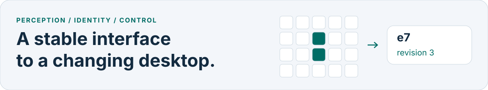
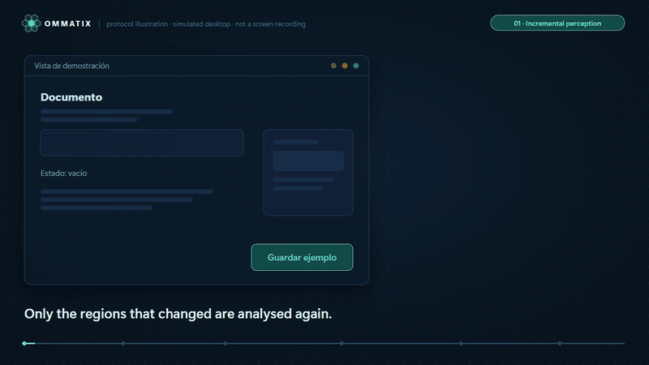
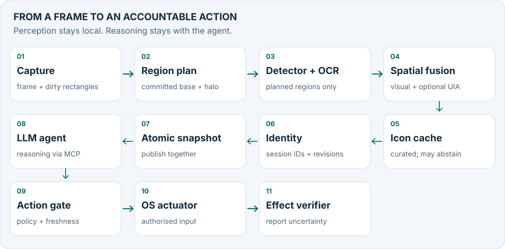
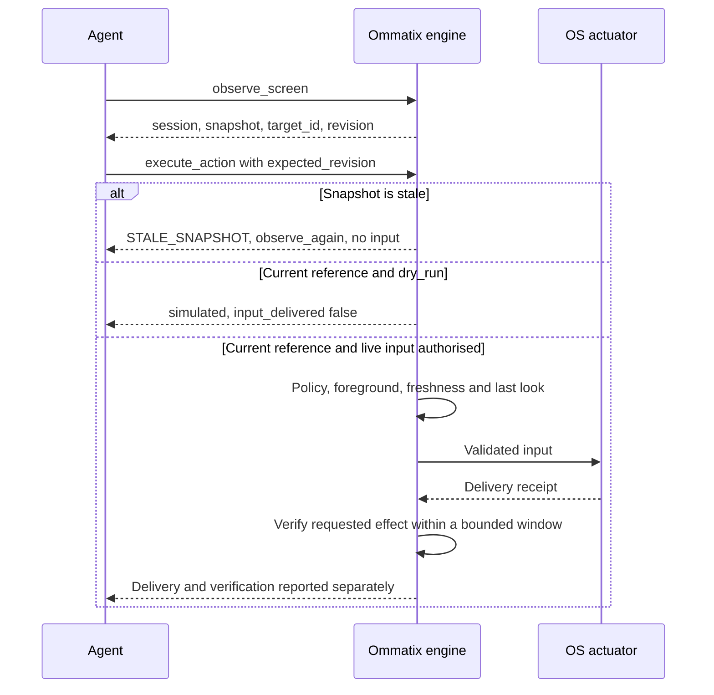
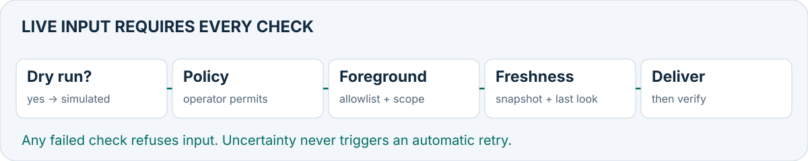
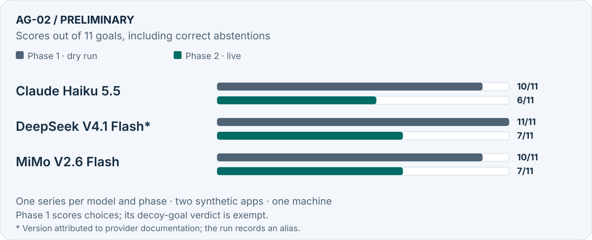

# Ommatix

**Spatial Indexing and Incremental Perception for GUI Agents**

[](https://github.com/Yosoyepa/Ommatix/actions/workflows/ci.yml)
[](#licence)
[](LICENSE-DOCS)
[](rust-toolchain.toml)
[](docs/thesis/07_CONTRATOS_MCP_Y_ERRORES.md)
[](#project-status)
[](docs/adr/0008-one-real-platform-first.md)

🇪🇸 [Leer en español](README.es.md)

<picture>
  <source media="(max-width: 640px) and (prefers-color-scheme: dark)" srcset="docs/assets/readme/hero-mobile-dark.svg">
  <source media="(max-width: 640px)" srcset="docs/assets/readme/hero-mobile-light.svg">
  <source media="(prefers-color-scheme: dark)" srcset="docs/assets/readme/hero-dark.svg">
  
</picture>

Ommatix is a thesis research prototype that lets an LLM agent address desktop elements by
**session IDs and revisions instead of coordinates**. Its local Rust engine analyses changed
regions against the last committed frame, with an explicit full-refresh fallback. Actuation
is fail-closed: actions default to a dry run; live input needs the operator’s policy and a
current observation. [Design and trust boundaries →](docs/architecture/overview.md)

<p align="center">
  <a href="docs/assets/readme/protocol-demo.mp4"></a>
</p>

<p align="center"><sub>An illustration on a simulated desktop, generated from the <a href="docs/thesis/contratos/ejemplos">contract examples</a>; not a screen recording.
<a href="docs/assets/readme/protocol-demo.mp4">Watch the 44-second video</a> (MP4, silent, captioned) ·
<a href="tools/readme-media/README.md">how it is made</a></sub></p>

## Why Ommatix

A coordinate identifies a location in an image; it does not establish which control will be
there when input arrives. Ommatix makes the link between observation and action explicit,
while keeping perception separate from the agent’s reasoning.
[Research problem →](docs/thesis/01_TESIS_Y_MARCO_TEORICO.md)

| Idea | What the engine does |
|---|---|
| **Incremental perception** | Plans changed regions, retains pending changes after failure, and takes a full refresh when geometry or budgets require it. [Algorithm 1](docs/thesis/04_ALGORITMOS_CORE.md) |
| **Stable identity** | Tracks elements within a session, advances revisions when action-relevant properties change, and abstains on ambiguous continuity. [Algorithms 3A–3B](docs/thesis/04_ALGORITMOS_CORE.md) |
| **Fail-closed actuation** | Checks snapshot, target, revision, permissions and foreground context before delivery. [ADR-0007](docs/adr/0007-fail-closed-actuation-and-honest-simulation.md) |
| **MCP contract** | Offers structured observations, actions and metrics over stdio; geometry stays inside the engine. [Contract](docs/thesis/07_CONTRATOS_MCP_Y_ERRORES.md) |

## How it works

<picture>
  <source media="(max-width: 640px) and (prefers-color-scheme: dark)" srcset="docs/assets/readme/pipeline-mobile-dark.svg">
  <source media="(max-width: 640px)" srcset="docs/assets/readme/pipeline-mobile-light.svg">
  <source media="(prefers-color-scheme: dark)" srcset="docs/assets/readme/pipeline-dark.svg">
  
</picture>

Each observation publishes the base frame, identity registry and snapshot together. A failed
stage publishes nothing, keeps the pending regions and blocks actions while degraded.
Optional UI Automation evidence is fused with vision and never reads a field’s value.
[Architecture](docs/architecture/overview.md) · [Accessibility evidence](docs/adr/0017-ui-automation-evidence-fused-with-vision.md)

<details>
<summary>One observe → act round trip, including stale-snapshot refusal</summary>



Source: [MCP contract](docs/thesis/07_CONTRATOS_MCP_Y_ERRORES.md) and
[action sequence](docs/diagrams/action-sequence.md). Every delivery spends the snapshot;
the next action needs another observation.

</details>

## The MCP contract

| Tool | Purpose |
|---|---|
| `observe_screen` | A page of elements with `target_id`, `revision`, role, label and actionability; query and snapshot-bound pagination. |
| `execute_action` | `click`, `type` or `scroll` on an element at an expected revision; dry run by default. |
| `get_engine_metrics` | Mode, observation and action counts, pending regions, and model-loading state. |

[Schemas and examples](docs/thesis/contratos/README.md) ·
[Errors and protocol profiles](docs/thesis/07_CONTRATOS_MCP_Y_ERRORES.md) ·
[Configuration and timing metadata](docs/guide/configuration.md#contract-and-diagnostics)

<details>
<summary>A real dry-run request and response from the dossier</summary>

Tool arguments from [click_input.json](docs/thesis/contratos/ejemplos/click_input.json),
verbatim JSON (whitespace only reformatted):

```json
{
  "request_id": "demo-click-001",
  "session_id": "demo-session",
  "snapshot_id": "s17",
  "geometry_epoch": 1,
  "target_id": "e7",
  "expected_revision": 3,
  "action": "click",
  "dry_run": true
}
```

Structured response from [simulated_output.json](docs/thesis/contratos/ejemplos/simulated_output.json):

```json
{
  "schema_version": "1.0",
  "request_id": "demo-click-001",
  "status": "simulated",
  "target_id": "e7",
  "snapshot_id": "s17",
  "input_delivered": false,
  "verified": false
}
```

</details>

## Safety model

> [!CAUTION]
> Live input is **off by default**. It requires a Windows `sendinput` build, `--source dxgi`,
> `--input sendinput`, the operator’s `actuation_enabled = true` and non-empty
> `allowed_applications`, and the agent’s `dry_run: false`. The operator controls the stop
> file and any window pin. [Read the operator guide before enabling input.](docs/guide/live-input.md)

<picture>
  <source media="(max-width: 640px) and (prefers-color-scheme: dark)" srcset="docs/assets/readme/gate-mobile-dark.svg">
  <source media="(max-width: 640px)" srcset="docs/assets/readme/gate-mobile-light.svg">
  <source media="(prefers-color-scheme: dark)" srcset="docs/assets/readme/gate-dark.svg">
  
</picture>

`simulated` claims no delivery; `input_delivered` claims no effect; `indeterminate` never
triggers an automatic retry. With UI Automation, typing waits for keyboard focus on the
target element between its focusing click and its keys.
[Action semantics](docs/adr/0007-fail-closed-actuation-and-honest-simulation.md) ·
[Two-phase typing](docs/adr/0018-two-phase-type-with-element-level-focus-confirmation.md)

> [!IMPORTANT]
> Screen, OCR and accessibility text are untrusted data and cannot grant permissions.
> The engine exposes no screenshots to the client and logs no screen values by default.
> Sending observations to an external model is the client’s data boundary; the AG-02
> experiment explicitly authorised synthetic test-app observations for its providers.
> [Privacy](docs/thesis/08_SEGURIDAD_Y_PRIVACIDAD.md) · [AG-02 protocol](docs/thesis/09_EVALUACION_EXPERIMENTAL.md#911-ag-02-un-agente-sólo-llm-con-ommatix-por-mcp)

## Results at a glance

<picture>
  <source media="(max-width: 640px) and (prefers-color-scheme: dark)" srcset="docs/assets/readme/results-mobile-dark.svg">
  <source media="(max-width: 640px)" srcset="docs/assets/readme/results-mobile-light.svg">
  <source media="(prefers-color-scheme: dark)" srcset="docs/assets/readme/results-dark.svg">
  
</picture>

*Source: [chapter 09 §9.11.1–3](docs/thesis/09_EVALUACION_EXPERIMENTAL.md#911-ag-02-un-agente-sólo-llm-con-ommatix-por-mcp),
18–19 October 2026. Phase 1 scores choices in dry run; phase 2 combines the agent verdict
with an OS-side oracle. Correct abstentions count in both phases.*

Phase 2 recorded **0 false successes and 0 protocol-defined safety events** for each model.
Phase 1 also reports zero under its implemented scoring, which exempts the decoy goal’s
verdict: the strict verdict rule instead gives 9/11, 10/11 and 9/11, and one false success
per model. These definitions matter when interpreting the figure.

| Measured perception latency | Warm p95 | Context |
|---|---:|---|
| One-region change scenario (`incr1`, AD) | 136.3 ms | UI Automation + DirectML; mostly regional plans. |
| Two-region change scenario (`incr2`, AD) | 137.6 ms | The adaptive rule selects a **full refresh**. |

Source: [S0 §16](docs/thesis/S0_RESULTADOS.md#16-inc-07-política-adaptativa-entre-refresco-completo-y-regional-en-vivo-con-uia-1065),
15 October 2026; Ryzen 7 5700X, RX 6700 XT, one synthetic app and one pinned detector.
RNF-05 is **accepted by scope**, with “incremental” interpreted as the change scenario.
[Scope decision](docs/thesis/06_PLAN_INTEGRACION_DOD_Y_ROADMAP.md#67-definition-of-done-del-producto)

> [!WARNING]
> Preliminary evidence: one series per model and phase, two synthetic apps, eleven fixed
> goals and one machine. Budgets and provider endpoints differ. There is no VLM baseline;
> AG-03 is planned, not run. Perception precision and coverage remain unmeasured, and the
> latency study does not measure the AG-02 agent loop. These results do not establish a
> model ranking, general desktop success rate, or an advantage over VLM agents.

[Read the experimental protocol, results and limitations →](docs/thesis/09_EVALUACION_EXPERIMENTAL.md)

## Quick start

Use the [pinned Rust 1.99.0 toolchain](rust-toolchain.toml). Python 3.11+ is needed for thesis checks.

```bash
cargo run -- demo   # simulated observations and a dry-run click
cargo run -- serve  # MCP over stdio on the simulated desktop
```

For an MCP client, build with `cargo build --locked`, put the binary on `PATH` (or use its absolute path), then configure:

```json
{"mcpServers":{"ommatix":{"command":"ommatix","args":["serve"]}}}
```

> [!TIP]
> The simulated desktop needs no models or screen access. [Getting started](docs/guide/getting-started.md) · [Configuration](docs/guide/configuration.md) · [Installation and rollback](docs/thesis/S4_INSTALACION_Y_REVERSION.md).

## Project status

As of **19 October 2026**, evidence checked against commit **`875495f`**.
The [dossier](docs/thesis/README.md) is the specification; this table states the current scope.

| Area | Current state |
|---|---|
| S0 · feasibility | Candidate detector and OCR measured; product detector validation and clean-machine installation remain pending. |
| S1 · geometric core | Implemented: tile diff, region plan, spatial fusion and transactional snapshots. |
| S2 · identity and contract | Implemented: temporal registry, curated icon cache and the three MCP tools. |
| S3 · Windows integration | Opt-in DXGI, SendInput, ONNX, Windows OCR and UI Automation; supervised evidence within the agreed profile. Integration cases IT-01–04 remain partial. |
| S4 · acceptance | Reduced protocol: five flows, each 10/10 with no false success. The broader corpus and evaluation remain deferred. |
| Definition of Done | **6/10 boxes checked: 1, 4, 5, 6, 8, 9.** Boxes 2 and 3 have scope acceptances, not fulfilment; box 7 lacks active-icon-cache memory evidence and run variation; box 10 retains partial integration and clean-installation work. |

Source: [chapter 06 §6.7](docs/thesis/06_PLAN_INTEGRACION_DOD_Y_ROADMAP.md#67-definition-of-done-del-producto).
First live platform: Windows 11 x64, one monitor, 100% DPI and one theme for the reduced MVP.
[Platform limits](docs/thesis/S4_INSTALACION_Y_REVERSION.md) · [What changed → CHANGELOG](docs/thesis/CHANGELOG.md)

## Documentation

| Read about… | Start here |
|---|---|
| Running and configuring the engine | [Getting started](docs/guide/getting-started.md) · [Configuration](docs/guide/configuration.md) · [Live input](docs/guide/live-input.md) |
| The research specification and evidence | [Thesis dossier (Spanish)](docs/thesis/README.md) · [Evaluation](docs/thesis/09_EVALUACION_EXPERIMENTAL.md) |
| Crates, ports and trust boundaries | [Architecture](docs/architecture/overview.md) · [Repository layout and development](docs/guide/development.md) |
| Design decisions and diagrams | [ADRs](docs/adr/README.md) · [Diagrams](docs/diagrams/README.md) |
| Reviews, terminology and the full index | [Reviews](docs/reviews) · [Glossary](docs/glossary.md) · [Documentation map](docs/README.md) |

## Research & citation

This repository accompanies the thesis on incremental visual perception and safe temporal
grounding for desktop agents. Cite the software using [CITATION.cff](CITATION.cff); the
[dossier](docs/thesis/README.md) is the public research specification. No publication venue or DOI is asserted.

```bibtex
@software{ommatix,
  author = {Andrade Unigarro, Juan Carlos},
  title = {Ommatix: Spatial Indexing and Incremental Perception for GUI Agents},
  url = {https://github.com/Yosoyepa/Ommatix}
}
```

## Contributing

Read [CONTRIBUTING.md](.github/CONTRIBUTING.md) and the authoritative [AGENTS.md](AGENTS.md).
People and AI coding agents follow the same rules. Use [issue forms](https://github.com/Yosoyepa/Ommatix/issues/new/choose)
for bugs, proposals and documentation; report vulnerabilities through
[private vulnerability reporting](.github/SECURITY.md). [Community conduct](.github/CODE_OF_CONDUCT.md) · [Support](.github/SUPPORT.md)

## Licence

Code, tools and test apps: [MIT](LICENSE-MIT) OR [Apache-2.0](LICENSE-APACHE).
Documentation, the dossier and README media: [CC BY 4.0](LICENSE-DOCS).
The [Contributor Covenant adaptation](.github/CODE_OF_CONDUCT.md) is CC BY-SA 4.0.
Copyright 2026 Juan Carlos Andrade Unigarro. [Licence decision](docs/adr/0023-licence-and-reduced-mvp-scope.md)

Model weights, ONNX Runtime and `DirectML.dll` are not redistributed. They retain their own
licences and require operator-managed, SHA-256-pinned downloads; the AGPL-3.0 weights are
not used. Dev-only media dependencies retain their own terms.
[Third-party artefacts](docs/thesis/S4_REPRODUCIBILIDAD.md#3-licencias-del-grafo-de-dependencias) · [Media tooling](tools/readme-media/README.md)
