# Ommatix

**Spatial Indexing and Incremental Perception for GUI Agents**

🇪🇸 [Leer en español](README.es.md)

Ommatix is a local perception engine that lets an LLM agent operate a desktop safely. It turns
screen frames into GUI elements with stable identifiers, re-analyses only the regions that
changed, and serves the result through the [Model Context Protocol](https://modelcontextprotocol.io).
The agent chooses an element by its identifier; Ommatix keeps the geometry, checks that the
agent's observation is still current, acts through the operating system and reports what it
could verify. Perception lives here; reasoning lives in the agent.

> **Why "Ommatix"?** Named after *ommatidia*, the independent photoreceptor units that make
> up the compound eye of fast-flying insects. Just as each ommatidium processes local changes
> in luminance in parallel without saturating the central nervous system, Ommatix divides the
> screen framebuffer into a spatial matrix of independent cells, processes only the regions
> with visual activity and gives the agent stable element identifiers instead of coordinates.

## The thesis

Ommatix implements the thesis *Incremental visual perception and safe temporal grounding for
desktop agents: spatial fusion, perceptual cache and identifier-based control over MCP*. Its
engineering and research dossier, in Spanish, is the baseline of this repository:
[`docs/thesis/`](docs/thesis/README.md).

| Part | Where |
|---|---|
| Technical audit, thesis framework, SDD, requirements (RF-01..18, RNF-01..10) | [chapters 00–03](docs/thesis/README.md) |
| Algorithms: incremental perception, spatial fusion, icon cache, temporal identity | [chapter 04](docs/thesis/04_ALGORITMOS_CORE.md) |
| TDD plan (76 planned tests), integration plan S0–S4 and definition of done | [chapters 05–06](docs/thesis/05_TDD_PLAN_Y_MATRIZ.md) |
| MCP contract, errors, JSON schemas and examples | [chapter 07](docs/thesis/07_CONTRATOS_MCP_Y_ERRORES.md), [`contratos/`](docs/thesis/contratos/README.md) |
| Security, evaluation protocol, runbook, references | chapters 08–12 |
| 32 Gherkin scenarios (BDD-01..32) and traceability matrices | [`features/`](docs/thesis/features), [`matrices/`](docs/thesis/matrices) |
| Python reference oracle (48 tests) and package validator | [`referencia_ejecutable/`](docs/thesis/referencia_ejecutable) |
| Architecture decisions ADR-0001..0014, in English | [`docs/adr/`](docs/adr/README.md) |

## How it works

```mermaid
flowchart LR
    CAP[Capture<br/>frame + dirty rects] --> PLAN[Algorithm 1<br/>exact tile diff,<br/>halo closure, budget]
    PLAN --> PER[Detector + OCR<br/>on planned regions]
    PER --> FUS[Algorithm 2<br/>spatial fusion,<br/>reading order, labels]
    FUS --> ICO[Algorithm 3A<br/>icon cache<br/>with rejection]
    ICO --> TRK[Algorithm 3B<br/>session IDs,<br/>revisions]
    TRK --> SNAP[Atomic commit<br/>immutable snapshot]
    SNAP -->|observe_screen| AG[LLM agent]
    AG -->|execute_action:<br/>target_id + revision| GATE[Policy and<br/>action gate]
    GATE --> ACT[OS actuator] --> VER[Effect verifier]
```



A failed step publishes nothing: the engine keeps the pending regions, reports itself
degraded and blocks actions until a consistent observation exists. Actions are dry runs
unless the agent and a local policy both allow them. More in the
[architecture overview](docs/architecture/overview.md).

## Status

**The dossier is the specification; the code is catching up with it.**

- `docs/thesis/` holds the consolidated dossier. Its oracle (48/48) and validator run in CI.
- `src/` holds a prototype written while the repository was bootstrapped, before the dossier
  was consolidated. It shares the architecture (Rust, hexagonal crates, MCP over stdio,
  dry-run by default, injected clock) but not the pipeline: it has a flat-colour detector
  without OCR, hashed cells, a mutable scene and seven MCP tools that return coordinates. The
  stages below replace it. The [overview](docs/architecture/overview.md#where-the-code-is-today)
  lists the differences.
- The thesis core from S1 (Algorithms 1 and 2, staging and commit) is in `ommatix-domain`,
  tested against the oracle's cases but not yet used by the running pipeline.
- First platform: **Windows 11 x64**, one monitor, DPI 100/125/150 %
  ([ADR-0008](docs/adr/0008-one-real-platform-first.md), approved 2026-10-14).

## Roadmap

From [thesis chapter 06](docs/thesis/06_PLAN_INTEGRACION_DOD_Y_ROADMAP.md):

- [x] Dossier consolidated into the repository; oracle and validator in CI
- [ ] **S0, spike:** hardware, candidate detectors and OCR, licences and ONNX export,
  execution provider, DXGI capture with stride, MCP client compatibility
- [x] **S1, geometric and incremental core:** exact tile diff, halo closure, line grouping,
  text ownership, staging and commit (UT-01..26, BDD-01..10) in `ommatix-domain`; oracle
  tests ported to Rust. Wired into the running pipeline in S2–S3
- [ ] **S2, identity, cache and contract:** temporal registry with tombstones, icon cache,
  MCP contract through `rmcp`, honest dry run (UT-27..43, CT). Done so far: the icon cache
  and the identity registry in `ommatix-domain` (UT-27..43); pending: the MCP contract
- [ ] **S3, real adapters and action loop on Windows 11:** DXGI, ONNX Runtime, `SendInput`,
  policy, stop and effect verification; the bootstrap's macOS and X11 adapters are retired
- [ ] **S4, acceptance:** 450 end-to-end runs on controlled applications, benchmarks, soak
  and the acceptance report

## Quick start

Requires Rust stable (pinned in `rust-toolchain.toml`) and Python 3.11 or later for the
thesis checks.

```bash
# Thesis checks (from docs/thesis/; the validator needs jsonschema)
pip install -r docs/thesis/requirements-validacion.txt
cd docs/thesis && python referencia_ejecutable/run_tests.py && python validar_paquete.py && cd -

# Bootstrap prototype
cargo run -- demo                       # scripted desktop session, one line per frame
cargo run -- serve --source sim         # MCP server on an interactive simulated desktop
cargo run --features screen -- serve --source screen   # live screen, dry-run input
```

The prototype's input is dry-run unless it is built with `native-input` and started with
`--source screen --input native`. Its MCP tools (`perceive`, `list_elements`, `element_at`,
`elements_in_rect`, `click`, `type_text`, `press_key`) are the bootstrap contract; S2
replaces them with the thesis contract: `observe_screen`, `execute_action` and
`get_engine_metrics`.

## Repository layout

```text
src/                       Cargo workspace (modular monolith, ADR-0014)
├── domain/                ommatix-domain        pure core, no I/O
├── application/           ommatix-application   use cases and port traits
├── adapters/
│   ├── capture/           ommatix-adapter-capture  frame capture
│   ├── vision/            ommatix-adapter-vision   detection (and OCR, from S3)
│   ├── input/             ommatix-adapter-input    OS input
│   ├── sim/               ommatix-adapter-sim      simulated desktop for deterministic fixtures
│   └── mcp/               ommatix-adapter-mcp      MCP server over stdio (driving adapter)
├── app/                   ommatix               composition root and CLI binary
└── acceptance/            ommatix-acceptance    executable Gherkin scenarios
docs/
├── thesis/                the thesis dossier (Spanish): chapters, contracts, matrices, oracle
├── adr/                   architecture decision records (bootstrap ones in adr/bootstrap/)
├── architecture/          overview (EN/ES)
├── diagrams/              Mermaid diagrams
└── reviews/               code reviews: finding, resolution, regression test
```

## Development

```bash
git config core.hooksPath .githooks     # once: fmt + clippy + tests before commit/push
cargo fmt --all
cargo clippy --workspace --all-targets -- -D warnings
cargo test --workspace                  # unit, integration and Gherkin acceptance tests
```

Contribution rules, for humans and AI agents alike, are in [AGENTS.md](AGENTS.md).

## Documentation

- [Thesis dossier](docs/thesis/README.md) (Spanish)
- [Architecture overview](docs/architecture/overview.md) · [Visión general](docs/architecture/overview.es.md)
- [Architecture decision records](docs/adr/README.md)
- [Diagrams](docs/diagrams/README.md)
- [Glossary / Glosario](docs/glossary.md)
- [Bootstrap MVP code review](docs/reviews/2026-10-14-mvp-review.md)
