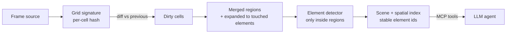

# Ommatix

**Spatial Indexing and Incremental Perception for GUI Agents**

🇪🇸 [Leer en español](README.es.md)

Ommatix is a low-latency, deterministic perception engine that lets LLM agents operate a
graphical desktop. Instead of sending every screenshot to a slow vision model, Ommatix
splits the framebuffer into a grid of independent cells, re-analyses **only the cells that
changed**, keeps every detected element in a spatial index, and answers the agent with
**exact pixel coordinates** through the [Model Context Protocol](https://modelcontextprotocol.io).

> **Why "Ommatix"?** Named after *ommatidia*, the independent photoreceptor units that make
> up the compound eye of fast-flying insects. Just as each ommatidium processes local changes
> in luminance in parallel without saturating the central nervous system, Ommatix divides the
> screen framebuffer into a spatial matrix of independent cells, processes only the regions
> with visual activity and delivers deterministic coordinates to the agent.

## Status

`v0.1.0` — **MVP in progress.** The agent can perceive and act (click, type, press keys)
end to end on a simulated desktop, recorded frames or, behind feature flags, the live
screen. The MVP's acceptance criteria are executable Gherkin features. See the
[roadmap](#roadmap).

## How it works



A static screen costs one hash pass and nothing else; typing in a text field re-analyses
3 of 260 cells in the demo session. More in [docs/architecture](docs/architecture/overview.md).

## Quick start

Requires Rust stable (pinned in `rust-toolchain.toml`).

```bash
cargo run -- demo                       # scripted desktop session, one line per frame
cargo run -- demo --theme dark          # same session in the dark theme (or contrasting-wallpaper)
cargo run -- serve --source sim         # MCP server on an interactive simulated desktop
cargo run -- serve --source images --images ./captures/session-01   # replay PNG frames
cargo run --features screen -- serve --source screen                 # live screen, dry-run input
cargo run --features screen,native-input -- serve --source screen --input native  # live input
```

Input is **dry-run by default**: actions are validated and recorded but never reach the OS
unless you build with `native-input` and pass `--input native` (ADR-0008). Native input
requires `--source screen`, so clicks land on the monitor the agent sees, mapped for HiDPI
and multi-monitor setups (ADR-0012). It works on macOS, Linux X11 and Windows at 100%
display scale; on Wayland and on scaled Windows displays Ommatix refuses native input at
start-up rather than guess where clicks land. Live capture on Linux needs the system
libraries listed in [AGENTS.md](AGENTS.md#toolchain).

### Use it from an MCP client

```json
{
  "mcpServers": {
    "ommatix": { "command": "/path/to/ommatix", "args": ["serve", "--source", "screen"] }
  }
}
```

| Tool | Purpose |
|---|---|
| `perceive` | Capture a frame, re-analyse changed regions, return added / updated / removed elements |
| `list_elements` | Every element on screen in reading order, with a click target |
| `element_at` | Elements under `(x, y)`, most specific first |
| `elements_in_rect` | Elements intersecting a rectangle |
| `click` | Click an element by id (preferred) or a coordinate |
| `type_text` | Type printable text into the focused control |
| `press_key` | Press Enter, Tab, Escape, Backspace, arrows… |

Each action waits for the screen to settle (no change for 2 frames, at most 1 s) and
returns the net change. Once an action is performed it is never reported as failed: if
watching the screen afterwards fails, the result carries `performed` and an
`observe_error`, so the agent does not repeat it. Run-dependent timings travel in `_meta`,
which keeps `structuredContent` reproducible (ADR-0012).

## Repository layout

```text
src/                       Cargo workspace members (modular monolith)
├── domain/                ommatix-domain        pure core: frame, grid, regions, scene, spatial index
├── application/           ommatix-application   ports (traits) + use cases: perceive, observe, act
├── adapters/
│   ├── capture/           ommatix-adapter-capture  FrameSource: scripted, PNG sequence, screen
│   ├── vision/            ommatix-adapter-vision   ElementDetector: flat-region detector
│   ├── input/             ommatix-adapter-input    InputController: dry-run, native (enigo)
│   ├── sim/               ommatix-adapter-sim      simulated desktop with themes (FrameSource + InputController)
│   └── mcp/               ommatix-adapter-mcp      MCP stdio server (driving adapter)
├── app/                   ommatix               composition root + CLI binary
└── acceptance/            ommatix-acceptance    Gherkin features (features/*.feature) + cucumber steps
docs/
├── adr/                   architecture decision records
├── architecture/          overview (EN/ES)
├── diagrams/              Mermaid diagrams (context, hexagon, pipeline)
└── reviews/               code reviews: finding → resolution → regression test
```

## Development

```bash
git config core.hooksPath .githooks     # once: fmt + clippy + tests before commit/push
cargo fmt --all
cargo clippy --workspace --all-targets -- -D warnings
cargo test --workspace                  # unit, integration and Gherkin acceptance tests
cargo test -p ommatix-acceptance        # only the Gherkin specification
cargo test -p ommatix-adapter-vision --release -- --ignored --nocapture   # detector benchmark
```

Contribution rules (for humans and AI agents) live in [AGENTS.md](AGENTS.md).

## Roadmap

- [x] Grid diffing, region merging, spatial index, stable element identity
- [x] Deterministic flat-region detector, same results on light, dark and contrasting themes
- [x] MCP server (stdio) with perception tools
- [x] Synthetic, PNG-sequence and live-screen sources
- [x] Actuation tools (click, type, keys) behind an `InputController` port, dry-run by default
- [x] Actions wait for the screen to settle; HiDPI and multi-monitor coordinate mapping
- [x] Executable Gherkin acceptance specification on a simulated desktop
- [ ] Validation on a real desktop (X11 clicks checked under Xvfb; Windows, macOS pending)
- [ ] Native input on Wayland and on scaled Windows displays
- [ ] Benchmarks (criterion) and latency budget per stage
- [ ] Text detection / OCR adapter, element classification (button, text, icon)
- [ ] Parallel per-region detection and SIMD hashing
- [ ] Evaluation harness against recorded GUI sessions

## Documentation

- [Architecture overview](docs/architecture/overview.md) · [Visión general](docs/architecture/overview.es.md)
- [Architecture decision records](docs/adr/README.md)
- [Acceptance features (Gherkin)](src/acceptance/features)
- [Diagrams](docs/diagrams/README.md)
- [MVP code review](docs/reviews/2026-10-14-mvp-review.md)
- [Glossary / Glosario](docs/glossary.md)
