# Ommatix

**Spatial Indexing and Incremental Perception for GUI Agents**

🇪🇸 [Leer en español](README.es.md)

Ommatix is a local perception engine that lets an LLM agent operate a desktop safely. It turns
screen frames into GUI elements with stable identifiers, re-analyses only the regions that
changed, and serves the result through the [Model Context Protocol](https://modelcontextprotocol.io).
The agent chooses an element by its identifier; Ommatix keeps the geometry, checks that the
agent's observation is still current, acts through the operating system and reports what it
could verify. Perception lives here; reasoning lives in the agent.

> **Why "Ommatix"?** Named after *ommatidia*, the independent photoreceptor units that make
> up the compound eye of fast-flying insects. Just as each ommatidium processes local changes
> in luminance in parallel without saturating the central nervous system, Ommatix divides the
> screen framebuffer into a spatial matrix of independent cells, processes only the regions
> with visual activity and gives the agent stable element identifiers instead of coordinates.

## The thesis

Ommatix implements the thesis *Incremental visual perception and safe temporal grounding for
desktop agents: spatial fusion, perceptual cache and identifier-based control over MCP*. Its
engineering and research dossier, in Spanish, is the baseline of this repository:
[`docs/thesis/`](docs/thesis/README.md).

| Part | Where |
|---|---|
| Technical audit, thesis framework, SDD, requirements (RF-01..18, RNF-01..10) | [chapters 00–03](docs/thesis/README.md) |
| Algorithms: incremental perception, spatial fusion, icon cache, temporal identity | [chapter 04](docs/thesis/04_ALGORITMOS_CORE.md) |
| TDD plan (76 planned tests), integration plan S0–S4 and definition of done | [chapters 05–06](docs/thesis/05_TDD_PLAN_Y_MATRIZ.md) |
| MCP contract, errors, JSON schemas and examples | [chapter 07](docs/thesis/07_CONTRATOS_MCP_Y_ERRORES.md), [`contratos/`](docs/thesis/contratos/README.md) |
| Security, evaluation protocol, runbook, references | chapters 08–12 |
| 32 Gherkin scenarios (BDD-01..32) and traceability matrices | [`features/`](docs/thesis/features), [`matrices/`](docs/thesis/matrices) |
| Python reference oracle (48 tests) and package validator | [`referencia_ejecutable/`](docs/thesis/referencia_ejecutable) |
| Architecture decisions ADR-0001..0015, in English | [`docs/adr/`](docs/adr/README.md) |

## How it works

```mermaid
flowchart LR
    CAP[Capture<br/>frame + dirty rects] --> PLAN[Algorithm 1<br/>exact tile diff,<br/>halo closure, budget]
    PLAN --> PER[Detector + OCR<br/>on planned regions]
    PER --> FUS[Algorithm 2<br/>spatial fusion,<br/>reading order, labels]
    FUS --> ICO[Algorithm 3A<br/>icon cache<br/>with rejection]
    ICO --> TRK[Algorithm 3B<br/>session IDs,<br/>revisions]
    TRK --> SNAP[Atomic commit<br/>immutable snapshot]
    SNAP -->|observe_screen| AG[LLM agent]
    AG -->|execute_action:<br/>target_id + revision| GATE[Policy and<br/>action gate]
    GATE --> ACT[OS actuator] --> VER[Effect verifier]
```



A failed step publishes nothing: the engine keeps the pending regions, reports itself
degraded and blocks actions until a consistent observation exists. Actions are dry runs
unless the agent and a local policy both allow them. More in the
[architecture overview](docs/architecture/overview.md).

## Status

**The dossier is the specification; the code is catching up with it.**

- `docs/thesis/` holds the consolidated dossier. Its oracle (48/48) and validator run in CI.
- `ommatix-domain` holds the thesis core: Algorithm 1 (exact tile diff, region plan, halo
  closure), Algorithm 2 (spatial fusion), Algorithm 3A (icon cache with rejection),
  Algorithm 3B (identity registry, freshness checks) and transactional snapshots, tested
  against the oracle's cases (UT-01..43).
- `ommatix-application` runs it as one engine behind the SDD ports, and `ommatix-adapter-mcp`
  serves the thesis contract (`observe_screen`, `execute_action`, `get_engine_metrics`) over
  MCP 2026-07-28 ([ADR-0015](docs/adr/0015-mcp-transport-on-rmcp-wire-types.md)). Contract
  tests CT-01..10 and scenarios BDD-01..27 run in CI. `serve` and `demo` use this engine.
  Each observation also resolves text-less icons against curated prototypes (Algorithm 3A)
  when the operator configures them; otherwise icon labels stay `unknown`.
- What is **not** real yet: the screen is a simulated desktop or a fixture, the detector is
  the bootstrap's flat-colour region finder (roles `unknown`, no OCR), and no real MCP client
  has been tested. Live input is **denied**: the action gate needs an allowlisted foreground
  application attested by the input adapter, and no adapter can attest one before S3. S3
  brings DXGI, ONNX Runtime and `SendInput`; S4 the acceptance runs. The
  [overview](docs/architecture/overview.md#where-the-code-is-today) lists what remains.
- First platform: **Windows 11 x64**, one monitor, DPI 100/125/150 %
  ([ADR-0008](docs/adr/0008-one-real-platform-first.md), approved 2026-10-14).

## Roadmap

From [thesis chapter 06](docs/thesis/06_PLAN_INTEGRACION_DOD_Y_ROADMAP.md):

- [x] Dossier consolidated into the repository; oracle and validator in CI
- [ ] **S0, spike:** hardware, candidate detectors and OCR, licences and ONNX export,
  execution provider, DXGI capture with stride, MCP client compatibility
- [x] **S1, geometric and incremental core:** exact tile diff, halo closure, line grouping,
  text ownership, staging and commit (UT-01..26, BDD-01..10) in `ommatix-domain`; oracle
  tests ported to Rust
- [x] **S2, identity, cache and contract:** temporal registry with tombstones, icon cache
  (UT-27..43, S2a); the engine, the SDD ports and the MCP contract through `rmcp` with an
  honest dry run (CT-01..10, BDD-11..27, S2b)
- [ ] **S3, real adapters and action loop on Windows 11:** DXGI, ONNX Runtime, `SendInput`,
  policy, stop and effect verification; the bootstrap's macOS and X11 adapters are retired
- [ ] **S4, acceptance:** 450 end-to-end runs on controlled applications, benchmarks, soak
  and the acceptance report

## Quick start

Requires Rust stable (pinned in `rust-toolchain.toml`) and Python 3.11 or later for the
thesis checks.

```bash
# Thesis checks (from docs/thesis/; the validator needs jsonschema)
pip install -r docs/thesis/requirements-validacion.txt
cd docs/thesis && python referencia_ejecutable/run_tests.py && python validar_paquete.py && cd -

# The engine
cargo run -- demo                                   # observations and a dry-run click on the simulated desktop, printed
cargo run -- demo --observations 5 --theme dark     # more observations, another theme
cargo run -- serve                                  # MCP server on stdio over the simulated desktop
cargo run -- serve --config ommatix.toml            # same, with a configuration file
cargo run -- serve --source images --images frames/ # a directory of PNG frames
cargo run --features screen -- serve --source screen   # the primary monitor
```

`serve` and `demo` take the same options:

| Option | Values | Default |
|---|---|---|
| `--config PATH` | a configuration file (below) | the dossier template's values |
| `--source` | `sim` (simulated desktop), `images` (PNG frames, flat-region detector), `screen` (primary monitor, flat-region detector; build feature `screen`) | `sim` |
| `--images DIR` | the PNG directory for `--source images` | none (required by `images`) |
| `--input` | `dry-run` (record, never touch the OS) or `native` (build feature `native-input`, which implies `screen`) | `[engine] mode` (`dry_run`) |
| `--theme` | `light`, `dark`, `contrasting-wallpaper` (simulated desktop only) | `light` |
| `--session-id ID` | 1–64 visible ASCII characters, for reproducible output | derived from the start time and the process ID |
| `--legacy` | also serve the legacy MCP profile 2025-11-25 (like `[mcp] legacy_enabled = true`) | off |
| `--observations N` (`demo` only) | 1–20 | 3 |

`--input native` (or `[engine] mode = "native"`) is refused before any adapter opens unless
the source is `screen`, `[safety] actuation_enabled = true` and the build has
`native-input`. Even then every action is a dry run unless the agent sets `dry_run: false`,
and the engine's gate also requires the foreground application, as the input adapter
attests it, to be in `[safety] allowed_applications`. The interim input adapter cannot
attest it, so live input is `POLICY_DENIED` until S3.

The configuration file has the shape of
[`docs/thesis/plantillas/configuracion_mvp.toml`](docs/thesis/plantillas/configuracion_mvp.toml)
(`[engine]`, `[mcp]`, `[safety]`, `[models]`, `[cache]`; at most 64 KiB); without one, the
template's values apply, which deny actuation and redact values. No CLI flag loosens
`[safety]`. The file is checked strictly:

- **Refused** (the server does not start): unknown sections or keys; out-of-range values
  (`tile_size` 8–1024, `halo_px` ≤ 1024, `max_regions` 1–1024, `full_refresh_area_ratio`
  in (0, 1], `max_snapshot_age_ms` ≥ 1, `max_message_bytes` 4096–65536, `max_entries` ≥ 1,
  blank `allowed_applications` entries); and values this build cannot honour: a `platform`
  other than `windows`, a `snapshot_policy` other than `strict`, a `profile` other than
  `2026-07-28` (the legacy profile is enabled with `legacy_enabled`), a `transport` other than
  `stdio`, `allow_destructive = true`, `allow_screenshots_to_client = true`, any `[models]`
  path or hash, and `[cache] persist = true`.
- **Accepted but not enforced** (a note on stderr at startup): `max_snapshot_age_ms` (every
  page reports its `age_ms` instead), and `actuation_enabled = true` with an input adapter
  that is not live.

`[cache]` may also turn on the icon resolver (Algorithm 3A) with five keys that go together:
`prototypes` (a JSON-lines file, relative to the configuration file, one
`{"label", "context", "grid"}` per line, where `grid` is the 9×8 greyscale crop as 72 values),
`context` (the application the prototypes apply to; until S3 identifies the foreground
application, the operator names it), `gradient_tau` (1–255), `max_distance` and `min_margin`
(0–1). None has a default, because the thesis calibrates them on its corpus (H4); any of them
without the others is refused, and so is the whole file on any invalid line or more than
`max_entries` prototypes. Without them the startup note says that icon labels stay unknown.

`[models]` is empty by default: no model is loaded, the detector is the flat-region finder
and there is no OCR. With the `images` or `screen` source it can select a detector
(`detector_manifest` + `detector_manifest_sha256`, a manifest shaped like
[`model_manifest.json`](docs/thesis/plantillas/model_manifest.json) whose status is
`SELECCIONADO`, plus `onnxruntime_path` + `onnxruntime_sha256`; build feature `onnx`) and
the Windows OCR (`ocr = "winrt"`, `ocr_language`, default `es-ES`; build feature
`winrt-ocr`). Every file is checked against its SHA-256, and a mismatch, a missing build
feature or an uninstalled language stops the engine: nothing falls back. The template's
`detector_path`, `detector_sha256`, `ocr_path` and `ocr_sha256` stay empty, since the
weights are declared in the manifest. No model has been selected yet (S0).

The MCP server exposes three tools, with the dossier's JSON schemas:

| Tool | Does |
|---|---|
| `observe_screen` | Observes the screen and returns a page of the new snapshot: `session_id`, `snapshot_id`, `geometry_epoch`, elements with `target_id`, `revision`, role, label and actionability, never coordinates; `query`, `limit` and a `cursor` bound to the snapshot |
| `execute_action` | `click`, `type` or `scroll` on a `target_id` at an expected revision; dry run by default; returns `simulated`, `rejected`, `input_delivered`, `effect_observed` or `indeterminate` |
| `get_engine_metrics` | Mode, observations, rejected and delivered actions, pending regions, whether models are loaded |

Domain errors come back as tool results with `isError: true`, a `code`, `retryable` and a
`next_step`; stage timings travel in the result's `_meta` under `io.ommatix/timings`.

## Repository layout

```text
src/                       Cargo workspace (modular monolith, ADR-0014)
├── domain/                ommatix-domain        thesis core, no I/O: incremental, fusion,
│                                                appearance, identity, snapshot
├── application/           ommatix-application   SDD ports, the Engine use case, contract types
├── adapters/
│   ├── capture/           ommatix-adapter-capture  FrameCapturer: scripted, PNG frames, screen
│   ├── vision/            ommatix-adapter-vision   VisionDetector, TextRecognizer (flat-region, ONNX, Windows OCR)
│   ├── input/             ommatix-adapter-input    OsActuator: dry run, native input
│   ├── sim/               ommatix-adapter-sim      simulated and fixture desktops (all four
│   │                                               pixel/input ports) for deterministic tests
│   └── mcp/               ommatix-adapter-mcp      MCP server over stdio (driving adapter),
│                                                   CT-01..10 in tests/
├── app/                   ommatix               composition root and CLI binary (serve, demo)
└── acceptance/            ommatix-acceptance    runs the thesis scenarios (tests/thesis.rs)
docs/
├── thesis/                the dossier (Spanish): chapters 00–12 at its root, contratos/,
│                          features/, matrices/, plantillas/, diagramas/, fuentes/, oracle
├── adr/                   architecture decision records (bootstrap ones in adr/bootstrap/)
├── architecture/          overview (EN/ES)
├── diagrams/              Mermaid diagrams, English labels
└── reviews/               code reviews: finding, resolution, regression test
```

How the dossier's SDD components ([chapter 02 §2.3](docs/thesis/02_SDD_ARQUITECTURA_MVP.md))
map onto the crates:

| SDD component | Where |
|---|---|
| MCP Adapter | `ommatix-adapter-mcp` |
| Observation Coordinator, Policy & Action Gate | `Engine` in `ommatix-application` |
| Spatial Fusion, Temporal Registry | `ommatix-domain` (`fusion`, `identity`), driven by the `Engine` |
| Icon Resolver | `ommatix-domain` (`appearance`), run by the `Engine` on text-less controls of the planned regions with the operator's curated prototypes |
| Capture Provider | `ommatix-adapter-capture` (`FrameCapturer`) |
| Perception Provider | `ommatix-adapter-vision` (`VisionDetector`, `TextRecognizer`) |
| OS Actuator | `ommatix-adapter-input` (`OsActuator`) |
| Effect Verifier | the `Engine`'s re-capture after delivery; partial, completed in S3 |
| Telemetry | stage timings in MCP `_meta`; partial, completed in S3 |

And how the dossier package maps onto the repository: its chapters, contracts, matrices,
templates (`plantillas/`: configuration and ports), features, diagrams and oracle are in
`docs/thesis/`; its ADRs are in `docs/adr/` in English; the reading edition (PDF and Word), the
manifest and the source conversation [F0] are kept outside the repository
([CHANGELOG 1.0.1](docs/thesis/CHANGELOG.md)).

## Development

```bash
git config core.hooksPath .githooks     # once: fmt + clippy + tests before commit/push
cargo fmt --all
cargo clippy --workspace --all-targets -- -D warnings
cargo test --workspace                  # unit, integration and Gherkin acceptance tests
```

Contribution rules, for humans and AI agents alike, are in [AGENTS.md](AGENTS.md).

## Documentation

- [Thesis dossier](docs/thesis/README.md) (Spanish)
- [Architecture overview](docs/architecture/overview.md) · [Visión general](docs/architecture/overview.es.md)
- [Architecture decision records](docs/adr/README.md)
- [Diagrams](docs/diagrams/README.md)
- [Glossary / Glosario](docs/glossary.md)
- Code reviews: [bootstrap MVP](docs/reviews/2026-10-14-mvp-review.md),
  [S2b engine and MCP adapter](docs/reviews/2026-10-14-s2b-engine-and-mcp.md)
