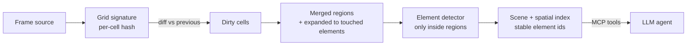

# Ommatix

**Spatial Indexing and Incremental Perception for GUI Agents**

🇪🇸 [Leer en español](README.es.md)

Ommatix is a low-latency, deterministic perception engine that lets LLM agents operate a
graphical desktop. Instead of sending every screenshot to a slow vision model, Ommatix
splits the framebuffer into a grid of independent cells, re-analyses **only the cells that
changed**, keeps every detected element in a spatial index, and answers the agent with
**exact pixel coordinates** through the [Model Context Protocol](https://modelcontextprotocol.io).

> **Why "Ommatix"?** Named after *ommatidia*, the independent photoreceptor units that make
> up the compound eye of fast-flying insects. Just as each ommatidium processes local changes
> in luminance in parallel without saturating the central nervous system, Ommatix divides the
> screen framebuffer into a spatial matrix of independent cells, processes only the regions
> with visual activity and delivers deterministic coordinates to the agent.

## Status

`v0.1.0` — **MVP bootstrap.** The full pipeline runs end to end on synthetic and recorded
frames, with live screen capture behind a feature flag. See the [roadmap](#roadmap).

## How it works



A static screen costs one hash pass and nothing else; typing in a text field re-analyses
3 of 260 cells in the demo session. More in [docs/architecture](docs/architecture/overview.md).

## Quick start

Requires Rust stable (pinned in `rust-toolchain.toml`).

```bash
cargo run -- demo                       # run the synthetic desktop session, one line per frame
cargo run -- serve                      # MCP server on stdio (synthetic source)
cargo run -- serve --source images --images ./captures/session-01   # replay PNG frames
cargo run --features screen -- serve --source screen                 # live primary monitor
```

Live capture on Linux needs the system libraries listed in [AGENTS.md](AGENTS.md#toolchain).

### Use it from an MCP client

```json
{
  "mcpServers": {
    "ommatix": { "command": "/path/to/ommatix", "args": ["serve", "--source", "screen"] }
  }
}
```

| Tool | Purpose |
|---|---|
| `perceive` | Capture a frame, re-analyse changed regions, return added / updated / removed elements |
| `list_elements` | Every element on screen in reading order, with a click target |
| `element_at` | Elements under `(x, y)`, most specific first |
| `elements_in_rect` | Elements intersecting a rectangle |

## Repository layout

```text
src/                       Cargo workspace members (modular monolith)
├── domain/                ommatix-domain        pure core: frame, grid, regions, scene, spatial index
├── application/           ommatix-application   ports (traits) + perception use case
├── adapters/
│   ├── capture/           ommatix-adapter-capture  FrameSource: scripted, PNG sequence, screen
│   ├── vision/            ommatix-adapter-vision   ElementDetector: contrast-blob detector
│   └── mcp/               ommatix-adapter-mcp      MCP stdio server (driving adapter)
└── app/                   ommatix               composition root + CLI binary
docs/
├── adr/                   architecture decision records
├── architecture/          overview (EN/ES)
└── diagrams/              Mermaid diagrams (context, hexagon, pipeline)
```

## Development

```bash
git config core.hooksPath .githooks     # once: fmt + clippy + tests before commit/push
cargo fmt --all
cargo clippy --workspace --all-targets -- -D warnings
cargo test --workspace
```

Contribution rules (for humans and AI agents) live in [AGENTS.md](AGENTS.md).

## Roadmap

- [x] Grid diffing, region merging, spatial index, stable element identity
- [x] Deterministic contrast-blob detector
- [x] MCP server (stdio) with perception tools
- [x] Synthetic, PNG-sequence and live-screen sources
- [ ] Benchmarks (criterion) and latency budget per stage
- [ ] Text detection / OCR adapter, element classification (button, text, icon)
- [ ] Input actuation tools (click, type) behind an `InputController` port
- [ ] Parallel per-region detection and SIMD hashing
- [ ] Evaluation harness against recorded GUI sessions

## Documentation

- [Architecture overview](docs/architecture/overview.md) · [Visión general](docs/architecture/overview.es.md)
- [Architecture decision records](docs/adr/README.md)
- [Diagrams](docs/diagrams/README.md)
- [Glossary / Glosario](docs/glossary.md)
