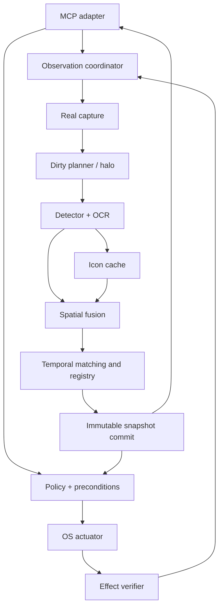

# Components / Componentes

*Observation runs from capture to an immutable snapshot; actions pass the policy gate, reach
the OS actuator and are checked by the effect verifier, which feeds a new observation.*
*La observación va de la captura a un snapshot inmutable; las acciones pasan la compuerta de
política, llegan al actuador del SO y el verificador de efectos las comprueba, lo que
alimenta una nueva observación.*

Source / Fuente: [`02_componentes.mmd`](../thesis/diagramas/02_componentes.mmd). Component
contracts: [thesis chapter 02 §2.3](../thesis/02_SDD_ARQUITECTURA_MVP.md).

