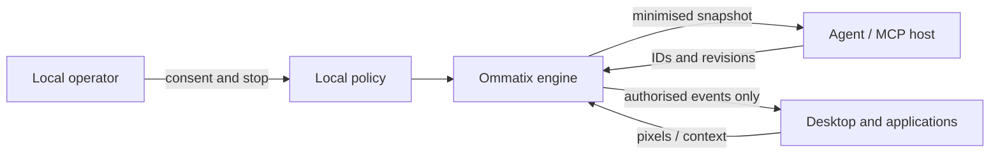

# System context / Contexto del sistema

*The agent works with element IDs and revisions; only the engine touches pixels and input,
and a local policy outside the agent's control decides what is allowed.*
*El agente trabaja con IDs y revisiones de elementos; sólo el motor toca píxeles y entrada,
y una política local fuera del control del agente decide qué se permite.*

Source / Fuente: [`01_contexto.mmd`](../thesis/diagramas/01_contexto.mmd).

