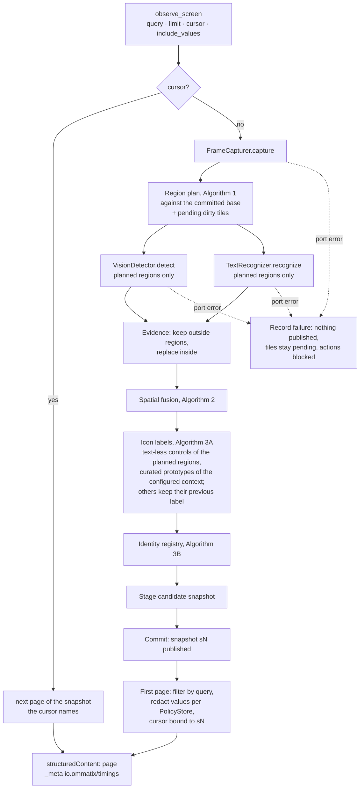
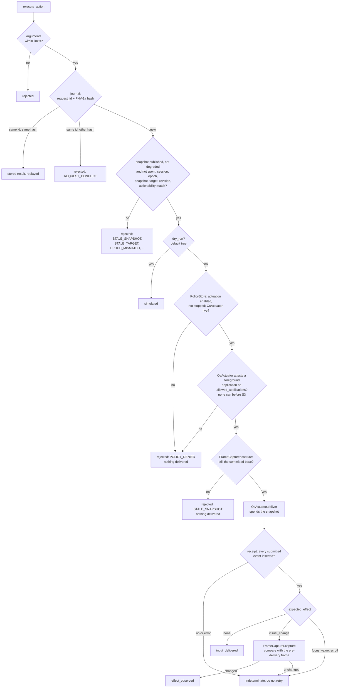

# The engine as implemented / El motor implementado

*What `ommatix-application`'s `Engine` does today (S2b) for each MCP tool, and which port it
calls at each step. A failed observation publishes nothing; an action reports only what is
known.*
*Lo que hace hoy (S2b) el `Engine` de `ommatix-application` con cada herramienta MCP y qué
puerto llama en cada paso. Una observación fallida no publica nada; una acción informa sólo
lo que se sabe.*

Design views: [components](components.md), [action sequence](action-sequence.md),
[snapshot lifecycle](snapshot-state.md). Contract:
[thesis chapter 07](../thesis/07_CONTRATOS_MCP_Y_ERRORES.md);
transport: [ADR-0015](../adr/0015-mcp-transport-on-rmcp-wire-types.md).

## observe_screen

## execute_action

The result of every new request that passes the argument checks is recorded in the journal
under its hash; the typed text itself is never stored. Any delivery, whatever its outcome,
spends the snapshot: the next action needs a new observation. `get_engine_metrics` reads the
counters (observations, rejected and delivered actions, pending regions) and reports whether
models are loaded.

El resultado de cada petición nueva que pasa la comprobación de argumentos se guarda en el
diario bajo su hash, nunca el texto tecleado. Cualquier entrega, sea cual sea su resultado,
agota el snapshot: la acción siguiente necesita una observación nueva.
`get_engine_metrics` lee los contadores (observaciones, acciones rechazadas y entregadas,
regiones pendientes) e informa si hay modelos cargados.
