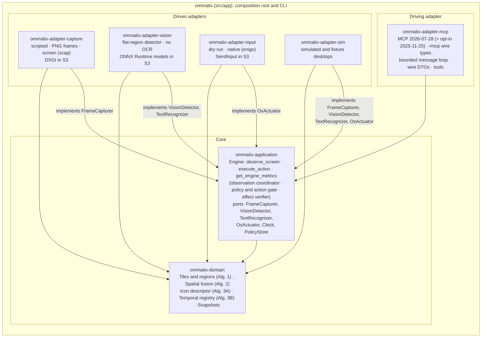

# Hexagonal architecture at S2b / Arquitectura hexagonal en S2b

[Diagrams](README.md) · [Architecture](../architecture/overview.md) · [Arquitectura](../architecture/overview.es.md)

> [!NOTE]
> A historical view: the crates as they were at S2b. It does not show what came after, such as the
> accessibility adapter and the Windows adapters; the present state is in the
> [architecture overview](../architecture/overview.md#where-the-code-is-today).
>
> Vista histórica: los crates tal como estaban en S2b. No muestra lo posterior, como el adaptador de
> accesibilidad y los adaptadores de Windows; el estado presente está en la
> [visión general](../architecture/overview.es.md#dónde-está-el-código-hoy).

*Crate layout from ADR-0014, as of S2b. Arrows point in the direction of the code
dependency; nothing points out of the domain.*
*Disposición en crates según ADR-0014, a partir de S2b. Las flechas indican la dirección de
la dependencia; nada sale del dominio.*

`app` reads the configuration (shaped like `docs/thesis/plantillas/configuracion_mvp.toml`),
provides the `Clock` and the `PolicyStore`, picks the adapters and builds the `Engine`. The
bootstrap ports `FrameSource`, `ElementDetector` and `InputController` are gone. The Windows
adapters (DXGI, ONNX Runtime, `SendInput`) replace these driven adapters in S3.

`app` lee la configuración (con la forma de `docs/thesis/plantillas/configuracion_mvp.toml`),
aporta el `Clock` y el `PolicyStore`, elige los adaptadores y construye el `Engine`. Los puertos
del arranque `FrameSource`, `ElementDetector` e `InputController` ya no existen. Los
adaptadores de Windows (DXGI, ONNX Runtime, `SendInput`) reemplazan en S3 a estos adaptadores
conducidos.
