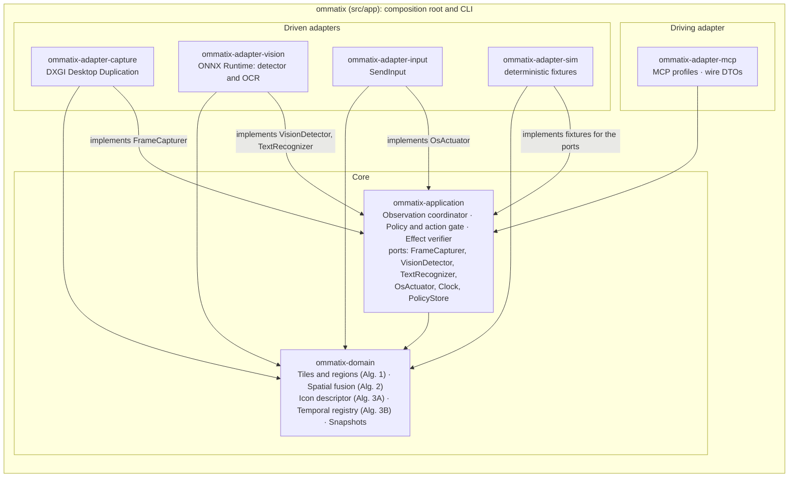

# Hexagonal architecture / Arquitectura hexagonal

*Target layout from ADR-0014. Arrows point in the direction of the code dependency; nothing
points out of the domain.*
*Disposición objetivo según ADR-0014. Las flechas indican la dirección de la dependencia;
nada sale del dominio.*

Today these crates still hold the bootstrap prototype: capture with `xcap`, a flat-region
detector, input with `enigo`, and the ports `FrameSource`, `ElementDetector` and
`InputController`. Stages S1–S3 of the thesis plan move them to this shape.

Hoy estos crates contienen todavía el prototipo del arranque: captura con `xcap`, un detector
de regiones planas, entrada con `enigo` y los puertos `FrameSource`, `ElementDetector` e
`InputController`. Las etapas S1–S3 del plan de la tesis los llevan a esta forma.
