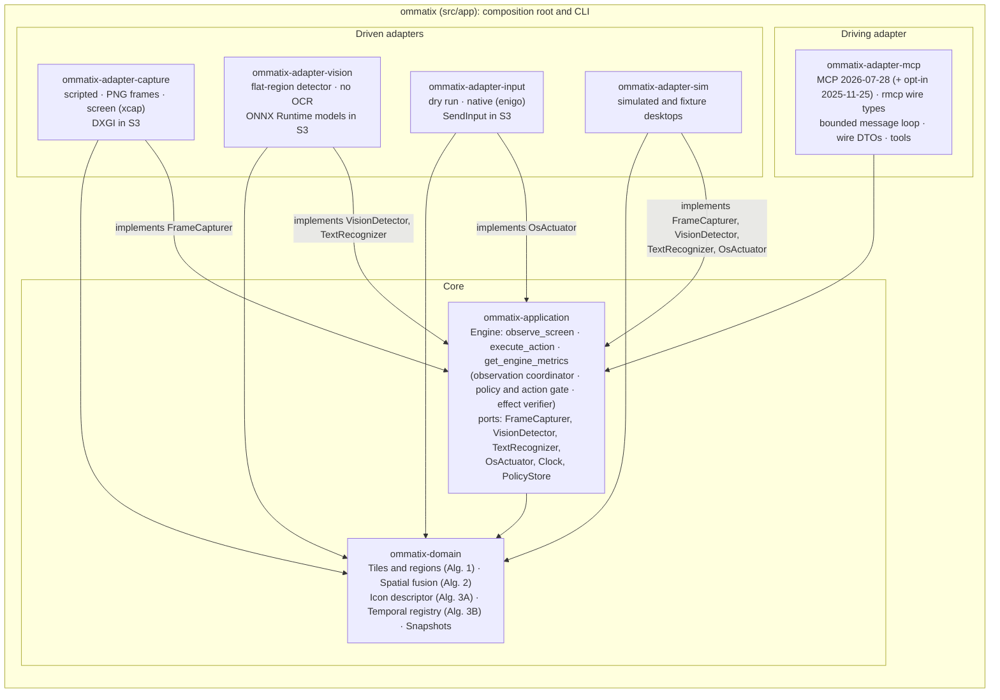

# Hexagonal architecture / Arquitectura hexagonal

*Crate layout from ADR-0014, as of S2b. Arrows point in the direction of the code
dependency; nothing points out of the domain.*
*Disposición en crates según ADR-0014, a partir de S2b. Las flechas indican la dirección de
la dependencia; nada sale del dominio.*

`app` reads the configuration (shaped like `docs/thesis/plantillas/configuracion_mvp.toml`),
provides the `Clock` and the `PolicyStore`, picks the adapters and builds the `Engine`. The
bootstrap ports `FrameSource`, `ElementDetector` and `InputController` are gone. The Windows
adapters (DXGI, ONNX Runtime, `SendInput`) replace the current driven adapters in S3.

`app` lee la configuración (con la forma de `docs/thesis/plantillas/configuracion_mvp.toml`),
aporta el `Clock` y el `PolicyStore`, elige los adaptadores y construye el `Engine`. Los puertos
del arranque `FrameSource`, `ElementDetector` e `InputController` ya no existen. Los
adaptadores de Windows (DXGI, ONNX Runtime, `SendInput`) reemplazan en S3 a los adaptadores
conducidos actuales.
