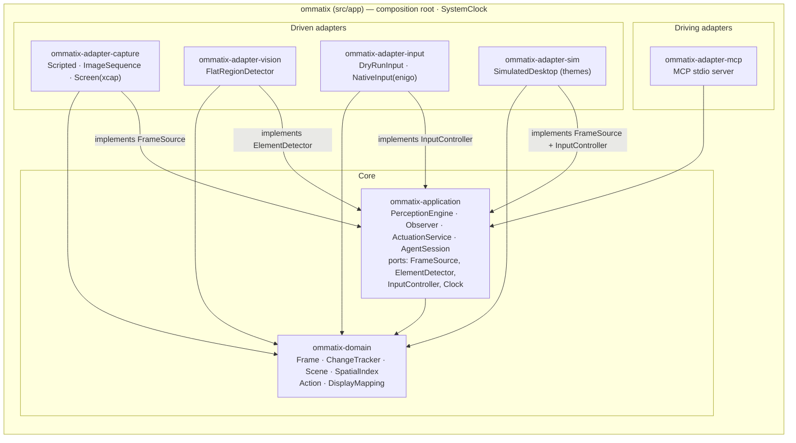

# Hexagonal architecture / Arquitectura hexagonal

*Arrows point in the direction of the code dependency. Nothing points out of the domain.*
*Las flechas indican la dirección de la dependencia. Nada sale del dominio.*

