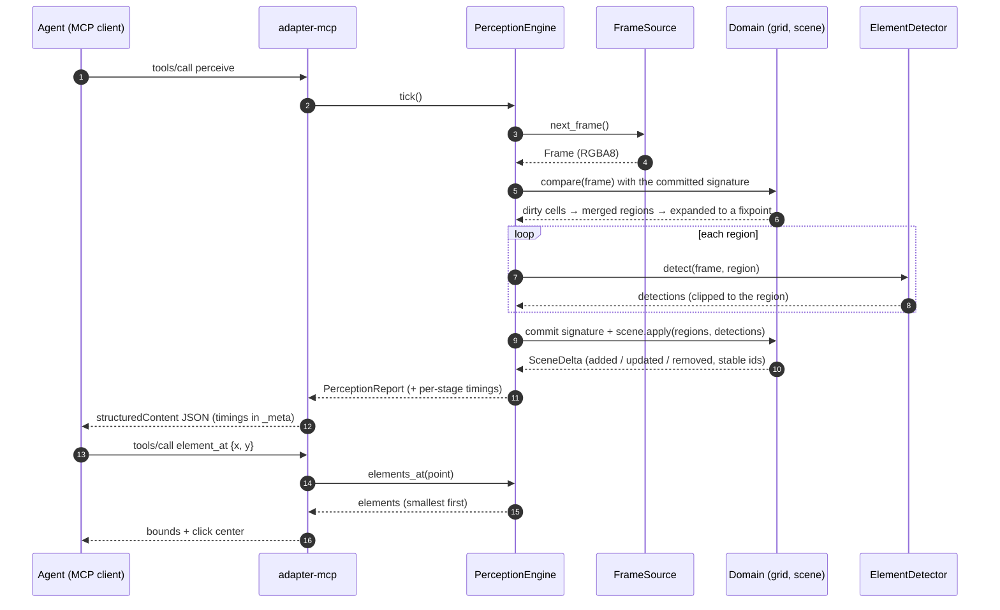
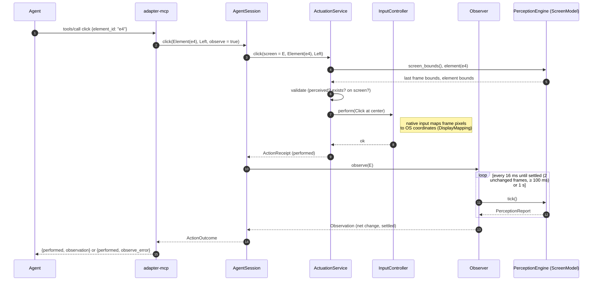

# Perception pipeline / Pipeline de percepción

*One `perceive` tool call. Hashing (step 5) reads each pixel once; only detection (steps
7–8) scales with the changed area. Nothing is committed until detection succeeds.*
*Una llamada a `perceive`. El hashing (paso 5) lee cada píxel una vez; solo la detección
(pasos 7–8) escala con el área cambiada. Nada se confirma hasta que la detección termina
bien.*

## Act and observe / Actuar y observar

