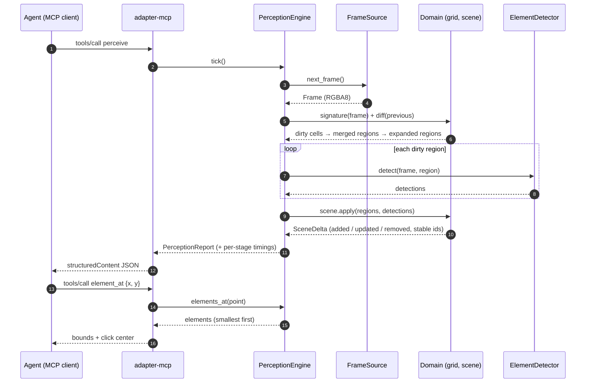

# Perception pipeline / Pipeline de percepción

*One `perceive` tool call. Only steps 5–6 scale with the changed area.*
*Una llamada a `perceive`. Solo los pasos 5–6 escalan con el área cambiada.*

