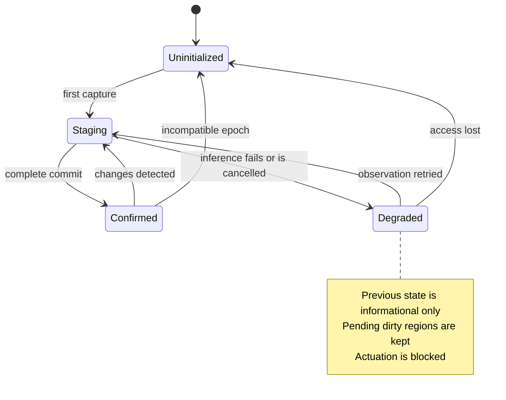

# Snapshot lifecycle / Ciclo de vida del snapshot

*Nothing is published until a commit completes. When inference fails, the engine is
degraded: the previous snapshot is informational only, pending dirty regions are kept and
actuation is blocked.*
*Nada se publica hasta que un commit termina. Si la inferencia falla, el motor queda
degradado: el snapshot anterior es sólo informativo, las regiones sucias pendientes se
conservan y la actuación se bloquea.*

Source / Fuente: [`04_estado_snapshot.mmd`](../thesis/diagramas/04_estado_snapshot.mmd).
Decision: [ADR-0006](../adr/0006-transactional-snapshots-and-commits.md).

